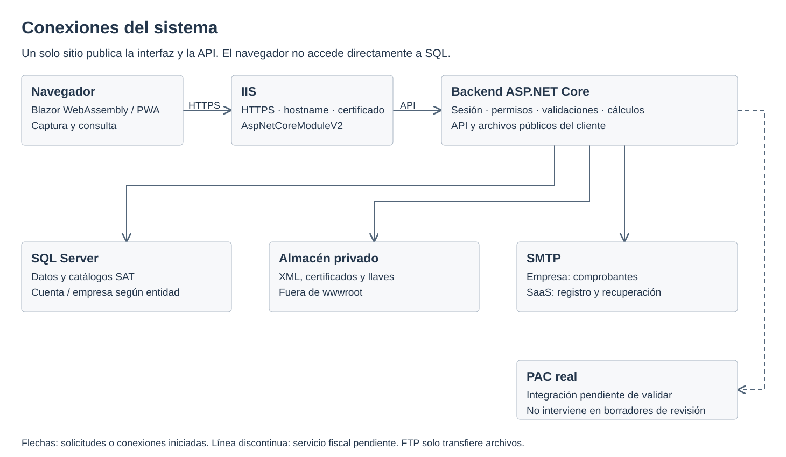
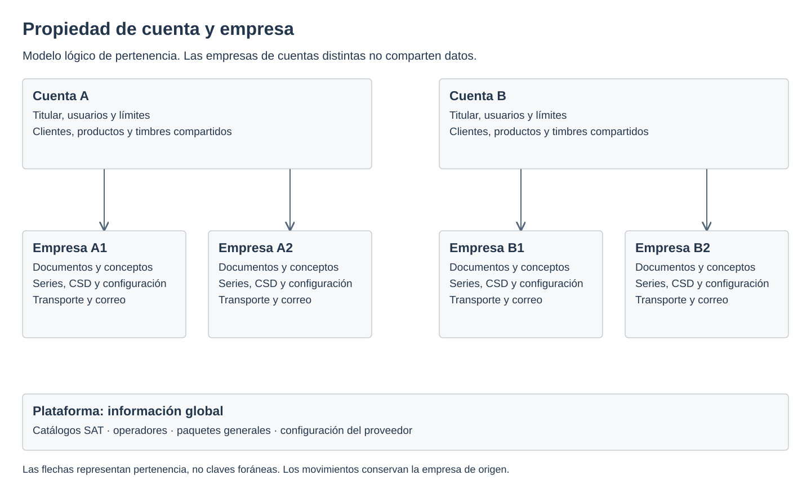

# Arquitectura del sistema

Referencia técnica de entrega · 6 de noviembre de 2026.

## 1. Propósito y alcance

Una cuenta contrata el servicio y agrupa empresas emisoras. Cada empresa conserva sus documentos, folios y configuración. Clientes, productos y bolsa de timbres se comparten únicamente dentro de la misma cuenta.

La entrega cubre revisión de documentos, cálculos, PDF/XML y correo. PAC real, CSD reales y pasarela requieren integración y validación posteriores. Carta Porte se limita al autotransporte nacional propio. Inventario, cotizaciones, addendas y complemento INE no forman parte de esta entrega.

## 2. Componentes

- **Facturacion.Client:** Blazor WebAssembly, PWA y MudBlazor. Captura, validación inmediata y presentación. Su código llega al navegador; no debe custodiar secretos ni decidir por sí solo los importes.
- **Facturacion.Server:** ASP.NET Core 10. Sirve la API y los estáticos del cliente. Ejecuta autorización, validaciones, cálculos, persistencia, XML, PDF y correo.
- **Facturacion.Shared:** DTO y contratos entre capas. Su modificación requiere acuerdo explícito y un commit dedicado sin otros cambios. Documentos consume los contratos de Plataforma; no debe resolver necesidades accediendo por dentro a sus implementaciones.
- **SQL Server:** datos operativos, fiscales, catálogos, auditoría y control de concurrencia. EF Core configura consultas para compatibilidad 120.
- **Almacenamiento privado:** archivos fiscales y certificados protegidos, fuera de `wwwroot`.
- **Servicios externos:** SMTP del sistema, SMTP de cada empresa y adaptador para PAC. La pasarela aún no está integrada.

La publicación compatible incluye .NET 10.0.14 para Windows x64. Se utilizan EF Core, QuestPDF para PDF, NPOI para catálogos y Serilog para registros. Las menciones a servicios externos en planes históricos no acreditan que estén conectados.

## 3. Comunicación y despliegue

1. El navegador obtiene la interfaz y llama a la API en el mismo origen.
2. IIS entrega las solicitudes al proceso ASP.NET Core mediante AspNetCoreModuleV2.
3. El servidor valida sesión, permiso y contexto de cuenta/empresa.
4. Sus servicios consultan SQL o el almacenamiento privado; el navegador no recibe credenciales SQL.
5. El servidor devuelve datos o transmite archivos autorizados. También conecta con SMTP.

En modalidad autocontenida, `web.config` inicia `Facturacion.Server.exe`. En modalidad dependiente del framework, inicia `dotnet` con `Facturacion.Server.dll`. El cliente está dentro de `wwwroot`; el backend queda en la raíz del sitio.

FTP solo transfiere archivos. Sitio, grupo de aplicaciones, DNS, puerto y HTTPS pertenecen a la infraestructura IIS.

## 4. Seguridad

### Sesión y autorización

Identity almacena usuarios y verifica contraseñas. La aplicación emite JWT propios y autoriza por permisos funcionales. El JWT del cliente vive en memoria. Los valores predeterminados son 15 minutos de acceso y cookie de renovación de 12 horas o 30 días al conservar la sesión.

Los tokens de renovación se guardan mediante hash y se rotan. Reutilizar uno consumido permite invalidar su familia. El arranque intenta recuperar la sesión antes de mostrar la interfaz. El operador tiene un acceso separado del cliente. La renovación utiliza una cookie HttpOnly, Secure y SameSite=Strict; el token de acceso no se guarda en localStorage ni sessionStorage.

Hay 66 permisos asignables a usuarios internos, agrupados por documentos, emisión, catálogos, tienda y empresa/configuración. El titular administra empresas y usuarios y recibe sus facultades al construir la sesión. Los operadores utilizan un conjunto propio de permisos. Ocultar una opción no sustituye la validación del endpoint.

### Aislamiento

Cuenta y empresa activa proceden de los claims. Cambiar de empresa exige autorización y un token nuevo. EF aplica filtros globales a entidades de cuenta o empresa y el sellado controla esas claves al escribir. Tablas globales y consultas administrativas necesitan controles explícitos en sus servicios; no todas las tablas llevan `EmpresaId`.

Son controles de la aplicación, no Row-Level Security de SQL. Un usuario con acceso directo a SQL tiene los permisos que le conceda el administrador.

Existen excepciones controladas al envío de identificadores: acceso de usuarios a empresas propias, filtro de empresa de alta en catálogos y administración del operador. El servidor valida su alcance; no sustituyen la empresa activa de una petición ordinaria.

### Secretos y archivos

CSD y contraseñas SMTP se protegen con Data Protection y propósitos separados. Los CSD de empresas pasan por el almacén privado; los del proveedor tienen contenido cifrado en SQL. Las contraseñas no se devuelven al navegador ni deben aparecer en registros.

La modalidad Staging permite guardar la cadena SQL sin cifrar cuando se habilita expresamente. Esta excepción de revisión no elimina el cifrado de CSD/SMTP y no es una recomendación para producción. La configuración privada y las llaves permanecen fuera de `wwwroot`.

Los precios y cantidades acreditadas se verifican en el servidor; el precio visible en el navegador no decide el cobro. Las operaciones de cobro/timbrado utilizan Idempotency-Key y conservación de su resultado para repeticiones.

El servidor configura cabeceras como Content-Security-Policy, X-Content-Type-Options, Referrer-Policy y Permissions-Policy; HSTS corresponde al contexto HTTPS no local configurado. La CSP contempla WebAssembly sin permitir ejecución arbitraria de scripts.

Los errores públicos no revelan excepciones internas. El diagnóstico completo corresponde a registros del servidor, depurados de secretos. El identificador técnico de traza no necesita mostrarse en el formulario.

El service worker guarda el app shell y excluye `/api/`. La comparación de versiones evita trabajar con un cliente anterior después de actualizar.

## 5. Dominio y propiedad de los datos

- **Cuenta:** titular, usuarios, límites, clientes, productos, compras, movimientos y saldo compartido.
- **Empresa:** emisor, comprobantes, conceptos, series, transporte, certificados, monedas y SMTP.
- **Plataforma:** operadores, configuración del sistema, paquetes generales, datos fiscales del proveedor y catálogos SAT.

`EmpresaAltaId` en clientes y productos identifica su procedencia; su pertenencia y filtro son por `CuentaId`.

La emisión conserva copias fiscales del emisor, receptor y conceptos. Cambiar un catálogo no debe reescribir documentos históricos. Los importes usan `decimal`, generalmente `decimal(18,6)`; `EquivalenciaDR` usa `decimal(28,10)`. Los eventos se guardan en UTC; una fecha civil conserva el significado de su campo.

La reserva de folios usa procedimientos y bloqueos de SQL, nunca `MAX(Folio)+1`. Un folio reservado para un intento fallido no se recicla. La bolsa controla reservas, confirmaciones y devoluciones. Una llamada HTTP al PAC no mantiene abierta una transacción SQL. La emisión usa idempotencia para evitar duplicados al repetir solicitudes.

Los estados son `borrador`, `timbrando`, `timbrado`, `error`, `cancelado` y `en_cancelacion`. Solo se eliminan documentos que sean borradores nunca timbrados. Los registros de catálogo sin uso se pueden eliminar bajo validación; los usados se desactivan. La bitácora registra cambios de la aplicación, no ediciones manuales hechas directamente en SQL.

El [diccionario de datos](docs/Base-de-datos.md) detalla tablas, columnas y claves físicas.

## 6. Documentos y salidas

La factura estándar comparte cabecera y conceptos con sus variantes. Notaría, Constructoras y Comercio Exterior agregan sus datos específicos. Carta Porte conserva ubicaciones, transporte y mercancías; pagos relaciona abonos con documentos previos.

El servidor recalcula importes y genera las salidas desde datos guardados. La vista previa puede presentar cambios del formulario antes de guardar: no implica que estén persistidos.

La factura de compra de timbres utiliza los datos, CSD y serie del proveedor, no los de la compradora. Sus datos de emisión se conservan por compra.

El XML final de un comprobante se referencia mediante una ruta privada. Los intentos de timbrado pueden guardar el XML enviado en SQL; las facturas del proveedor tienen sus propios campos. No existe una tabla única que guarde todos los PDF y XML.

En revisión, un borrador puede producir archivos sin PAC ni CSD reales. Certificados o firmas sintéticos solo prueban el flujo técnico. Validar XSD no acredita aceptación fiscal.

Los comprobantes salen exclusivamente por el SMTP de la empresa. El SMTP del SaaS atiende registro, recuperación e invitaciones. Si falta o falla el de la empresa, no se sustituye por el del sistema. Se validan sus destinos en el servidor, se permiten puertos 465/587 y se rechazan direcciones locales o privadas. Aceptación SMTP y recepción en bandeja son resultados distintos.

## 7. Catálogos SAT

La carga inicial usa archivos incluidos en la publicación y registra su versión. Requiere esquema actualizado, archivos accesibles y permisos SQL. No crea tablas faltantes.

El operador consulta y actualiza catálogos. Una actualización futura requiere obtener la fuente oficial y cargarla mediante el flujo disponible; no se descargan automáticamente todas las nuevas publicaciones de Internet.

Los catálogos grandes se buscan en el servidor con resultados limitados. Los pequeños se pueden cargar para selección. El servidor valida las claves al guardar. El cambio de versión permite invalidar selecciones cacheadas del cliente.

## 8. Interfaz

Componentes comunes, variables CSS y temas claro, oscuro y cálido organizan formularios y tablas. Se priorizan captura por teclado y búsquedas por clave/descripción. La validación del navegador complementa la del servidor. Esta revisión no constituye certificación formal de accesibilidad ni de todos los navegadores.

## 9. Operación y mantenimiento

Una base entregada por script de SSMS puede tener el mismo esquema y un historial EF vacío. No se deben ejecutar todas las migraciones sobre ella suponiendo que está vacía.

La actualización conserva configuración privada, archivos y llaves. Las llaves protegidas por Windows pueden depender del equipo y la identidad que las crearon. Copiar `cnf` a otra máquina no garantiza descifrado; un traslado requiere una prueba de recuperación.

`AllowedHosts` permite nombres dentro de la aplicación; no crea DNS, abre puertos ni emite certificados. IIS 500.31 señala carga del runtime. Un fallo de catálogos dentro de la aplicación exige revisar archivos, esquema, permisos y registros.

## 10. Referencias de implementación

- Aislamiento: `Facturacion.Server/Data/FiltroDeEmpresa.cs` y contexto de tenencia.
- SQL: `Facturacion.Server/Data/OpcionesDeAppDbContext.cs`.
- Arranque: `Facturacion.Server/Infra/Instalacion/`.
- Archivos y correo: `Facturacion.Server/Infra/Almacen/` y `Infra/Correo/`.
- Emisión: `Facturacion.Server/Modules/Documentos/`.
- Permisos: `Facturacion.Shared/Comun/Permiso.cs`.

Continuar con [Instalación y actualización](docs/Instalacion-y-actualizacion.md), [Funcionamiento](docs/Funcionamiento.md) y [Pruebas y pendientes](docs/Pruebas-y-pendientes.md).
