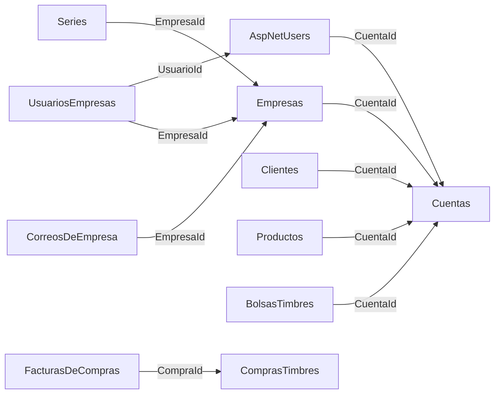
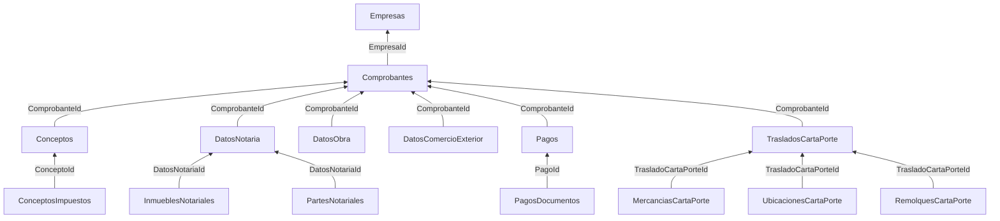

# Base de datos

Diccionario y modelo de datos · 19 de noviembre de 2026 · [Manual de entrega](Manual-de-entrega.md)

## 1. Alcance

La aplicación utiliza **una base SQL**, no una por empresa ni una para el operador y otra para clientes. Cuenta y empresa delimitan la pertenencia de los datos.

El inventario levantado el 6 de noviembre registró **93 tablas y 950 columnas**: 91 tablas del modelo de aplicación/Identity, una de historial EF y la tabla opcional `sysdiagrams` de SSMS. En el corte del 19 de noviembre se incorpora `Paquetes.Eliminado` al diccionario, según la migración posterior. El recuento de noviembre 6 corresponde al esquema observado en esa fecha.

La comparación de metadatos del 6 de noviembre encontró iguales las 54 relaciones, 24 valores predeterminados, dos restricciones CHECK, tres índices de texto completo y 66 permisos de aplicación. Las diferencias de índices y módulos corresponden a diagramas de SSMS. El historial EF también difiere debido al origen por script.

Se comparó **estructura**, no igualdad de registros de negocio, usuarios SQL ni configuración privada. Este diccionario no contiene datos personales, contraseñas o contenido de certificados.

## 2. Propiedad y relaciones

- `CuentaId`: contratante propietario. Clientes, productos y bolsa se comparten únicamente dentro de su cuenta.
- `EmpresaId`: emisor propietario o empresa de origen según la entidad. Un movimiento de bolsa conserva empresa de origen aunque afecte saldo de cuenta.
- `EmpresaAltaId`: procedencia de cliente/producto; no restringe el catálogo a esa empresa.
- `UsuarioId` / `OperadorId`: autor o sujeto de la operación según el campo.
- `Id`: identificador técnico; no sustituye al RFC o folio fiscal.
- `Activo` / `Activa`: disponibilidad operativa; no equivale a borrar historial.

Cuenta y empresa activa se obtienen de la sesión. Filtros EF y controles del servidor protegen su alcance; una consulta SQL directa no pasa por esos controles.

Las flechas siguientes van de la tabla con FK hacia su tabla referenciada. Son relaciones físicas seleccionadas, no un diagrama de permisos. El diccionario enumera las 54 FK completas.

### Plataforma

### Documentos

Un nombre terminado en Id no garantiza una FK. `Conceptos.ProductoId` y `MercanciasCartaPorte.ProductoId` son referencias validadas por la aplicación, sin FK física hacia Productos en el esquema revisado.

## 3. Persistencia de una operación

Al guardar un borrador, el servicio valida acceso, datos y cálculos; persiste cabecera, conceptos/impuestos y datos de la variante. La vista previa no guarda automáticamente cada modificación y guardar conceptos no da de alta productos.

La emisión conserva copias fiscales de emisor, receptor y renglones, reserva folio y registra intentos. Cambiar un cliente después no reescribe documentos emitidos. La llamada al PAC queda fuera de la transacción SQL; intentos e idempotencia evitan duplicados al recuperar resultados.

Un pago guarda cabecera, documentos relacionados, saldos/parcialidad e impuestos. Comprar registra una operación pendiente; la acreditación confirmada modifica la bolsa mediante su procedimiento. Las facturas de compras del operador tienen tablas propias: el proveedor es el emisor y la compradora es receptora.

### Base, archivos y configuración

- SQL guarda importes, claves, copias fiscales, auditoría y referencias a archivos.
- `XmlsDeComprobante` guarda en claro el XML timbrado de cada comprobante y `SolicitudesCancelacion.Acuse` el acuse de cancelación (24-nov-2026). `Comprobantes.RutaXml` queda solo para los timbrados anteriores, cuyo archivo se copia a la base al arrancar y se conserva como respaldo. Los intentos de timbrado conservan XML enviado en SQL; la emisión del proveedor también guarda resultados mediante sus tablas de intentos.
- Los PDF se generan desde datos del documento y del XML timbrado; no se guardan.
- `CertificadosCsd` referencia archivos protegidos; `CertificadosProveedor` contiene CER/KEY cifrados en columnas binarias.
- `DatosComercioExterior.Contenido` guarda JSON tipado, validado por el servidor. Su validación de negocio no depende de funciones JSON de versiones posteriores a SQL 2014.
- Conexión y llaves de arranque están en la configuración privada del servidor, no en una tabla de parámetros SQL.

El respaldo debe cubrir SQL, archivos privados y llaveros. Consultar el [procedimiento de instalación y actualización](Manual-de-entrega.md#iis).

## 4. Tipos y concurrencia

Los importes usan decimal, generalmente (18,6); EquivalenciaDR utiliza (28,10). Los tamaños nvarchar siguientes están expresados en caracteres, no bytes. Las columnas rowversion/timestamp son control binario de concurrencia, no fechas. Los eventos Utc representan instantes UTC; las fechas civiles conservan el significado de su campo.

Los procedimientos operativos son ReservarFolio, ReservarTimbre, ConfirmarTimbre, DevolverTimbre, AcreditarCompra y ReservarFolioProveedor. Controlan reservas y actualizaciones mediante bloqueos/transacciones. La identidad de ejecución necesita permiso EXECUTE; leer tablas no lo concede.

## 5. Diccionario de tablas

Cada entrada explica su finalidad y despliega columnas, índices y FK. NULL significa ausencia permitida por SQL. El servicio puede exigir un campo según la operación. Los índices incluyen sus filtros físicos. Las reglas adicionales se consultan en los servicios y en la [guía de operación](Manual-de-entrega.md#operacion).

- [Cuenta y usuarios](#grupo-cuenta-y-usuarios)
- [Sesiones y operador](#grupo-sesiones-y-operador)
- [Configuración y certificados](#grupo-configuracion-y-certificados)
- [Clientes y productos](#grupo-clientes-y-productos)
- [Documentos](#grupo-documentos)
- [Complemento de pagos](#grupo-complemento-de-pagos)
- [Notaría y obra](#grupo-notaria-y-obra)
- [Comercio Exterior](#grupo-comercio-exterior)
- [Carta Porte](#grupo-carta-porte)
- [Timbres y compras](#grupo-timbres-y-compras)
- [Facturas del operador](#grupo-facturas-del-operador)
- [Control técnico](#grupo-control-tecnico)
- [Catálogos SAT](#grupo-catalogos-sat)

### Cuenta y usuarios

#### `Cuentas`

Representa al contratante del SaaS: nombre, correo de contacto, estado y límites de usuarios y empresas.

Es la raíz comercial. Una cuenta puede tener varias empresas; no es una factura ni un usuario de SQL. Sus límites los administra el operador.

Columnas y estructura de Cuentas (7 columnas)

- `Activa`: `bit`; NOT NULL.
- `CorreoContacto`: `nvarchar(254)`; NOT NULL.
- `FechaAltaUtc`: `datetime2(7)`; NOT NULL.
- `Id`: `uniqueidentifier`; NOT NULL.
- `LimiteDeEmpresas`: `int`; NOT NULL.
- `LimiteDeUsuarios`: `int`; NOT NULL.
- `Nombre`: `nvarchar(254)`; NOT NULL.

**Índices**

- `PK_Cuentas`: PK; claves `Id ASC`.

**Relaciones físicas salientes**

Sin FK saliente en el esquema revisado. Puede haber referencias lógicas validadas por servicios.

#### `Empresas`

Guarda al emisor: RFC, nombre fiscal, régimen, código postal, zona horaria, domicilios, contacto, logo y licencias.

CuentaId indica a qué contratante pertenece. Cada empresa mantiene comprobantes, series, vehículos y configuración propios. Las licencias habilitan variantes; no equivalen a permisos de usuario.

Columnas y estructura de Empresas (34 columnas)

- `Activa`: `bit`; NOT NULL.
- `Calle`: `nvarchar(128)`; NULL.
- `CartaPorteCalle`: `nvarchar(128)`; NULL.
- `CartaPorteCodigoPostal`: `nvarchar(5)`; NULL.
- `CartaPorteEstado`: `nvarchar(3)`; NULL.
- `CartaPorteMunicipio`: `nvarchar(3)`; NULL.
- `CartaPorteNumeroExterior`: `nvarchar(32)`; NULL.
- `CartaPorteNumeroInterior`: `nvarchar(32)`; NULL.
- `CodigoPostal`: `nvarchar(5)`; NULL.
- `CodigoPostalExpedicion`: `nvarchar(5)`; NOT NULL.
- `Colonia`: `nvarchar(128)`; NULL.
- `CorreoContacto`: `nvarchar(254)`; NULL.
- `CuentaId`: `uniqueidentifier`; NOT NULL.
- `Estado`: `nvarchar(128)`; NULL.
- `FechaAltaUtc`: `datetime2(7)`; NOT NULL.
- `Id`: `uniqueidentifier`; NOT NULL.
- `LicComercio`: `bit`; NOT NULL.
- `LicINE`: `bit`; NOT NULL.
- `LicNotarios`: `bit`; NOT NULL.
- `LicObras`: `bit`; NOT NULL.
- `Localidad`: `nvarchar(128)`; NULL.
- `LogoNombreOriginal`: `nvarchar(256)`; NULL.
- `LogoRuta`: `nvarchar(256)`; NULL.
- `LogoTipoMime`: `nvarchar(64)`; NULL.
- `Municipio`: `nvarchar(128)`; NULL.
- `NombreFiscal`: `nvarchar(254)`; NOT NULL.
- `NumeroExterior`: `nvarchar(32)`; NULL.
- `NumeroInterior`: `nvarchar(32)`; NULL.
- `Pais`: `nvarchar(64)`; NULL.
- `Referencia`: `nvarchar(256)`; NULL.
- `RegimenFiscal`: `nvarchar(3)`; NOT NULL.
- `Rfc`: `nvarchar(13)`; NOT NULL.
- `Telefono`: `nvarchar(32)`; NULL.
- `ZonaHoraria`: `nvarchar(64)`; NOT NULL.

**Índices**

- `IX_Empresas_CuentaId_Rfc`: único; claves `CuentaId ASC|Rfc ASC`.
- `PK_Empresas`: PK; claves `Id ASC`.

**Relaciones físicas salientes**

- `FK_Empresas_Cuentas_CuentaId` → `dbo.Cuentas`; `CuentaId=Id`; al borrar: NO ACTION.

#### `AspNetUsers`

Almacena usuarios del cliente mediante ASP.NET Core Identity: identidad, PasswordHash, bloqueos y campos CuentaId, Nombre, Activo y EsTitular.

El titular es el dueño de la cuenta; los internos pertenecen a la misma cuenta. La contraseña se verifica con hash, no se recupera descifrándola. No son usuarios SQL ni operadores de plataforma.

Columnas y estructura de AspNetUsers (23 columnas)

- `AccessFailedCount`: `int`; NOT NULL.
- `Activo`: `bit`; NOT NULL.
- `BloqueosConsecutivos`: `int`; NOT NULL.
- `ConcurrencyStamp`: `nvarchar(max)`; NULL.
- `CreadoPorAdministrador`: `bit`; NOT NULL.
- `CuentaId`: `uniqueidentifier`; NOT NULL.
- `Email`: `nvarchar(256)`; NULL.
- `EmailConfirmed`: `bit`; NOT NULL.
- `EsTitular`: `bit`; NOT NULL.
- `FechaAltaUtc`: `datetime2(7)`; NOT NULL.
- `Id`: `uniqueidentifier`; NOT NULL.
- `LockoutEnabled`: `bit`; NOT NULL.
- `LockoutEnd`: `datetimeoffset(7)`; NULL.
- `Nombre`: `nvarchar(254)`; NOT NULL.
- `NormalizedEmail`: `nvarchar(256)`; NULL.
- `NormalizedUserName`: `nvarchar(256)`; NULL.
- `PasswordHash`: `nvarchar(max)`; NULL.
- `PhoneNumber`: `nvarchar(max)`; NULL.
- `PhoneNumberConfirmed`: `bit`; NOT NULL.
- `SecurityStamp`: `nvarchar(max)`; NULL.
- `TemaPreferido`: `nvarchar(16)`; NULL.
- `TwoFactorEnabled`: `bit`; NOT NULL.
- `UserName`: `nvarchar(256)`; NULL.

**Índices**

- `EmailIndex`: no único; claves `NormalizedEmail ASC`.
- `IX_AspNetUsers_CuentaId`: no único; claves `CuentaId ASC`.
- `IX_AspNetUsers_CuentaId_Titular`: único; claves `CuentaId ASC`; filtro `([EsTitular]=(1))`.
- `PK_AspNetUsers`: PK; claves `Id ASC`.
- `UserNameIndex`: único; claves `NormalizedUserName ASC`; filtro `([NormalizedUserName] IS NOT NULL)`.

**Relaciones físicas salientes**

- `FK_AspNetUsers_Cuentas_CuentaId` → `dbo.Cuentas`; `CuentaId=Id`; al borrar: NO ACTION.

#### `UsuariosEmpresas`

Relaciona un usuario con cada empresa a la que tiene acceso, con estado y fecha de alta.

Resuelve la relación muchos a muchos: un usuario entra a varias empresas y una empresa admite varios usuarios. El servidor valida que las empresas elegidas pertenezcan a su cuenta.

Columnas y estructura de UsuariosEmpresas (4 columnas)

- `Activo`: `bit`; NOT NULL.
- `EmpresaId`: `uniqueidentifier`; NOT NULL.
- `FechaAltaUtc`: `datetime2(7)`; NOT NULL.
- `UsuarioId`: `uniqueidentifier`; NOT NULL.

**Índices**

- `IX_UsuariosEmpresas_EmpresaId`: no único; claves `EmpresaId ASC`.
- `PK_UsuariosEmpresas`: PK; claves `UsuarioId ASC|EmpresaId ASC`.

**Relaciones físicas salientes**

- `FK_UsuariosEmpresas_AspNetUsers_UsuarioId` → `dbo.AspNetUsers`; `UsuarioId=Id`; al borrar: NO ACTION.
- `FK_UsuariosEmpresas_Empresas_EmpresaId` → `dbo.Empresas`; `EmpresaId=Id`; al borrar: NO ACTION.

#### `Permisos`

Catálogo de las 66 acciones asignables del cliente, con clave y descripción.

Define qué acciones existen; no guarda directamente quién puede ejecutarlas. No es una tabla de roles ni el catálogo de permisos del operador.

Columnas y estructura de Permisos (2 columnas)

- `Clave`: `nvarchar(32)`; NOT NULL.
- `Descripcion`: `nvarchar(128)`; NOT NULL.

**Índices**

- `PK_Permisos`: PK; claves `Clave ASC`.

**Relaciones físicas salientes**

Sin FK saliente en el esquema revisado. Puede haber referencias lógicas validadas por servicios.

#### `UsuariosEmpresasPermisos`

Asigna una clave de permiso a un usuario en una empresa; guarda quién y cuándo la otorgó.

El esquema conserva EmpresaId, pero el servicio sincroniza el mismo juego de permisos en las empresas asignadas al usuario. Los permisos implícitos y los del titular se calculan al emitir el token, no todos necesitan filas aquí.

Columnas y estructura de UsuariosEmpresasPermisos (5 columnas)

- `EmpresaId`: `uniqueidentifier`; NOT NULL.
- `OtorgadoPorUsuarioId`: `uniqueidentifier`; NULL.
- `OtorgadoUtc`: `datetime2(7)`; NOT NULL.
- `PermisoClave`: `nvarchar(32)`; NOT NULL.
- `UsuarioId`: `uniqueidentifier`; NOT NULL.

**Índices**

- `IX_UsuariosEmpresasPermisos_PermisoClave`: no único; claves `PermisoClave ASC`.
- `PK_UsuariosEmpresasPermisos`: PK; claves `UsuarioId ASC|EmpresaId ASC|PermisoClave ASC`.

**Relaciones físicas salientes**

- `FK_UsuariosEmpresasPermisos_Permisos_PermisoClave` → `dbo.Permisos`; `PermisoClave=Clave`; al borrar: NO ACTION.
- `FK_UsuariosEmpresasPermisos_UsuariosEmpresas_UsuarioId_EmpresaId` → `dbo.UsuariosEmpresas`; `UsuarioId=UsuarioId|EmpresaId=EmpresaId`; al borrar: NO ACTION.

#### `AltasPendientes`

Guarda solicitudes de registro aún sin confirmar: correo, nombre, cuenta solicitada, hash del código, caducidad e intentos.

Permite comprobar el código enviado antes de completar el registro. El código se compara por hash; una solicitud pendiente no significa que ya exista una cuenta activa.

Columnas y estructura de AltasPendientes (10 columnas)

- `ConsumidoUtc`: `datetime2(7)`; NULL.
- `Correo`: `nvarchar(254)`; NOT NULL.
- `CreadoUtc`: `datetime2(7)`; NOT NULL.
- `ExpiraUtc`: `datetime2(7)`; NOT NULL.
- `HashCodigo`: `nvarchar(256)`; NOT NULL.
- `Id`: `uniqueidentifier`; NOT NULL.
- `Intentos`: `int`; NOT NULL.
- `IpCreacion`: `nvarchar(45)`; NULL.
- `Nombre`: `nvarchar(128)`; NOT NULL.
- `NombreCuenta`: `nvarchar(200)`; NOT NULL.

**Índices**

- `IX_AltasPendientes_Correo`: no único; claves `Correo ASC`.
- `IX_AltasPendientes_Expira`: no único; claves `ExpiraUtc ASC`.
- `PK_AltasPendientes`: PK; claves `Id ASC`.

**Relaciones físicas salientes**

Sin FK saliente en el esquema revisado. Puede haber referencias lógicas validadas por servicios.

#### `AspNetUserClaims`

Declaraciones persistentes opcionales asociadas a usuarios.

Son tablas auxiliares creadas por Identity. Su existencia no demuestra que haya inicio de sesión con Google u otro proveedor implementado. No confundirlas con los JWT en memoria ni con la rotación de RefreshTokens.

Columnas y estructura de AspNetUserClaims (4 columnas)

- `ClaimType`: `nvarchar(max)`; NULL.
- `ClaimValue`: `nvarchar(max)`; NULL.
- `Id`: `int`; NOT NULL, IDENTITY(1,1).
- `UserId`: `uniqueidentifier`; NOT NULL.

**Índices**

- `IX_AspNetUserClaims_UserId`: no único; claves `UserId ASC`.
- `PK_AspNetUserClaims`: PK; claves `Id ASC`.

**Relaciones físicas salientes**

- `FK_AspNetUserClaims_AspNetUsers_UserId` → `dbo.AspNetUsers`; `UserId=Id`; al borrar: CASCADE.

#### `AspNetUserLogins`

Asociaciones opcionales a proveedores externos de inicio de sesión.

Son tablas auxiliares creadas por Identity. Su existencia no demuestra que haya inicio de sesión con Google u otro proveedor implementado. No confundirlas con los JWT en memoria ni con la rotación de RefreshTokens.

Columnas y estructura de AspNetUserLogins (4 columnas)

- `LoginProvider`: `nvarchar(450)`; NOT NULL.
- `ProviderDisplayName`: `nvarchar(max)`; NULL.
- `ProviderKey`: `nvarchar(450)`; NOT NULL.
- `UserId`: `uniqueidentifier`; NOT NULL.

**Índices**

- `IX_AspNetUserLogins_UserId`: no único; claves `UserId ASC`.
- `PK_AspNetUserLogins`: PK; claves `LoginProvider ASC|ProviderKey ASC`.

**Relaciones físicas salientes**

- `FK_AspNetUserLogins_AspNetUsers_UserId` → `dbo.AspNetUsers`; `UserId=Id`; al borrar: CASCADE.

#### `AspNetUserTokens`

Tokens de proveedores y mecanismos de Identity, identificados por usuario, proveedor y nombre.

Son tablas auxiliares creadas por Identity. Su existencia no demuestra que haya inicio de sesión con Google u otro proveedor implementado. No confundirlas con los JWT en memoria ni con la rotación de RefreshTokens.

Columnas y estructura de AspNetUserTokens (4 columnas)

- `LoginProvider`: `nvarchar(450)`; NOT NULL.
- `Name`: `nvarchar(450)`; NOT NULL.
- `UserId`: `uniqueidentifier`; NOT NULL.
- `Value`: `nvarchar(max)`; NULL.

**Índices**

- `PK_AspNetUserTokens`: PK; claves `UserId ASC|LoginProvider ASC|Name ASC`.

**Relaciones físicas salientes**

- `FK_AspNetUserTokens_AspNetUsers_UserId` → `dbo.AspNetUsers`; `UserId=Id`; al borrar: CASCADE.

### Sesiones y operador

#### `RefreshTokens`

Guarda el hash de renovación de sesión del cliente, usuario, familia, empresa activa, vencimiento, consumo, reemplazo y revocación.

El token sin hash viaja en la cookie; no es la contraseña. Cada uso consume uno y crea otro. La familia permite revocar la sesión completa ante reutilización. El access token JWT no se almacena aquí.

Columnas y estructura de RefreshTokens (13 columnas)

- `AgenteUsuario`: `nvarchar(256)`; NULL.
- `ConsumidoUtc`: `datetime2(7)`; NULL.
- `CreadoUtc`: `datetime2(7)`; NOT NULL.
- `EmpresaActivaId`: `uniqueidentifier`; NULL.
- `ExpiraUtc`: `datetime2(7)`; NOT NULL.
- `FamiliaId`: `uniqueidentifier`; NOT NULL.
- `HashToken`: `nvarchar(64)`; NOT NULL.
- `Id`: `uniqueidentifier`; NOT NULL.
- `IpCreacion`: `nvarchar(45)`; NULL.
- `MotivoRevocacion`: `nvarchar(128)`; NULL.
- `ReemplazadoPorId`: `uniqueidentifier`; NULL.
- `RevocadoUtc`: `datetime2(7)`; NULL.
- `UsuarioId`: `uniqueidentifier`; NOT NULL.

**Índices**

- `IX_RefreshTokens_FamiliaId`: no único; claves `FamiliaId ASC`.
- `IX_RefreshTokens_HashToken`: único; claves `HashToken ASC`.
- `IX_RefreshTokens_UsuarioId`: no único; claves `UsuarioId ASC`.
- `PK_RefreshTokens`: PK; claves `Id ASC`.

**Relaciones físicas salientes**

- `FK_RefreshTokens_AspNetUsers_UsuarioId` → `dbo.AspNetUsers`; `UsuarioId=Id`; al borrar: NO ACTION.

#### `OperadoresPlataforma`

Identidad administrativa separada: correo, hash de contraseña, Activo, EsPrincipal, intentos fallidos y bloqueo.

El operador administra el SaaS. No es el titular de una empresa. El indicador de principal distingue al administrador de los operadores secundarios.

Columnas y estructura de OperadoresPlataforma (12 columnas)

- `AccesosFallidos`: `int`; NOT NULL.
- `Activo`: `bit`; NOT NULL.
- `BloqueadoHastaUtc`: `datetime2(7)`; NULL.
- `BloqueosConsecutivos`: `int`; NOT NULL.
- `Correo`: `nvarchar(254)`; NOT NULL.
- `CorreoNormalizado`: `nvarchar(254)`; NOT NULL.
- `EsPrincipal`: `bit`; NOT NULL.
- `FechaAltaUtc`: `datetime2(7)`; NOT NULL.
- `HashContrasena`: `nvarchar(256)`; NOT NULL.
- `Id`: `uniqueidentifier`; NOT NULL.
- `Nombre`: `nvarchar(128)`; NOT NULL.
- `UltimoAccesoUtc`: `datetime2(7)`; NULL.

**Índices**

- `IX_OperadoresPlataforma_Correo`: único; claves `CorreoNormalizado ASC`.
- `PK_OperadoresPlataforma`: PK; claves `Id ASC`.

**Relaciones físicas salientes**

Sin FK saliente en el esquema revisado. Puede haber referencias lógicas validadas por servicios.

#### `OperadoresPermisos`

Guarda acciones concedidas a un operador secundario.

La clave es la combinación de operador y permiso. Mantiene separada la autorización de administración del catálogo de permisos de los clientes.

Columnas y estructura de OperadoresPermisos (2 columnas)

- `OperadorId`: `uniqueidentifier`; NOT NULL.
- `Permiso`: `nvarchar(64)`; NOT NULL.

**Índices**

- `IX_OperadoresPermisos_Permiso`: no único; claves `Permiso ASC`.
- `PK_OperadoresPermisos`: PK; claves `OperadorId ASC|Permiso ASC`.

**Relaciones físicas salientes**

- `FK_OperadoresPermisos_OperadoresPlataforma_OperadorId` → `dbo.OperadoresPlataforma`; `OperadorId=Id`; al borrar: CASCADE.

#### `RefreshTokensOperador`

Sesiones renovables de operadores con hash, familia, fechas y revocaciones.

Aplica rotación de forma separada a las sesiones del cliente; iniciar sesión como operador no concede por sí mismo una sesión de cliente.

Columnas y estructura de RefreshTokensOperador (12 columnas)

- `AgenteUsuario`: `nvarchar(256)`; NULL.
- `ConsumidoUtc`: `datetime2(7)`; NULL.
- `CreadoUtc`: `datetime2(7)`; NOT NULL.
- `ExpiraUtc`: `datetime2(7)`; NOT NULL.
- `FamiliaId`: `uniqueidentifier`; NOT NULL.
- `HashToken`: `nvarchar(64)`; NOT NULL.
- `Id`: `uniqueidentifier`; NOT NULL.
- `IpCreacion`: `nvarchar(45)`; NULL.
- `MotivoRevocacion`: `nvarchar(128)`; NULL.
- `OperadorId`: `uniqueidentifier`; NOT NULL.
- `ReemplazadoPorId`: `uniqueidentifier`; NULL.
- `RevocadoUtc`: `datetime2(7)`; NULL.

**Índices**

- `IX_RefreshTokensOperador_FamiliaId`: no único; claves `FamiliaId ASC`.
- `IX_RefreshTokensOperador_HashToken`: único; claves `HashToken ASC`.
- `IX_RefreshTokensOperador_OperadorId`: no único; claves `OperadorId ASC`.
- `PK_RefreshTokensOperador`: PK; claves `Id ASC`.

**Relaciones físicas salientes**

- `FK_RefreshTokensOperador_OperadoresPlataforma_OperadorId` → `dbo.OperadoresPlataforma`; `OperadorId=Id`; al borrar: NO ACTION.

### Configuración y certificados

#### `ConfiguracionDelSistema`

Configuración global del SaaS: SMTP del sistema, remitente, nombre del sistema y plantillas de registro y recuperación.

Se administra desde operador. El SMTP de esta tabla envía correos del sistema; los comprobantes de clientes utilizan CorreosDeEmpresa. La contraseña SMTP se guarda cifrada.

Columnas y estructura de ConfiguracionDelSistema (15 columnas)

- `ActualizadaPorOperadorId`: `uniqueidentifier`; NOT NULL.
- `ActualizadaUtc`: `datetime2(7)`; NOT NULL.
- `AsuntoContrasena`: `nvarchar(128)`; NOT NULL.
- `AsuntoVerificacion`: `nvarchar(128)`; NOT NULL.
- `ContrasenaSmtpCifrada`: `nvarchar(2048)`; NULL.
- `CuerpoContrasena`: `nvarchar(max)`; NOT NULL.
- `CuerpoVerificacion`: `nvarchar(max)`; NOT NULL.
- `Id`: `tinyint`; NOT NULL.
- `NombreDelSistema`: `nvarchar(128)`; NOT NULL.
- `PuertoSmtp`: `int`; NOT NULL.
- `RemitenteCorreo`: `nvarchar(254)`; NOT NULL.
- `RemitenteNombre`: `nvarchar(128)`; NOT NULL.
- `ServidorSmtp`: `nvarchar(253)`; NOT NULL.
- `UsarTls`: `bit`; NOT NULL.
- `UsuarioSmtp`: `nvarchar(254)`; NOT NULL.

**Índices**

- `PK_ConfiguracionDelSistema`: PK; claves `Id ASC`.

**Relaciones físicas salientes**

Sin FK saliente en el esquema revisado. Puede haber referencias lógicas validadas por servicios.

#### `ConfiguracionesEmpresa`

Valores iniciales de IVA, IEPS, retenciones, ISH y aviso de vencimiento del CSD.

Es configuración por empresa. Precarga capturas, pero no cambia retroactivamente los impuestos ya guardados en un comprobante.

Columnas y estructura de ConfiguracionesEmpresa (17 columnas)

- `CodigoCorreoRespuestaExpiraUtc`: `datetime2(7)`; NULL.
- `CodigoCorreoRespuestaSolicitadoUtc`: `datetime2(7)`; NULL.
- `CorreoRespuestaPendiente`: `nvarchar(254)`; NULL.
- `CorreoRespuestaVerificado`: `nvarchar(254)`; NULL.
- `DiasAvisoCaducidadCertificado`: `int`; NOT NULL.
- `EmpresaId`: `uniqueidentifier`; NOT NULL.
- `HashCodigoCorreoRespuesta`: `nvarchar(256)`; NULL.
- `IntentosCodigoCorreoRespuesta`: `int`; NOT NULL.
- `SolicitudesCorreoRespuestaEnVentana`: `int`; NOT NULL.
- `TasaIepsPorDefecto`: `decimal(18,6)`; NOT NULL.
- `TasaIshPorDefecto`: `decimal(18,6)`; NOT NULL.
- `TasaIvaPorDefecto`: `decimal(18,6)`; NOT NULL.
- `TasaRetencionIepsPorDefecto`: `decimal(18,6)`; NOT NULL.
- `TasaRetencionIsrPorDefecto`: `decimal(18,6)`; NOT NULL.
- `TasaRetencionIvaPorDefecto`: `decimal(18,6)`; NOT NULL.
- `VentanaSolicitudesCorreoRespuestaUtc`: `datetime2(7)`; NULL.
- `VersionFila`: `timestamp`; NOT NULL.

**Índices**

- `PK_ConfiguracionesEmpresa`: PK; claves `EmpresaId ASC`.

**Relaciones físicas salientes**

- `FK_ConfiguracionesEmpresa_Empresas_EmpresaId` → `dbo.Empresas`; `EmpresaId=Id`; al borrar: NO ACTION.

#### `MonedasDeEmpresa`

Lista de monedas SAT habilitadas en cada empresa, con Activa y fecha de cambio.

SatMoneda contiene el catálogo general; esta tabla indica cuáles usa una empresa. Desactivar una moneda no cambia la moneda de documentos anteriores.

Columnas y estructura de MonedasDeEmpresa (4 columnas)

- `Activa`: `bit`; NOT NULL.
- `EmpresaId`: `uniqueidentifier`; NOT NULL.
- `ModificadaUtc`: `datetime2(7)`; NOT NULL.
- `Moneda`: `varchar(3)`; NOT NULL.

**Índices**

- `PK_MonedasDeEmpresa`: PK; claves `EmpresaId ASC|Moneda ASC`.

**Relaciones físicas salientes**

- `FK_MonedasDeEmpresa_Empresas_EmpresaId` → `dbo.Empresas`; `EmpresaId=Id`; al borrar: NO ACTION.

#### `CorreosDeEmpresa`

Servidor SMTP, puerto, usuario, remitente y contraseña cifrada para enviar los documentos del emisor.

Una empresa no toma prestado en silencio el correo del SaaS. Si falta configuración o falla la conexión, el envío informa el fallo. La contraseña no vuelve al navegador.

Columnas y estructura de CorreosDeEmpresa (7 columnas)

- `ContrasenaCifrada`: `nvarchar(2048)`; NULL.
- `EmpresaId`: `uniqueidentifier`; NOT NULL.
- `Puerto`: `int`; NOT NULL.
- `RemitenteCorreo`: `nvarchar(254)`; NULL.
- `RemitenteNombre`: `nvarchar(128)`; NULL.
- `Servidor`: `nvarchar(253)`; NULL.
- `Usuario`: `nvarchar(254)`; NULL.

**Índices**

- `PK_CorreosDeEmpresa`: PK; claves `EmpresaId ASC`.

**Relaciones físicas salientes**

- `FK_CorreosDeEmpresa_Empresas_EmpresaId` → `dbo.Empresas`; `EmpresaId=Id`; al borrar: NO ACTION.

#### `CertificadosCsd`

Metadatos del CSD del emisor: número de serie, vigencia, rutas CER/KEY, contraseña cifrada y estado.

Los archivos del certificado de empresa se guardan cifrados en el almacén privado; la tabla conserva sus referencias. Es el CSD de la empresa, no una credencial del PAC.

Columnas y estructura de CertificadosCsd (11 columnas)

- `Activo`: `bit`; NOT NULL.
- `CargadoPorUsuarioId`: `uniqueidentifier`; NOT NULL.
- `ContrasenaCifrada`: `nvarchar(1024)`; NOT NULL.
- `EmpresaId`: `uniqueidentifier`; NOT NULL.
- `FechaCargaUtc`: `datetime2(7)`; NOT NULL.
- `Id`: `uniqueidentifier`; NOT NULL.
- `NumeroSerie`: `nvarchar(20)`; NOT NULL.
- `RutaCer`: `nvarchar(256)`; NOT NULL.
- `RutaKey`: `nvarchar(256)`; NOT NULL.
- `VigenciaDesdeUtc`: `datetime2(7)`; NOT NULL.
- `VigenciaHastaUtc`: `datetime2(7)`; NOT NULL.

**Índices**

- `IX_CertificadosCsd_UnoActivoPorEmpresa`: único; claves `EmpresaId ASC`; filtro `([Activo]=(1))`.
- `PK_CertificadosCsd`: PK; claves `Id ASC`.

**Relaciones físicas salientes**

- `FK_CertificadosCsd_Empresas_EmpresaId` → `dbo.Empresas`; `EmpresaId=Id`; al borrar: NO ACTION.

### Clientes y productos

#### `Clientes`

Catálogo de receptores de la cuenta: RFC, nombre, régimen, CP fiscal, contacto, dirección y preferencias de pago.

CuentaId permite compartirlos entre empresas de la misma cuenta. EmpresaAltaId identifica el origen para el filtro de alta, no la propiedad exclusiva. Modificar este catálogo cambia futuras capturas, no las copias históricas de facturas emitidas.

Columnas y estructura de Clientes (28 columnas)

- `Activo`: `bit`; NOT NULL.
- `Calle`: `nvarchar(128)`; NULL.
- `ClaveInterna`: `int`; NOT NULL.
- `CodigoPostal`: `nvarchar(5)`; NULL.
- `Colonia`: `nvarchar(128)`; NULL.
- `CorreoPrincipal`: `nvarchar(254)`; NULL.
- `CuentaId`: `uniqueidentifier`; NOT NULL.
- `DomicilioFiscalCp`: `nvarchar(5)`; NOT NULL.
- `EmpresaAltaId`: `uniqueidentifier`; NULL.
- `Estado`: `nvarchar(128)`; NULL.
- `FechaAltaUtc`: `datetime2(7)`; NOT NULL.
- `FechaModificacionUtc`: `datetime2(7)`; NULL.
- `FormaPagoPreferida`: `nvarchar(4)`; NULL.
- `Id`: `uniqueidentifier`; NOT NULL.
- `Localidad`: `nvarchar(128)`; NULL.
- `MetodoPagoPreferido`: `nvarchar(3)`; NULL.
- `Municipio`: `nvarchar(128)`; NULL.
- `Nombre`: `nvarchar(254)`; NOT NULL.
- `NumeroExterior`: `nvarchar(32)`; NULL.
- `NumeroInterior`: `nvarchar(32)`; NULL.
- `NumRegIdTrib`: `nvarchar(40)`; NULL.
- `Pais`: `nvarchar(64)`; NULL.
- `Referencia`: `nvarchar(256)`; NULL.
- `RegimenFiscal`: `nvarchar(3)`; NOT NULL.
- `ResidenciaFiscal`: `nvarchar(3)`; NULL.
- `Rfc`: `nvarchar(13)`; NOT NULL.
- `Telefono`: `nvarchar(32)`; NULL.
- `UsoCfdiPreferido`: `nvarchar(4)`; NULL.

**Índices**

- `IX_Clientes_ClaveInternaPorCuenta`: único; claves `CuentaId ASC|ClaveInterna ASC`.
- `IX_Clientes_CuentaId_Activo_Nombre`: no único; claves `CuentaId ASC|Activo ASC|Nombre ASC`.
- `IX_Clientes_EmpresaAltaId`: no único; claves `EmpresaAltaId ASC`.
- `IX_Clientes_RfcPorCuenta`: único; claves `CuentaId ASC|Rfc ASC`; filtro `([Rfc]<>'XAXX010101000' AND [Rfc]<>'XEXX010101000')`.
- `PK_Clientes`: PK; claves `Id ASC`.

**Relaciones físicas salientes**

- `FK_Clientes_Cuentas_CuentaId` → `dbo.Cuentas`; `CuentaId=Id`; al borrar: NO ACTION.
- `FK_Clientes_Empresas_EmpresaAltaId` → `dbo.Empresas`; `EmpresaAltaId=Id`; al borrar: NO ACTION.

#### `Productos`

Catálogo compartido de productos y servicios: código, nombre facturable, detalle, claves SAT, unidad, precio, peso y objeto de impuesto.

Descripción es el nombre facturable; Detalle amplía el texto. El precio del catálogo precarga el concepto, cuyo precio puede ajustarse en la factura. No representa existencias: no se implementó inventario.

Columnas y estructura de Productos (16 columnas)

- `Activo`: `bit`; NOT NULL.
- `ClaveProdServ`: `nvarchar(8)`; NOT NULL.
- `ClaveUnidad`: `nvarchar(20)`; NOT NULL.
- `CodigoInterno`: `int`; NOT NULL.
- `CuentaId`: `uniqueidentifier`; NOT NULL.
- `Descripcion`: `nvarchar(1000)`; NOT NULL.
- `Detalle`: `nvarchar(1000)`; NULL.
- `EmpresaAltaId`: `uniqueidentifier`; NULL.
- `FechaAltaUtc`: `datetime2(7)`; NOT NULL.
- `FechaModificacionUtc`: `datetime2(7)`; NULL.
- `Id`: `uniqueidentifier`; NOT NULL.
- `IdInterno`: `nvarchar(100)`; NULL.
- `ObjetoImp`: `nvarchar(2)`; NOT NULL.
- `PesoKg`: `decimal(18,6)`; NULL.
- `UnidadTexto`: `nvarchar(64)`; NOT NULL.
- `ValorUnitario`: `decimal(18,6)`; NOT NULL.

**Índices**

- `IX_Productos_CodigoInternoPorCuenta`: único; claves `CuentaId ASC|CodigoInterno ASC`.
- `IX_Productos_CuentaId_Activo_Descripcion`: no único; claves `CuentaId ASC|Activo ASC|Descripcion ASC`.
- `IX_Productos_CuentaId_IdInterno`: no único; claves `CuentaId ASC|IdInterno ASC`.
- `IX_Productos_EmpresaAltaId`: no único; claves `EmpresaAltaId ASC`.
- `PK_Productos`: PK; claves `Id ASC`.

**Relaciones físicas salientes**

- `FK_Productos_Cuentas_CuentaId` → `dbo.Cuentas`; `CuentaId=Id`; al borrar: NO ACTION.
- `FK_Productos_Empresas_EmpresaAltaId` → `dbo.Empresas`; `EmpresaAltaId=Id`; al borrar: NO ACTION.

#### `ProductosImpuestos`

Configuración de los impuestos predeterminados de cada producto: impuesto, factor, tasa y retención.

Un producto admite varios impuestos. Son reglas iniciales sin los importes definitivos de cada operación; los impuestos calculados de una factura se guardan en ConceptosImpuestos.

Columnas y estructura de ProductosImpuestos (7 columnas)

- `CuentaId`: `uniqueidentifier`; NOT NULL.
- `EsRetencion`: `bit`; NOT NULL.
- `Id`: `uniqueidentifier`; NOT NULL.
- `Impuesto`: `nvarchar(3)`; NOT NULL.
- `ProductoId`: `uniqueidentifier`; NOT NULL.
- `TasaOCuota`: `decimal(18,6)`; NULL.
- `TipoFactor`: `nvarchar(16)`; NOT NULL.

**Índices**

- `IX_ProductosImpuestos_SinImpuestoRepetido`: único; claves `ProductoId ASC|Impuesto ASC|EsRetencion ASC`.
- `PK_ProductosImpuestos`: PK; claves `Id ASC`.

**Relaciones físicas salientes**

- `FK_ProductosImpuestos_Productos_ProductoId` → `dbo.Productos`; `ProductoId=Id`; al borrar: CASCADE.

### Documentos

#### `Comprobantes`

Cabecera común: empresa emisora, tipo, variante, estado, fechas, receptor copiado, importes, serie/folio, UUID y datos de certificación.

Factura estándar, Notaría, Obra y Comercio Exterior comparten esta cabecera. Pagos y traslados también son comprobantes con ramas propias. TipoDeComprobante no es lo mismo que Variante. La tabla guarda datos, no una imagen del PDF.

Columnas y estructura de Comprobantes (48 columnas)

- `CadenaOriginalSat`: `nvarchar(max)`; NULL.
- `ClienteId`: `uniqueidentifier`; NULL.
- `CondicionesDePago`: `nvarchar(1000)`; NULL.
- `CreadoPorUsuarioId`: `uniqueidentifier`; NOT NULL.
- `CreadoUtc`: `datetime2(7)`; NOT NULL.
- `Descuento`: `decimal(18,6)`; NOT NULL.
- `EmisorNombre`: `nvarchar(254)`; NOT NULL.
- `EmisorRegimenFiscal`: `nvarchar(3)`; NOT NULL.
- `EmisorRfc`: `nvarchar(13)`; NOT NULL.
- `EmpresaId`: `uniqueidentifier`; NOT NULL.
- `Estatus`: `nvarchar(16)`; NOT NULL.
- `Exportacion`: `nvarchar(2)`; NOT NULL.
- `FechaEmisionUtc`: `datetime2(7)`; NOT NULL.
- `FechaTimbradoUtc`: `datetime2(7)`; NULL.
- `Folio`: `int`; NULL.
- `FormaPago`: `nvarchar(2)`; NULL.
- `GlobalAnio`: `int`; NULL.
- `GlobalMeses`: `nvarchar(2)`; NULL.
- `GlobalPeriodicidad`: `nvarchar(2)`; NULL.
- `Id`: `uniqueidentifier`; NOT NULL.
- `LugarExpedicion`: `nvarchar(5)`; NOT NULL.
- `MetodoPago`: `nvarchar(3)`; NULL.
- `ModificadoUtc`: `datetime2(7)`; NULL.
- `Moneda`: `nvarchar(3)`; NOT NULL.
- `NoCertificadoEmisor`: `nvarchar(20)`; NULL.
- `NoCertificadoSat`: `nvarchar(20)`; NULL.
- `Observaciones`: `nvarchar(2000)`; NULL.
- `ReceptorDomicilioFiscal`: `nvarchar(5)`; NOT NULL.
- `ReceptorNombre`: `nvarchar(254)`; NOT NULL.
- `ReceptorNumRegIdTrib`: `nvarchar(40)`; NULL.
- `ReceptorRegimenFiscal`: `nvarchar(3)`; NOT NULL.
- `ReceptorResidenciaFiscal`: `nvarchar(3)`; NULL.
- `ReceptorRfc`: `nvarchar(13)`; NOT NULL.
- `ReceptorUsoCfdi`: `nvarchar(4)`; NOT NULL.
- `RutaXml`: `nvarchar(400)`; NULL.
- `SelloCfd`: `nvarchar(max)`; NULL.
- `SelloSat`: `nvarchar(max)`; NULL.
- `Serie`: `nvarchar(25)`; NULL.
- `SerieId`: `uniqueidentifier`; NULL.
- `SubTotal`: `decimal(18,6)`; NOT NULL.
- `TasaIsh`: `decimal(18,6)`; NULL.
- `TipoCambio`: `decimal(18,6)`; NULL.
- `TipoDeComprobante`: `nvarchar(1)`; NOT NULL.
- `Total`: `decimal(18,6)`; NOT NULL.
- `TotalImpuestosRetenidos`: `decimal(18,6)`; NOT NULL.
- `TotalImpuestosTrasladados`: `decimal(18,6)`; NOT NULL.
- `Uuid`: `uniqueidentifier`; NULL.
- `Variante`: `nvarchar(20)`; NULL.

**Índices**

- `IX_Comprobantes_EmpresaId_Estatus_FechaEmisionUtc`: no único; claves `EmpresaId ASC|Estatus ASC|FechaEmisionUtc ASC`.
- `IX_Comprobantes_EmpresaId_FechaEmisionUtc`: no único; claves `EmpresaId ASC|FechaEmisionUtc ASC`.
- `IX_Comprobantes_FolioPorSerie`: único; claves `EmpresaId ASC|SerieId ASC|Folio ASC`; filtro `([Folio] IS NOT NULL)`.
- `IX_Comprobantes_Uuid`: único; claves `Uuid ASC`; filtro `([Uuid] IS NOT NULL)`.
- `PK_Comprobantes`: PK; claves `Id ASC`.

**Relaciones físicas salientes**

- `FK_Comprobantes_Empresas_EmpresaId` → `dbo.Empresas`; `EmpresaId=Id`; al borrar: NO ACTION.

#### `Conceptos`

Renglones del comprobante: descripción, claves SAT, cantidad, precio, descuento, importe, objeto de impuesto y orden.

ProductoId sirve para rastrear el origen. Los valores del renglón son copias de esa operación; cambiar Productos no reescribe el documento. DatosFiscalesJson es un campo opcional de compatibilidad cuya captura adicional se retiró de esta entrega.

Columnas y estructura de Conceptos (17 columnas)

- `AplicaIsh`: `bit`; NOT NULL.
- `Cantidad`: `decimal(18,6)`; NOT NULL.
- `ClaveProdServ`: `nvarchar(8)`; NOT NULL.
- `ClaveUnidad`: `nvarchar(20)`; NOT NULL.
- `ComprobanteId`: `uniqueidentifier`; NOT NULL.
- `DatosFiscalesJson`: `nvarchar(max)`; NULL.
- `Descripcion`: `nvarchar(1000)`; NOT NULL.
- `Descuento`: `decimal(18,6)`; NOT NULL.
- `EmpresaId`: `uniqueidentifier`; NOT NULL.
- `Id`: `uniqueidentifier`; NOT NULL.
- `Importe`: `decimal(18,6)`; NOT NULL.
- `NoIdentificacion`: `nvarchar(100)`; NULL.
- `ObjetoImp`: `nvarchar(2)`; NOT NULL.
- `Orden`: `int`; NOT NULL.
- `ProductoId`: `uniqueidentifier`; NULL.
- `UnidadTexto`: `nvarchar(64)`; NULL.
- `ValorUnitario`: `decimal(18,6)`; NOT NULL.

**Índices**

- `IX_Conceptos_OrdenPorComprobante`: único; claves `ComprobanteId ASC|Orden ASC`.
- `PK_Conceptos`: PK; claves `Id ASC`.

**Relaciones físicas salientes**

- `FK_Conceptos_Comprobantes_ComprobanteId` → `dbo.Comprobantes`; `ComprobanteId=Id`; al borrar: CASCADE.

#### `ConceptosImpuestos`

Impuestos calculados de cada renglón: base, tasa/cuota, importe, factor y si es retención.

Se relaciona con Conceptos. Se separa porque un renglón puede tener más de un impuesto. Exento puede tener tasa e importe nulos; no equivale a una tasa numérica cero.

Columnas y estructura de ConceptosImpuestos (9 columnas)

- `Base`: `decimal(18,6)`; NOT NULL.
- `ConceptoId`: `uniqueidentifier`; NOT NULL.
- `EmpresaId`: `uniqueidentifier`; NOT NULL.
- `EsRetencion`: `bit`; NOT NULL.
- `Id`: `uniqueidentifier`; NOT NULL.
- `Importe`: `decimal(18,6)`; NULL.
- `Impuesto`: `nvarchar(3)`; NOT NULL.
- `TasaOCuota`: `decimal(18,6)`; NULL.
- `TipoFactor`: `nvarchar(16)`; NOT NULL.

**Índices**

- `IX_ConceptosImpuestos_SinImpuestoRepetido`: único; claves `ConceptoId ASC|Impuesto ASC|EsRetencion ASC`.
- `PK_ConceptosImpuestos`: PK; claves `Id ASC`.

**Relaciones físicas salientes**

- `FK_ConceptosImpuestos_Conceptos_ConceptoId` → `dbo.Conceptos`; `ConceptoId=Id`; al borrar: CASCADE.

#### `ComprobantesRelacionados`

Tipo de relación y UUID de otros CFDI que se relacionan con el comprobante.

Se guarda el UUID porque el documento relacionado puede provenir de otro sistema y no existir en esta base. No todos esos UUID tienen una llave foránea a Comprobantes.

Columnas y estructura de ComprobantesRelacionados (5 columnas)

- `ComprobanteId`: `uniqueidentifier`; NOT NULL.
- `EmpresaId`: `uniqueidentifier`; NOT NULL.
- `Id`: `uniqueidentifier`; NOT NULL.
- `TipoRelacion`: `nvarchar(2)`; NOT NULL.
- `UuidRelacionado`: `uniqueidentifier`; NOT NULL.

**Índices**

- `IX_ComprobantesRelacionados_SinRepetir`: único; claves `ComprobanteId ASC|UuidRelacionado ASC`.
- `PK_ComprobantesRelacionados`: PK; claves `Id ASC`.

**Relaciones físicas salientes**

- `FK_ComprobantesRelacionados_Comprobantes_ComprobanteId` → `dbo.Comprobantes`; `ComprobanteId=Id`; al borrar: CASCADE.

#### `Series`

Series por empresa y tipo de comprobante: prefijo, folio inicial, folio actual y estado.

Las empresas comparten timbres, pero no su numeración. El folio interno no es el UUID fiscal. La asignación concurrente se resuelve en SQL con bloqueo, no buscando MAX+1.

Columnas y estructura de Series (8 columnas)

- `Activa`: `bit`; NOT NULL.
- `EmpresaId`: `uniqueidentifier`; NOT NULL.
- `FechaAltaUtc`: `datetime2(7)`; NOT NULL.
- `FolioActual`: `int`; NOT NULL.
- `FolioInicial`: `int`; NOT NULL.
- `Id`: `uniqueidentifier`; NOT NULL.
- `Prefijo`: `nvarchar(25)`; NOT NULL.
- `TipoComprobante`: `nvarchar(1)`; NOT NULL.

**Índices**

- `IX_Series_EmpresaId_Prefijo`: único; claves `EmpresaId ASC|Prefijo ASC`.
- `PK_Series`: PK; claves `Id ASC`.

**Relaciones físicas salientes**

- `FK_Series_Empresas_EmpresaId` → `dbo.Empresas`; `EmpresaId=Id`; al borrar: NO ACTION.

#### `ReservasFolio`

Registra el folio apartado, su serie, empresa, comprobante y resolución.

Explica por qué un número ya usado no debe reciclarse si falla la emisión. Reservado, confirmado y abandonado describen la reserva, no el estado completo del CFDI.

Columnas y estructura de ReservasFolio (8 columnas)

- `ComprobanteId`: `uniqueidentifier`; NULL.
- `EmpresaId`: `uniqueidentifier`; NOT NULL.
- `Estado`: `nvarchar(16)`; NOT NULL.
- `Folio`: `int`; NOT NULL.
- `Id`: `uniqueidentifier`; NOT NULL.
- `MomentoResolucionUtc`: `datetime2(7)`; NULL.
- `MomentoUtc`: `datetime2(7)`; NOT NULL.
- `SerieId`: `uniqueidentifier`; NOT NULL.

**Índices**

- `IX_ReservasFolio_EmpresaId_Estado`: no único; claves `EmpresaId ASC|Estado ASC`.
- `IX_ReservasFolio_SinFolioRepetido`: único; claves `SerieId ASC|Folio ASC`.
- `PK_ReservasFolio`: PK; claves `Id ASC`.

**Relaciones físicas salientes**

- `FK_ReservasFolio_Series_SerieId` → `dbo.Series`; `SerieId=Id`; al borrar: NO ACTION.

#### `IntentosTimbrado`

Historial de cada intento: número, resultado, tiempos, clave de idempotencia, XML enviado y errores.

Un comprobante puede tener varios intentos. Se conserva el XML exacto enviado para recuperación; regenerarlo con otro CSD podría producir un archivo distinto. El PAC real sigue pendiente de integración en esta entrega.

Columnas y estructura de IntentosTimbrado (12 columnas)

- `ClaveIdempotencia`: `nvarchar(128)`; NULL.
- `CodigoError`: `nvarchar(32)`; NULL.
- `ComprobanteId`: `uniqueidentifier`; NOT NULL.
- `DuracionMs`: `int`; NULL.
- `EmpresaId`: `uniqueidentifier`; NOT NULL.
- `Id`: `uniqueidentifier`; NOT NULL.
- `IniciadoUtc`: `datetime2(7)`; NOT NULL.
- `MensajeError`: `nvarchar(2000)`; NULL.
- `Numero`: `int`; NOT NULL.
- `Resultado`: `nvarchar(32)`; NOT NULL.
- `TerminadoUtc`: `datetime2(7)`; NULL.
- `XmlEnviado`: `nvarchar(max)`; NULL.

**Índices**

- `IX_IntentosTimbrado_EnVuelo`: no único; claves `EmpresaId ASC|IniciadoUtc ASC`; filtro `([Resultado]='en_vuelo')`.
- `IX_IntentosTimbrado_NumeroPorComprobante`: único; claves `ComprobanteId ASC|Numero ASC`.
- `PK_IntentosTimbrado`: PK; claves `Id ASC`.

**Relaciones físicas salientes**

- `FK_IntentosTimbrado_Comprobantes_ComprobanteId` → `dbo.Comprobantes`; `ComprobanteId=Id`; al borrar: CASCADE.

#### `SolicitudesCancelacion`

Motivo, sustitución cuando corresponda, estado, fechas y respuesta de la solicitud de cancelación.

Solicitar cancelar y haber cancelado no son lo mismo. La solicitud tiene su seguimiento propio y el comprobante conserva su estado. La operación real depende del PAC/SAT, fuera de la demostración actual.

Columnas y estructura de SolicitudesCancelacion (15 columnas)

- `CodigoRespuesta`: `nvarchar(32)`; NULL.
- `ComprobanteId`: `uniqueidentifier`; NOT NULL.
- `ConsultadaUtc`: `datetime2(7)`; NULL.
- `EmpresaId`: `uniqueidentifier`; NOT NULL.
- `EsCancelableSat`: `nvarchar(64)`; NULL.
- `Estado`: `nvarchar(32)`; NOT NULL.
- `EstadoCfdiSat`: `nvarchar(32)`; NULL.
- `EstatusCancelacionSat`: `nvarchar(64)`; NULL.
- `Id`: `uniqueidentifier`; NOT NULL.
- `MensajeRespuesta`: `nvarchar(2000)`; NULL.
- `Motivo`: `nvarchar(2)`; NOT NULL.
- `ResueltaUtc`: `datetime2(7)`; NULL.
- `SolicitadaPorUsuarioId`: `uniqueidentifier`; NOT NULL.
- `SolicitadaUtc`: `datetime2(7)`; NOT NULL.
- `UuidSustituye`: `uniqueidentifier`; NULL.

**Índices**

- `IX_SolicitudesCancelacion_EmpresaId_Estado`: no único; claves `EmpresaId ASC|Estado ASC`.
- `IX_SolicitudesCancelacion_PorComprobante`: no único; claves `ComprobanteId ASC|SolicitadaUtc ASC`.
- `PK_SolicitudesCancelacion`: PK; claves `Id ASC`.

**Relaciones físicas salientes**

- `FK_SolicitudesCancelacion_Comprobantes_ComprobanteId` → `dbo.Comprobantes`; `ComprobanteId=Id`; al borrar: CASCADE.

#### `EnviosDeCorreo`

Historial de envíos: comprobante, destinatarios, copia oculta, asunto, XML incluido, resultado, usuario y fecha.

Se registran éxitos y fallos. Exitoso indica que el servidor SMTP aceptó el envío; la entrega final al buzón se confirma aparte. No guarda la contraseña SMTP ni sustituye al archivo XML.

Columnas y estructura de EnviosDeCorreo (11 columnas)

- `Asunto`: `nvarchar(200)`; NOT NULL.
- `ComprobanteId`: `uniqueidentifier`; NOT NULL.
- `CopiaOculta`: `nvarchar(254)`; NULL.
- `Destinatarios`: `nvarchar(2600)`; NOT NULL.
- `EmpresaId`: `uniqueidentifier`; NOT NULL.
- `EnviadoPorUsuarioId`: `uniqueidentifier`; NOT NULL.
- `EnviadoUtc`: `datetime2(7)`; NOT NULL.
- `Error`: `nvarchar(64)`; NULL.
- `Exitoso`: `bit`; NOT NULL.
- `Id`: `uniqueidentifier`; NOT NULL.
- `IncluyoXml`: `bit`; NOT NULL.

**Índices**

- `IX_EnviosDeCorreo_PorComprobante`: no único; claves `ComprobanteId ASC|EnviadoUtc ASC`.
- `PK_EnviosDeCorreo`: PK; claves `Id ASC`.

**Relaciones físicas salientes**

- `FK_EnviosDeCorreo_Comprobantes_ComprobanteId` → `dbo.Comprobantes`; `ComprobanteId=Id`; al borrar: CASCADE.

### Complemento de pagos

#### `Pagos`

Datos del pago dentro de un comprobante tipo P: fecha, forma, moneda, tipo de cambio, monto, operación y datos bancarios/SPEI opcionales.

El dinero pagado se guarda aquí. En el CFDI raíz de pago el subtotal y total son cero y la moneda es XXX; eso no significa que el abono sea cero. Es distinto de una pasarela que cobra compras del SaaS.

Columnas y estructura de Pagos (18 columnas)

- `CadPago`: `nvarchar(max)`; NULL.
- `CertPago`: `nvarchar(max)`; NULL.
- `ComprobanteId`: `uniqueidentifier`; NOT NULL.
- `CtaBeneficiario`: `nvarchar(50)`; NULL.
- `CtaOrdenante`: `nvarchar(50)`; NULL.
- `EmpresaId`: `uniqueidentifier`; NOT NULL.
- `FechaPagoUtc`: `datetime2(7)`; NOT NULL.
- `FormaDePagoP`: `nvarchar(2)`; NOT NULL.
- `Id`: `uniqueidentifier`; NOT NULL.
- `MonedaP`: `nvarchar(3)`; NOT NULL.
- `Monto`: `decimal(18,6)`; NOT NULL.
- `NomBancoOrdExt`: `nvarchar(300)`; NULL.
- `NumOperacion`: `nvarchar(100)`; NULL.
- `RfcEmisorCtaBen`: `nvarchar(13)`; NULL.
- `RfcEmisorCtaOrd`: `nvarchar(13)`; NULL.
- `SelloPago`: `nvarchar(max)`; NULL.
- `TipoCadPago`: `nvarchar(2)`; NULL.
- `TipoCambioP`: `decimal(18,6)`; NULL.

**Índices**

- `IX_Pagos_UnoPorComprobante`: único; claves `ComprobanteId ASC`.
- `PK_Pagos`: PK; claves `Id ASC`.

**Relaciones físicas salientes**

- `FK_Pagos_Comprobantes_ComprobanteId` → `dbo.Comprobantes`; `ComprobanteId=Id`; al borrar: CASCADE.

#### `PagosDocumentos`

Facturas a las que se aplica un pago: UUID, moneda, equivalencia, parcialidad, saldo anterior, importe pagado y saldo insoluto.

Un pago puede aplicarse a varios documentos. Conserva los saldos de esa parcialidad, no una consulta cambiante al saldo actual. La referencia interna al comprobante puede ser nula para documentos externos.

Columnas y estructura de PagosDocumentos (15 columnas)

- `ComprobantePagadoId`: `uniqueidentifier`; NULL.
- `DecimalesMonedaDR`: `int`; NOT NULL.
- `EmpresaId`: `uniqueidentifier`; NOT NULL.
- `EquivalenciaDR`: `decimal(28,10)`; NOT NULL.
- `Folio`: `nvarchar(40)`; NULL.
- `Id`: `uniqueidentifier`; NOT NULL.
- `IdDocumento`: `uniqueidentifier`; NOT NULL.
- `ImpPagado`: `decimal(18,6)`; NOT NULL.
- `ImpSaldoAnt`: `decimal(18,6)`; NOT NULL.
- `ImpSaldoInsoluto`: `decimal(18,6)`; NOT NULL.
- `MonedaDR`: `nvarchar(3)`; NOT NULL.
- `NumParcialidad`: `int`; NOT NULL.
- `ObjetoImpDR`: `nvarchar(2)`; NOT NULL.
- `PagoId`: `uniqueidentifier`; NOT NULL.
- `Serie`: `nvarchar(25)`; NULL.

**Índices**

- `IX_PagosDocumentos_PorDocumento`: no único; claves `IdDocumento ASC`.
- `IX_PagosDocumentos_SinDocumentoRepetido`: único; claves `PagoId ASC|IdDocumento ASC`.
- `PK_PagosDocumentos`: PK; claves `Id ASC`.

**Relaciones físicas salientes**

- `FK_PagosDocumentos_Pagos_PagoId` → `dbo.Pagos`; `PagoId=Id`; al borrar: CASCADE.

#### `PagosDocumentosImpuestos`

Desglose proporcional de los impuestos correspondientes al documento abonado.

Se calcula a partir de los impuestos de la factura y del importe de la parcialidad. No se vuelve a consultar el precio actual del producto para calcular el impuesto de un pago antiguo.

Columnas y estructura de PagosDocumentosImpuestos (9 columnas)

- `Base`: `decimal(18,6)`; NOT NULL.
- `DocumentoPagadoId`: `uniqueidentifier`; NOT NULL.
- `EmpresaId`: `uniqueidentifier`; NOT NULL.
- `EsRetencion`: `bit`; NOT NULL.
- `Id`: `uniqueidentifier`; NOT NULL.
- `Importe`: `decimal(18,6)`; NULL.
- `Impuesto`: `nvarchar(3)`; NOT NULL.
- `TasaOCuota`: `decimal(18,6)`; NULL.
- `TipoFactor`: `nvarchar(16)`; NOT NULL.

**Índices**

- `IX_PagosDocumentosImpuestos_SinImpuestoRepetido`: único; claves `DocumentoPagadoId ASC|Impuesto ASC|EsRetencion ASC|TasaOCuota ASC`; filtro `([TasaOCuota] IS NOT NULL)`.
- `PK_PagosDocumentosImpuestos`: PK; claves `Id ASC`.

**Relaciones físicas salientes**

- `FK_PagosDocumentosImpuestos_PagosDocumentos_DocumentoPagadoId` → `dbo.PagosDocumentos`; `DocumentoPagadoId=Id`; al borrar: CASCADE.

### Notaría y obra

#### `ConfiguracionesNotario`

Perfil del notario por empresa: CURP, número de notaría, estado y adscripción.

Es el perfil reutilizable. No equivale a una operación notarial concreta y sus cambios no deben alterar los datos copiados de una operación emitida.

Columnas y estructura de ConfiguracionesNotario (6 columnas)

- `Adscripcion`: `nvarchar(255)`; NULL.
- `Curp`: `nvarchar(18)`; NOT NULL.
- `EmpresaId`: `uniqueidentifier`; NOT NULL.
- `Estado`: `nvarchar(3)`; NOT NULL.
- `ModificadoUtc`: `datetime2(7)`; NOT NULL.
- `NumeroNotaria`: `int`; NOT NULL.

**Índices**

- `PK_ConfiguracionesNotario`: PK; claves `EmpresaId ASC`.

**Relaciones físicas salientes**

- `FK_ConfiguracionesNotario_Empresas_EmpresaId` → `dbo.Empresas`; `EmpresaId=Id`; al borrar: CASCADE.

#### `DatosNotaria`

Información de una operación: instrumento, fecha, monto, subtotal, IVA y banderas de copropiedad.

Se vincula a Comprobantes. Los importes de la operación inmobiliaria se distinguen de los honorarios que forman los conceptos de la factura.

Columnas y estructura de DatosNotaria (10 columnas)

- `AdquirentesEnCopropiedad`: `bit`; NOT NULL.
- `ComprobanteId`: `uniqueidentifier`; NOT NULL.
- `EmpresaId`: `uniqueidentifier`; NOT NULL.
- `EnajenantesEnCopropiedad`: `bit`; NOT NULL.
- `FechaInstrumentoNotarial`: `date`; NOT NULL.
- `Id`: `uniqueidentifier`; NOT NULL.
- `IvaOperacion`: `decimal(18,6)`; NOT NULL.
- `MontoOperacion`: `decimal(18,6)`; NOT NULL.
- `NumeroInstrumentoNotarial`: `int`; NOT NULL.
- `SubtotalOperacion`: `decimal(18,6)`; NOT NULL.

**Índices**

- `IX_DatosNotaria_ComprobanteId`: único; claves `ComprobanteId ASC`.
- `PK_DatosNotaria`: PK; claves `Id ASC`.

**Relaciones físicas salientes**

- `FK_DatosNotaria_Comprobantes_ComprobanteId` → `dbo.Comprobantes`; `ComprobanteId=Id`; al borrar: CASCADE.

#### `InmueblesNotariales`

Inmuebles de la operación: orden, tipo y domicilio.

Depende de DatosNotaria. Una operación puede incluir varios inmuebles, por eso no se pusieron todos como columnas repetidas en la cabecera.

Columnas y estructura de InmueblesNotariales (15 columnas)

- `Calle`: `nvarchar(150)`; NOT NULL.
- `CodigoPostal`: `nvarchar(5)`; NOT NULL.
- `Colonia`: `nvarchar(100)`; NULL.
- `DatosNotariaId`: `uniqueidentifier`; NOT NULL.
- `EmpresaId`: `uniqueidentifier`; NOT NULL.
- `Estado`: `nvarchar(3)`; NOT NULL.
- `Id`: `uniqueidentifier`; NOT NULL.
- `Localidad`: `nvarchar(100)`; NULL.
- `Municipio`: `nvarchar(100)`; NOT NULL.
- `NumeroExterior`: `nvarchar(55)`; NULL.
- `NumeroInterior`: `nvarchar(30)`; NULL.
- `Orden`: `int`; NOT NULL.
- `Pais`: `nvarchar(3)`; NOT NULL.
- `Referencia`: `nvarchar(100)`; NULL.
- `TipoInmueble`: `nvarchar(2)`; NOT NULL.

**Índices**

- `IX_InmueblesNotariales_DatosNotariaId_Orden`: único; claves `DatosNotariaId ASC|Orden ASC`.
- `PK_InmueblesNotariales`: PK; claves `Id ASC`.

**Relaciones físicas salientes**

- `FK_InmueblesNotariales_DatosNotaria_DatosNotariaId` → `dbo.DatosNotaria`; `DatosNotariaId=Id`; al borrar: CASCADE.

#### `PartesNotariales`

Personas que intervienen: rol de enajenante/adquirente, nombres, RFC, CURP y porcentaje.

Depende de DatosNotaria. Permite múltiples vendedores y compradores y guardar la distribución de copropiedad cuando aplica.

Columnas y estructura de PartesNotariales (11 columnas)

- `ApellidoMaterno`: `nvarchar(200)`; NULL.
- `ApellidoPaterno`: `nvarchar(200)`; NULL.
- `Curp`: `nvarchar(18)`; NULL.
- `DatosNotariaId`: `uniqueidentifier`; NOT NULL.
- `EmpresaId`: `uniqueidentifier`; NOT NULL.
- `Id`: `uniqueidentifier`; NOT NULL.
- `Nombre`: `nvarchar(254)`; NOT NULL.
- `Orden`: `int`; NOT NULL.
- `Porcentaje`: `decimal(5,2)`; NULL.
- `Rfc`: `nvarchar(13)`; NOT NULL.
- `Rol`: `nvarchar(12)`; NOT NULL.

**Índices**

- `IX_PartesNotariales_DatosNotariaId_Rol_Orden`: único; claves `DatosNotariaId ASC|Rol ASC|Orden ASC`.
- `PK_PartesNotariales`: PK; claves `Id ASC`.

**Relaciones físicas salientes**

- `FK_PartesNotariales_DatosNotaria_DatosNotariaId` → `dbo.DatosNotaria`; `DatosNotariaId=Id`; al borrar: CASCADE.

#### `DatosObra`

Parámetros de la estimación: tipo de obra, amortización, retenciones, devoluciones, IVA y deducciones con nombre y porcentaje.

La estimación comercial, el líquido y el total fiscal son magnitudes diferentes. No toda deducción contractual se convierte en impuesto del CFDI. ServicioParcialJson se conserva como dato opcional de compatibilidad, sin captura adicional habilitada en esta entrega.

Columnas y estructura de DatosObra (19 columnas)

- `ComprobanteId`: `uniqueidentifier`; NOT NULL.
- `Devoluciones`: `decimal(18,6)`; NOT NULL.
- `EmpresaId`: `uniqueidentifier`; NOT NULL.
- `Id`: `uniqueidentifier`; NOT NULL.
- `NombreDeduccion1`: `nvarchar(60)`; NOT NULL.
- `NombreDeduccion2`: `nvarchar(60)`; NOT NULL.
- `NombreDeduccion3`: `nvarchar(60)`; NOT NULL.
- `NombreDeduccion4`: `nvarchar(60)`; NOT NULL.
- `PorcentajeAmortizacion`: `decimal(8,4)`; NOT NULL.
- `PorcentajeDeduccion1`: `decimal(8,4)`; NOT NULL.
- `PorcentajeDeduccion2`: `decimal(8,4)`; NOT NULL.
- `PorcentajeDeduccion3`: `decimal(8,4)`; NOT NULL.
- `PorcentajeDeduccion4`: `decimal(8,4)`; NOT NULL.
- `PorcentajeDevoluciones`: `decimal(8,4)`; NULL.
- `PorcentajeIva`: `decimal(8,4)`; NOT NULL.
- `PorcentajeRetenciones`: `decimal(8,4)`; NULL.
- `Retenciones`: `decimal(18,6)`; NOT NULL.
- `ServicioParcialJson`: `nvarchar(max)`; NULL.
- `TipoObra`: `nvarchar(10)`; NULL.

**Índices**

- `IX_DatosObra_ComprobanteId`: único; claves `ComprobanteId ASC`.
- `PK_DatosObra`: PK; claves `Id ASC`.

**Relaciones físicas salientes**

- `FK_DatosObra_Comprobantes_ComprobanteId` → `dbo.Comprobantes`; `ComprobanteId=Id`; al borrar: CASCADE.

### Comercio Exterior

#### `DatosComercioExterior`

Contenido JSON del complemento vinculado a un comprobante: datos de comercio, domicilios y mercancías.

No hay una tabla independiente por cada propiedad anidada. El servicio deserializa el JSON tipado y valida su contenido antes de producir el XML del complemento. Es flexible, pero exige validar en el servidor: SQL no comprueba por sí solo las reglas internas del JSON.

Columnas y estructura de DatosComercioExterior (4 columnas)

- `ComprobanteId`: `uniqueidentifier`; NOT NULL.
- `Contenido`: `nvarchar(max)`; NOT NULL.
- `EmpresaId`: `uniqueidentifier`; NOT NULL.
- `Id`: `uniqueidentifier`; NOT NULL.

**Índices**

- `IX_DatosComercioExterior_ComprobanteId`: único; claves `ComprobanteId ASC`.
- `PK_DatosComercioExterior`: PK; claves `Id ASC`.

**Relaciones físicas salientes**

- `FK_DatosComercioExterior_Comprobantes_ComprobanteId` → `dbo.Comprobantes`; `ComprobanteId=Id`; al borrar: CASCADE.

### Carta Porte

#### `Vehiculos`

Catálogo de cada empresa: unidad, placa, modelo, configuración, peso, aseguradora, póliza y permiso.

Se selecciona al crear el traslado. Sus datos se copian al documento para conservar lo utilizado en el viaje, aunque después se actualice el vehículo.

Columnas y estructura de Vehiculos (15 columnas)

- `Activo`: `bit`; NOT NULL.
- `AnioModelo`: `int`; NOT NULL.
- `Aseguradora`: `nvarchar(150)`; NOT NULL.
- `Clave`: `nvarchar(30)`; NOT NULL.
- `ConfiguracionAutotransporte`: `nvarchar(10)`; NOT NULL.
- `Descripcion`: `nvarchar(250)`; NOT NULL.
- `EmpresaId`: `uniqueidentifier`; NOT NULL.
- `FechaAltaUtc`: `datetime2(7)`; NOT NULL.
- `FechaModificacionUtc`: `datetime2(7)`; NULL.
- `Id`: `uniqueidentifier`; NOT NULL.
- `NumeroPermiso`: `nvarchar(50)`; NOT NULL.
- `PesoBrutoVehicular`: `decimal(18,6)`; NOT NULL.
- `Placa`: `nvarchar(20)`; NOT NULL.
- `Poliza`: `nvarchar(50)`; NOT NULL.
- `TipoPermiso`: `nvarchar(10)`; NOT NULL.

**Índices**

- `IX_Vehiculos_EmpresaId_Activo_Descripcion`: no único; claves `EmpresaId ASC|Activo ASC|Descripcion ASC`.
- `IX_Vehiculos_EmpresaId_Clave`: único; claves `EmpresaId ASC|Clave ASC`.
- `PK_Vehiculos`: PK; claves `Id ASC`.

**Relaciones físicas salientes**

- `FK_Vehiculos_Empresas_EmpresaId` → `dbo.Empresas`; `EmpresaId=Id`; al borrar: NO ACTION.

#### `FigurasTransporte`

Personas que participan en transporte: tipo de figura, RFC, nombre, licencia y domicilio.

Es el catálogo reutilizable de la empresa. SatFiguraTransporte es el catálogo de tipos permitidos; no son las mismas entidades.

Columnas y estructura de FigurasTransporte (16 columnas)

- `Activo`: `bit`; NOT NULL.
- `Calle`: `nvarchar(150)`; NOT NULL.
- `Clave`: `nvarchar(30)`; NOT NULL.
- `CodigoPostal`: `nvarchar(5)`; NOT NULL.
- `EmpresaId`: `uniqueidentifier`; NOT NULL.
- `Estado`: `nvarchar(3)`; NOT NULL.
- `FechaAltaUtc`: `datetime2(7)`; NOT NULL.
- `FechaModificacionUtc`: `datetime2(7)`; NULL.
- `Id`: `uniqueidentifier`; NOT NULL.
- `Municipio`: `nvarchar(3)`; NOT NULL.
- `Nombre`: `nvarchar(254)`; NOT NULL.
- `NumeroExterior`: `nvarchar(55)`; NOT NULL.
- `NumeroInterior`: `nvarchar(55)`; NULL.
- `NumeroLicencia`: `nvarchar(50)`; NULL.
- `Rfc`: `nvarchar(13)`; NOT NULL.
- `TipoFigura`: `nvarchar(10)`; NOT NULL.

**Índices**

- `IX_FigurasTransporte_EmpresaId_Activo_Nombre`: no único; claves `EmpresaId ASC|Activo ASC|Nombre ASC`.
- `IX_FigurasTransporte_EmpresaId_Clave`: único; claves `EmpresaId ASC|Clave ASC`.
- `PK_FigurasTransporte`: PK; claves `Id ASC`.

**Relaciones físicas salientes**

- `FK_FigurasTransporte_Empresas_EmpresaId` → `dbo.Empresas`; `EmpresaId=Id`; al borrar: NO ACTION.

#### `TrasladosCartaPorte`

Rama de transporte de Comprobantes: vehículo, figura, destino, IdCCP, fechas, distancia, peso y copias de la unidad y del conductor.

El alcance revisado es autotransporte nacional propio. No afirmar que tener esta tabla implementa transporte marítimo, aéreo, ferroviario o internacional.

Columnas y estructura de TrasladosCartaPorte (26 columnas)

- `AseguraMedAmbiente`: `nvarchar(50)`; NULL.
- `ClienteDestinoId`: `uniqueidentifier`; NULL.
- `ComprobanteId`: `uniqueidentifier`; NOT NULL.
- `DistanciaRecorridaKm`: `decimal(18,6)`; NOT NULL.
- `EmpresaId`: `uniqueidentifier`; NOT NULL.
- `FechaLlegadaUtc`: `datetime2(7)`; NOT NULL.
- `FechaSalidaUtc`: `datetime2(7)`; NOT NULL.
- `FiguraNombre`: `nvarchar(254)`; NULL.
- `FiguraNumeroLicencia`: `nvarchar(50)`; NULL.
- `FiguraRfc`: `nvarchar(13)`; NULL.
- `FiguraTipo`: `nvarchar(10)`; NULL.
- `FiguraTransporteId`: `uniqueidentifier`; NOT NULL.
- `Id`: `uniqueidentifier`; NOT NULL.
- `IdCcp`: `nvarchar(36)`; NULL.
- `PesoBrutoTotalKg`: `decimal(18,6)`; NOT NULL.
- `PolizaMedAmbiente`: `nvarchar(30)`; NULL.
- `TotalMercancias`: `decimal(18,6)`; NOT NULL.
- `VehiculoAnioModelo`: `int`; NULL.
- `VehiculoAseguradora`: `nvarchar(150)`; NULL.
- `VehiculoConfiguracionAutotransporte`: `nvarchar(10)`; NULL.
- `VehiculoId`: `uniqueidentifier`; NOT NULL.
- `VehiculoNumeroPermiso`: `nvarchar(50)`; NULL.
- `VehiculoPesoBruto`: `decimal(18,6)`; NULL.
- `VehiculoPlaca`: `nvarchar(20)`; NULL.
- `VehiculoPoliza`: `nvarchar(50)`; NULL.
- `VehiculoTipoPermiso`: `nvarchar(10)`; NULL.

**Índices**

- `IX_TrasladosCartaPorte_ComprobanteId`: único; claves `ComprobanteId ASC`.
- `IX_TrasladosCartaPorte_FiguraTransporteId`: no único; claves `FiguraTransporteId ASC`.
- `IX_TrasladosCartaPorte_IdCcp`: único; claves `IdCcp ASC`; filtro `([IdCcp] IS NOT NULL)`.
- `IX_TrasladosCartaPorte_VehiculoId`: no único; claves `VehiculoId ASC`.
- `PK_TrasladosCartaPorte`: PK; claves `Id ASC`.

**Relaciones físicas salientes**

- `FK_TrasladosCartaPorte_Comprobantes_ComprobanteId` → `dbo.Comprobantes`; `ComprobanteId=Id`; al borrar: CASCADE.
- `FK_TrasladosCartaPorte_FigurasTransporte_FiguraTransporteId` → `dbo.FigurasTransporte`; `FiguraTransporteId=Id`; al borrar: NO ACTION.
- `FK_TrasladosCartaPorte_Vehiculos_VehiculoId` → `dbo.Vehiculos`; `VehiculoId=Id`; al borrar: NO ACTION.

#### `UbicacionesCartaPorte`

Orígenes y destinos del traslado: tipo, orden, remitente/destinatario y domicilio.

Depende de TrasladosCartaPorte. Son datos del viaje; no se obtiene siempre el destino leyendo la dirección actual del cliente.

Columnas y estructura de UbicacionesCartaPorte (13 columnas)

- `Calle`: `nvarchar(150)`; NOT NULL.
- `CodigoPostal`: `nvarchar(5)`; NOT NULL.
- `EmpresaId`: `uniqueidentifier`; NOT NULL.
- `Estado`: `nvarchar(3)`; NOT NULL.
- `Id`: `uniqueidentifier`; NOT NULL.
- `Municipio`: `nvarchar(3)`; NOT NULL.
- `NombreRemitenteDestinatario`: `nvarchar(254)`; NULL.
- `NumeroExterior`: `nvarchar(55)`; NOT NULL.
- `NumeroInterior`: `nvarchar(55)`; NULL.
- `Orden`: `int`; NOT NULL.
- `RfcRemitenteDestinatario`: `nvarchar(13)`; NULL.
- `Tipo`: `nvarchar(8)`; NOT NULL.
- `TrasladoCartaPorteId`: `uniqueidentifier`; NOT NULL.

**Índices**

- `IX_UbicacionesCartaPorte_TrasladoCartaPorteId_Orden`: único; claves `TrasladoCartaPorteId ASC|Orden ASC`.
- `PK_UbicacionesCartaPorte`: PK; claves `Id ASC`.

**Relaciones físicas salientes**

- `FK_UbicacionesCartaPorte_TrasladosCartaPorte_TrasladoCartaPorteId` → `dbo.TrasladosCartaPorte`; `TrasladoCartaPorteId=Id`; al borrar: CASCADE.

#### `MercanciasCartaPorte`

Mercancías transportadas: clave, descripción, cantidad, unidad, pesos, dimensiones y clasificación peligrosa cuando aplica.

Depende del traslado. Representa bienes transportados, no necesariamente conceptos cobrados en una factura. Conserva su propia descripción y peso. ProductoId es una referencia opcional al catálogo de la cuenta para la captura; el documento conserva descripción, claves y pesos propios.

Columnas y estructura de MercanciasCartaPorte (17 columnas)

- `Cantidad`: `decimal(18,6)`; NOT NULL.
- `ClaveProdServ`: `nvarchar(8)`; NOT NULL.
- `ClaveUnidad`: `nvarchar(20)`; NOT NULL.
- `CveMaterialPeligroso`: `nvarchar(4)`; NULL.
- `Descripcion`: `nvarchar(1000)`; NOT NULL.
- `DescripEmbalaje`: `nvarchar(100)`; NULL.
- `Dimensiones`: `nvarchar(14)`; NULL.
- `Embalaje`: `nvarchar(5)`; NULL.
- `EmpresaId`: `uniqueidentifier`; NOT NULL.
- `Id`: `uniqueidentifier`; NOT NULL.
- `MaterialPeligroso`: `nvarchar(2)`; NULL.
- `Orden`: `int`; NOT NULL.
- `PesoEnKg`: `decimal(18,6)`; NOT NULL.
- `PesoUnitarioKg`: `decimal(18,6)`; NULL.
- `ProductoId`: `uniqueidentifier`; NULL.
- `TrasladoCartaPorteId`: `uniqueidentifier`; NOT NULL.
- `Unidad`: `nvarchar(20)`; NULL.

**Índices**

- `IX_MercanciasCartaPorte_TrasladoCartaPorteId_Orden`: único; claves `TrasladoCartaPorteId ASC|Orden ASC`.
- `PK_MercanciasCartaPorte`: PK; claves `Id ASC`.

**Relaciones físicas salientes**

- `FK_MercanciasCartaPorte_TrasladosCartaPorte_TrasladoCartaPorteId` → `dbo.TrasladosCartaPorte`; `TrasladoCartaPorteId=Id`; al borrar: CASCADE.

#### `RemolquesCartaPorte`

Remolques utilizados: orden, subtipo y placa.

Depende del traslado y admite una colección; SatSubTipoRemolque aporta las claves válidas. Son remolques de ese documento, no un catálogo global de vehículos.

Columnas y estructura de RemolquesCartaPorte (6 columnas)

- `EmpresaId`: `uniqueidentifier`; NOT NULL.
- `Id`: `uniqueidentifier`; NOT NULL.
- `Orden`: `int`; NOT NULL.
- `Placa`: `nvarchar(7)`; NOT NULL.
- `SubTipoRem`: `nvarchar(6)`; NOT NULL.
- `TrasladoCartaPorteId`: `uniqueidentifier`; NOT NULL.

**Índices**

- `IX_RemolquesCartaPorte_TrasladoCartaPorteId_Orden`: único; claves `TrasladoCartaPorteId ASC|Orden ASC`.
- `PK_RemolquesCartaPorte`: PK; claves `Id ASC`.

**Relaciones físicas salientes**

- `FK_RemolquesCartaPorte_TrasladosCartaPorte_TrasladoCartaPorteId` → `dbo.TrasladosCartaPorte`; `TrasladoCartaPorteId=Id`; al borrar: CASCADE.

### Timbres y compras

#### `Paquetes`

Ofertas de timbres: cantidad, precio, vigencia, claves SAT, orden y estado.

`CuentaId` nulo identifica paquetes generales y con valor identifica ofertas exclusivas. La compra toma el precio del servidor. `Eliminado` retira la oferta del catálogo y permite conservar sus referencias históricas. La migración del 19 de noviembre lo agrega con valor inicial falso.

Columnas y estructura de Paquetes (12 columnas)

- `Activo`: `bit`; NOT NULL.
- `CantidadTimbres`: `int`; NOT NULL.
- `ClaveProdServ`: `nvarchar(8)`; NULL.
- `ClaveUnidad`: `nvarchar(3)`; NULL.
- `CuentaId`: `uniqueidentifier`; NULL.
- `Eliminado`: `bit`; NOT NULL, predeterminado en falso.
- `Id`: `uniqueidentifier`; NOT NULL.
- `Nombre`: `nvarchar(100)`; NOT NULL.
- `Orden`: `int`; NOT NULL.
- `PrecioPorTimbre`: `decimal(18,6)`; NOT NULL.
- `PrecioTotal`: `decimal(18,6)`; NOT NULL.
- `VigenciaMeses`: `int`; NOT NULL.

**Índices**

- `IX_Paquetes_CuentaId_Activo_Orden`: no único; claves `CuentaId ASC|Activo ASC|Orden ASC`.
- `PK_Paquetes`: PK; claves `Id ASC`.

**Relaciones físicas salientes**

- `FK_Paquetes_Cuentas_CuentaId` → `dbo.Cuentas`; `CuentaId=Id`; al borrar: NO ACTION.

#### `ComprasTimbres`

Compra de un paquete por una cuenta: empresa de origen, usuario, cantidad, precios, IVA incluido, vigencia, estado y copias de los datos comprados.

Comprar y acreditar son pasos distintos. Pendiente de pago no significa saldo disponible. Cambiar un paquete después no cambia el precio histórico de esta compra; la acreditación confirmada alimenta la bolsa.

Columnas y estructura de ComprasTimbres (23 columnas)

- `AcreditadaUtc`: `datetime2(7)`; NULL.
- `CanceladaUtc`: `datetime2(7)`; NULL.
- `CantidadTimbres`: `int`; NOT NULL.
- `ClaveProdServAlComprar`: `nvarchar(8)`; NULL.
- `ClaveUnidadAlComprar`: `nvarchar(3)`; NULL.
- `CreadaUtc`: `datetime2(7)`; NOT NULL.
- `CuentaId`: `uniqueidentifier`; NOT NULL.
- `EmpresaId`: `uniqueidentifier`; NOT NULL.
- `EmpresaNombreAlComprar`: `nvarchar(254)`; NOT NULL.
- `EmpresaRfcAlComprar`: `nvarchar(13)`; NOT NULL.
- `Estado`: `nvarchar(20)`; NOT NULL.
- `Id`: `uniqueidentifier`; NOT NULL.
- `Iva`: `decimal(18,6)`; NOT NULL.
- `MotivoCancelacion`: `nvarchar(300)`; NULL.
- `NombrePaquete`: `nvarchar(100)`; NOT NULL.
- `PaqueteId`: `uniqueidentifier`; NOT NULL.
- `PrecioPorTimbre`: `decimal(18,6)`; NOT NULL.
- `PrecioTotal`: `decimal(18,6)`; NOT NULL.
- `Subtotal`: `decimal(18,6)`; NOT NULL.
- `TasaIva`: `decimal(18,6)`; NOT NULL.
- `UsuarioId`: `uniqueidentifier`; NOT NULL.
- `VenceUtc`: `datetime2(7)`; NULL.
- `VigenciaMeses`: `int`; NOT NULL.

**Índices**

- `IX_ComprasTimbres_CuentaId_CreadaUtc`: no único; claves `CuentaId ASC|CreadaUtc ASC`.
- `IX_ComprasTimbres_Estado`: no único; claves `Estado ASC`; filtro `([Estado]='pendiente_de_pago')`.
- `PK_ComprasTimbres`: PK; claves `Id ASC`.

**Relaciones físicas salientes**

Sin FK saliente en el esquema revisado. Puede haber referencias lógicas validadas por servicios.

#### `BolsasTimbres`

Saldo actual de una cuenta separado en disponibles y reservados.

Lo comparten sus empresas; reservar evita que dos emisiones gasten el mismo timbre. En la revisión de borradores no se consume saldo. No guarda el detalle de todos los movimientos: ese detalle está en MovimientosTimbre.

Columnas y estructura de BolsasTimbres (5 columnas)

- `ActualizadaUtc`: `datetime2(7)`; NOT NULL.
- `CuentaId`: `uniqueidentifier`; NOT NULL.
- `Disponibles`: `int`; NOT NULL.
- `Id`: `uniqueidentifier`; NOT NULL.
- `Reservados`: `int`; NOT NULL.

**Índices**

- `IX_BolsasTimbres_CuentaId`: único; claves `CuentaId ASC`.
- `PK_BolsasTimbres`: PK; claves `Id ASC`.

**Relaciones físicas salientes**

- `FK_BolsasTimbres_Cuentas_CuentaId` → `dbo.Cuentas`; `CuentaId=Id`; al borrar: NO ACTION.

#### `ReservasTimbre`

Timbre apartado para un comprobante y empresa, con estado y resolución.

Aunque la bolsa es por cuenta, la reserva conserva la empresa y el documento causantes. Se confirma o devuelve según el resultado del proceso.

Columnas y estructura de ReservasTimbre (7 columnas)

- `ComprobanteId`: `uniqueidentifier`; NOT NULL.
- `CreadaUtc`: `datetime2(7)`; NOT NULL.
- `EmpresaId`: `uniqueidentifier`; NOT NULL.
- `Estado`: `nvarchar(20)`; NOT NULL.
- `Id`: `uniqueidentifier`; NOT NULL.
- `MotivoResolucion`: `nvarchar(300)`; NULL.
- `ResueltaUtc`: `datetime2(7)`; NULL.

**Índices**

- `IX_ReservasTimbre_CreadaUtc`: no único; claves `CreadaUtc ASC`; filtro `([Estado]='reservado')`.
- `IX_ReservasTimbre_EmpresaId_ComprobanteId`: no único; claves `EmpresaId ASC|ComprobanteId ASC`.
- `PK_ReservasTimbre`: PK; claves `Id ASC`.

**Relaciones físicas salientes**

Sin FK saliente en el esquema revisado. Puede haber referencias lógicas validadas por servicios.

#### `MovimientosTimbre`

Libro de movimientos de la cuenta: compra, reserva, consumo, devolución o ajuste, variaciones y saldos posteriores.

Conserva empresa de origen, usuario y referencias de compra/reserva. Permite explicar cómo se llegó al saldo actual; no es otra bolsa independiente por empresa.

Columnas y estructura de MovimientosTimbre (13 columnas)

- `CompraId`: `uniqueidentifier`; NULL.
- `CuentaId`: `uniqueidentifier`; NOT NULL.
- `DeltaDisponible`: `int`; NOT NULL.
- `DeltaReservado`: `int`; NOT NULL.
- `DisponiblesDespues`: `int`; NOT NULL.
- `EmpresaId`: `uniqueidentifier`; NOT NULL.
- `Id`: `uniqueidentifier`; NOT NULL.
- `MomentoUtc`: `datetime2(7)`; NOT NULL.
- `Motivo`: `nvarchar(300)`; NULL.
- `ReservadosDespues`: `int`; NOT NULL.
- `ReservaId`: `uniqueidentifier`; NULL.
- `Tipo`: `nvarchar(20)`; NOT NULL.
- `UsuarioId`: `uniqueidentifier`; NULL.

**Índices**

- `IX_MovimientosTimbre_CuentaId_MomentoUtc`: no único; claves `CuentaId ASC|MomentoUtc ASC`.
- `PK_MovimientosTimbre`: PK; claves `Id ASC`.

**Relaciones físicas salientes**

Sin FK saliente en el esquema revisado. Puede haber referencias lógicas validadas por servicios.

#### `Membresias`

Periodos de servicio de una cuenta, con inicio, fin y estado.

Representa la vigencia del acceso comercial. No debe confundirse con la cantidad de timbres ni con una factura de compra de paquetes.

Columnas y estructura de Membresias (6 columnas)

- `CreadaUtc`: `datetime2(7)`; NOT NULL.
- `CuentaId`: `uniqueidentifier`; NOT NULL.
- `Estado`: `nvarchar(20)`; NOT NULL.
- `FinUtc`: `datetime2(7)`; NOT NULL.
- `Id`: `uniqueidentifier`; NOT NULL.
- `InicioUtc`: `datetime2(7)`; NOT NULL.

**Índices**

- `IX_Membresias_CuentaId_FinUtc`: no único; claves `CuentaId ASC|FinUtc ASC`.
- `PK_Membresias`: PK; claves `Id ASC`.

**Relaciones físicas salientes**

- `FK_Membresias_Cuentas_CuentaId` → `dbo.Cuentas`; `CuentaId=Id`; al borrar: NO ACTION.

### Facturas del operador

#### `ConfiguracionFiscalProveedor`

Identidad fiscal del proveedor del SaaS: RFC, nombre, régimen, CP, zona horaria, serie y versión.

Es el emisor que factura la venta de timbres. No es la configuración fiscal de cada empresa cliente ni la identidad del operador que inicia sesión.

Columnas y estructura de ConfiguracionFiscalProveedor (10 columnas)

- `ActualizadaPorOperadorId`: `uniqueidentifier`; NOT NULL.
- `ActualizadaUtc`: `datetime2(7)`; NOT NULL.
- `CodigoPostalExpedicion`: `nvarchar(5)`; NOT NULL.
- `Id`: `tinyint`; NOT NULL.
- `NombreFiscal`: `nvarchar(254)`; NOT NULL.
- `RegimenFiscal`: `nvarchar(3)`; NOT NULL.
- `Rfc`: `nvarchar(13)`; NOT NULL.
- `Serie`: `nvarchar(25)`; NOT NULL.
- `Version`: `timestamp`; NOT NULL.
- `ZonaHoraria`: `nvarchar(64)`; NOT NULL.

**Índices**

- `PK_ConfiguracionFiscalProveedor`: PK; claves `Id ASC`.

**Relaciones físicas salientes**

Sin FK saliente en el esquema revisado. Puede haber referencias lógicas validadas por servicios.

#### `CertificadosProveedor`

CSD del proveedor del SaaS con CER, KEY y contraseña cifrados, vigencia y estado.

Aquí los archivos cifrados están en columnas binarias, a diferencia de CertificadosCsd que referencia rutas del almacén. Ninguno de esos certificados es la contraseña de acceso al PAC.

Columnas y estructura de CertificadosProveedor (12 columnas)

- `Activo`: `bit`; NOT NULL.
- `CargadoPorOperadorId`: `uniqueidentifier`; NOT NULL.
- `CargadoUtc`: `datetime2(7)`; NOT NULL.
- `CerCifrado`: `varbinary(max)`; NOT NULL.
- `ConfiguracionId`: `tinyint`; NOT NULL.
- `ContrasenaCifrada`: `nvarchar(3000)`; NOT NULL.
- `Id`: `uniqueidentifier`; NOT NULL.
- `KeyCifrada`: `varbinary(max)`; NOT NULL.
- `NumeroSerie`: `nvarchar(40)`; NOT NULL.
- `Rfc`: `nvarchar(13)`; NOT NULL.
- `VigenciaDesdeUtc`: `datetime2(7)`; NOT NULL.
- `VigenciaHastaUtc`: `datetime2(7)`; NOT NULL.

**Índices**

- `IX_CertificadosProveedor_ConfiguracionId`: único; claves `ConfiguracionId ASC`; filtro `([Activo]=(1))`.
- `IX_CertificadosProveedor_ConfiguracionId_NumeroSerie`: único; claves `ConfiguracionId ASC|NumeroSerie ASC`.
- `PK_CertificadosProveedor`: PK; claves `Id ASC`.

**Relaciones físicas salientes**

- `FK_CertificadosProveedor_ConfiguracionFiscalProveedor_ConfiguracionId` → `dbo.ConfiguracionFiscalProveedor`; `ConfiguracionId=Id`; al borrar: NO ACTION.

#### `FacturasDeCompras`

Factura asociada a una compra: emisor y receptor copiados, concepto del paquete, claves, subtotal, IVA, total, estado y certificación.

Se separa de los comprobantes emitidos por las empresas: el emisor es el proveedor del sistema. Incluye versión para detectar cambios concurrentes. Tener una compra pagada no significa que su factura ya esté timbrada.

Columnas y estructura de FacturasDeCompras (34 columnas)

- `ActualizadaPorOperadorId`: `uniqueidentifier`; NOT NULL.
- `ActualizadaUtc`: `datetime2(7)`; NOT NULL.
- `CantidadTimbres`: `int`; NOT NULL.
- `ClaveProdServ`: `nvarchar(8)`; NOT NULL.
- `ClaveUnidad`: `nvarchar(3)`; NOT NULL.
- `CompraId`: `uniqueidentifier`; NOT NULL.
- `CreadaPorOperadorId`: `uniqueidentifier`; NOT NULL.
- `CreadaUtc`: `datetime2(7)`; NOT NULL.
- `CuentaId`: `uniqueidentifier`; NOT NULL.
- `Descripcion`: `nvarchar(1000)`; NOT NULL.
- `EmisorCodigoPostal`: `nvarchar(5)`; NOT NULL.
- `EmisorNombre`: `nvarchar(254)`; NOT NULL.
- `EmisorRegimen`: `nvarchar(3)`; NOT NULL.
- `EmisorRfc`: `nvarchar(13)`; NOT NULL.
- `EmisorZonaHoraria`: `nvarchar(64)`; NOT NULL.
- `EmpresaId`: `uniqueidentifier`; NOT NULL.
- `Estado`: `nvarchar(20)`; NOT NULL.
- `FechaTimbradoUtc`: `datetime2(7)`; NULL.
- `Folio`: `int`; NULL.
- `FormaPago`: `nvarchar(2)`; NOT NULL.
- `Id`: `uniqueidentifier`; NOT NULL.
- `Iva`: `decimal(18,6)`; NOT NULL.
- `ReceptorCodigoPostal`: `nvarchar(5)`; NOT NULL.
- `ReceptorNombre`: `nvarchar(254)`; NOT NULL.
- `ReceptorRegimen`: `nvarchar(3)`; NOT NULL.
- `ReceptorRfc`: `nvarchar(13)`; NOT NULL.
- `Serie`: `nvarchar(25)`; NOT NULL.
- `Subtotal`: `decimal(18,6)`; NOT NULL.
- `TasaIva`: `decimal(18,6)`; NOT NULL.
- `Total`: `decimal(18,6)`; NOT NULL.
- `UsoCfdi`: `nvarchar(3)`; NOT NULL.
- `Uuid`: `uniqueidentifier`; NULL.
- `Version`: `timestamp`; NOT NULL.
- `VersionProveedor`: `varbinary(8)`; NOT NULL.

**Índices**

- `IX_FacturasDeCompras_CompraId`: único; claves `CompraId ASC`.
- `IX_FacturasDeCompras_CuentaId_CreadaUtc`: no único; claves `CuentaId ASC|CreadaUtc ASC`.
- `PK_FacturasDeCompras`: PK; claves `Id ASC`.

**Relaciones físicas salientes**

- `FK_FacturasDeCompras_ComprasTimbres_CompraId` → `dbo.ComprasTimbres`; `CompraId=Id`; al borrar: NO ACTION.

#### `IntentosFacturasProveedor`

Intentos de emisión del proveedor, con folio, certificado, operador, clave de solicitud, XML enviado/timbrado y resultado.

Permite recuperar intentos sin duplicar la factura de una compra. En esta rama hay XML guardado en la base; no afirmar que todos los XML del sistema viven únicamente en carpetas.

Columnas y estructura de IntentosFacturasProveedor (23 columnas)

- `ActualizadaUtc`: `datetime2(7)`; NOT NULL.
- `CadenaOriginal`: `nvarchar(max)`; NULL.
- `CadenaOriginalSat`: `nvarchar(max)`; NULL.
- `CertificadoId`: `uniqueidentifier`; NOT NULL.
- `ClaveSolicitud`: `nvarchar(128)`; NOT NULL.
- `CodigoError`: `nvarchar(100)`; NULL.
- `Control`: `uniqueidentifier`; NOT NULL.
- `CuentaId`: `uniqueidentifier`; NOT NULL.
- `Estado`: `nvarchar(20)`; NOT NULL.
- `FacturaId`: `uniqueidentifier`; NOT NULL.
- `FechaEmisionUtc`: `datetime2(7)`; NOT NULL.
- `FechaTimbradoUtc`: `datetime2(7)`; NULL.
- `Folio`: `int`; NOT NULL.
- `Id`: `uniqueidentifier`; NOT NULL.
- `NoCertificado`: `nvarchar(40)`; NULL.
- `NoCertificadoSat`: `nvarchar(40)`; NULL.
- `OperadorId`: `uniqueidentifier`; NOT NULL.
- `Sello`: `nvarchar(max)`; NULL.
- `SelloSat`: `nvarchar(max)`; NULL.
- `Uuid`: `uniqueidentifier`; NULL.
- `VersionSolicitada`: `varbinary(8)`; NOT NULL.
- `XmlEnviado`: `nvarchar(max)`; NULL.
- `XmlTimbrado`: `nvarchar(max)`; NULL.

**Índices**

- `IX_IntentosFacturasProveedor_CertificadoId`: no único; claves `CertificadoId ASC`.
- `IX_IntentosFacturasProveedor_Estado_ActualizadaUtc`: no único; claves `Estado ASC|ActualizadaUtc ASC`.
- `IX_IntentosFacturasProveedor_FacturaId`: único; claves `FacturaId ASC`; filtro `([Estado]=N'timbrando')`.
- `IX_IntentosFacturasProveedor_OperadorId_ClaveSolicitud`: único; claves `OperadorId ASC|ClaveSolicitud ASC`.
- `PK_IntentosFacturasProveedor`: PK; claves `Id ASC`.

**Relaciones físicas salientes**

- `FK_IntentosFacturasProveedor_CertificadosProveedor_CertificadoId` → `dbo.CertificadosProveedor`; `CertificadoId=Id`; al borrar: NO ACTION.
- `FK_IntentosFacturasProveedor_FacturasDeCompras_FacturaId` → `dbo.FacturasDeCompras`; `FacturaId=Id`; al borrar: NO ACTION.

#### `SeriesFacturasProveedor`

Último folio por RFC y serie del proveedor.

Separa la numeración de las facturas que vende el SaaS de las series de cada empresa cliente. No es una bolsa de timbres ni el UUID fiscal.

Columnas y estructura de SeriesFacturasProveedor (3 columnas)

- `Rfc`: `nvarchar(13)`; NOT NULL.
- `Serie`: `nvarchar(25)`; NOT NULL.
- `UltimoFolio`: `int`; NOT NULL.

**Índices**

- `PK_SeriesFacturasProveedor`: PK; claves `Rfc ASC|Serie ASC`.

**Relaciones físicas salientes**

Sin FK saliente en el esquema revisado. Puede haber referencias lógicas validadas por servicios.

### Control técnico

#### `Bitacora`

Registros de cambios con entidad, acción, valores anterior/nuevo, usuario u operador, cuenta/empresa cuando corresponda, momento y traza.

Permite seguir quién cambió un dato. Se escribe desde los servicios de negocio; no es una grabación automática de cualquier UPDATE hecho a mano en SSMS. Los secretos se excluyen del contenido registrado.

Columnas y estructura de Bitacora (13 columnas)

- `Accion`: `nvarchar(64)`; NOT NULL.
- `CuentaId`: `uniqueidentifier`; NULL.
- `EmpresaId`: `uniqueidentifier`; NULL.
- `Entidad`: `nvarchar(128)`; NOT NULL.
- `EntidadId`: `nvarchar(64)`; NULL.
- `Id`: `bigint`; NOT NULL, IDENTITY(1,1).
- `IpOrigen`: `nvarchar(45)`; NULL.
- `MomentoUtc`: `datetime2(7)`; NOT NULL.
- `OperadorId`: `uniqueidentifier`; NULL.
- `TraceId`: `nvarchar(64)`; NULL.
- `UsuarioId`: `uniqueidentifier`; NULL.
- `ValorAnterior`: `nvarchar(max)`; NULL.
- `ValorNuevo`: `nvarchar(max)`; NULL.

**Índices**

- `IX_Bitacora_CuentaId_MomentoUtc`: no único; claves `CuentaId ASC|MomentoUtc ASC`.
- `IX_Bitacora_EmpresaId_MomentoUtc`: no único; claves `EmpresaId ASC|MomentoUtc ASC`.
- `IX_Bitacora_PorOperador`: no único; claves `OperadorId ASC|MomentoUtc ASC`; filtro `([OperadorId] IS NOT NULL)`.
- `PK_Bitacora`: PK; claves `Id ASC`.

**Relaciones físicas salientes**

Sin FK saliente en el esquema revisado. Puede haber referencias lógicas validadas por servicios.

#### `ClavesIdempotencia`

Clave de una operación, endpoint, usuario, empresa, hash de petición, código HTTP y respuesta JSON con caducidad.

Si se repite una operación con la misma clave y contenido, se reutiliza la respuesta. No equivale a bloquear todos los dobles clics del sistema ni a deduplicar por precio o nombre.

Columnas y estructura de ClavesIdempotencia (10 columnas)

- `Clave`: `nvarchar(128)`; NOT NULL.
- `CodigoEstado`: `int`; NOT NULL.
- `CreadoUtc`: `datetime2(7)`; NOT NULL.
- `EmpresaId`: `uniqueidentifier`; NOT NULL.
- `Endpoint`: `nvarchar(256)`; NOT NULL.
- `ExpiraUtc`: `datetime2(7)`; NOT NULL.
- `HashPeticion`: `nvarchar(64)`; NOT NULL.
- `Id`: `uniqueidentifier`; NOT NULL.
- `RespuestaJson`: `nvarchar(max)`; NOT NULL.
- `UsuarioId`: `uniqueidentifier`; NOT NULL.

**Índices**

- `IX_ClavesIdempotencia_EmpresaId_Clave`: único; claves `EmpresaId ASC|Clave ASC`.
- `IX_ClavesIdempotencia_ExpiraUtc`: no único; claves `ExpiraUtc ASC`.
- `PK_ClavesIdempotencia`: PK; claves `Id ASC`.

**Relaciones físicas salientes**

Sin FK saliente en el esquema revisado. Puede haber referencias lógicas validadas por servicios.

#### `CatalogoVersion`

Versión, fecha y datos de control de la carga de catálogos.

Permite distinguir qué catálogo se cargó y coordinar su actualización. No guarda las miles de claves: cada catálogo SAT tiene su tabla.

Columnas y estructura de CatalogoVersion (6 columnas)

- `Catalogo`: `nvarchar(32)`; NOT NULL.
- `FechaCargaUtc`: `datetime2(7)`; NOT NULL.
- `FechaPublicacion`: `date`; NULL.
- `RenglonesVigentes`: `int`; NOT NULL.
- `RevisionCatalogo`: `nvarchar(16)`; NOT NULL.
- `VersionCatalogo`: `nvarchar(16)`; NOT NULL.

**Índices**

- `PK_CatalogoVersion`: PK; claves `Catalogo ASC`.

**Relaciones físicas salientes**

Sin FK saliente en el esquema revisado. Puede haber referencias lógicas validadas por servicios.

#### `__EFMigrationsHistory`

Historial técnico de migraciones ejecutadas por Entity Framework.

No contiene facturas ni se usa como permiso del cliente. La base actualizada por el script de entrega puede tener este historial vacío aunque sus tablas ya estén actualizadas; no ejecutar EF database update a ciegas sobre ella.

Columnas y estructura de __EFMigrationsHistory (2 columnas)

- `MigrationId`: `nvarchar(150)`; NOT NULL.
- `ProductVersion`: `nvarchar(32)`; NOT NULL.

**Índices**

- `PK___EFMigrationsHistory`: PK; claves `MigrationId ASC`.

**Relaciones físicas salientes**

Sin FK saliente en el esquema revisado. Puede haber referencias lógicas validadas por servicios.

#### `sysdiagrams`

Diagramas creados por SQL Server Management Studio.

Es auxiliar de SSMS; no pertenece al funcionamiento de la aplicación. Puede faltar en la base del ingeniero sin afectar facturación. Los procedimientos sp_*diagram y fn_diagramobjects acompañan esta función.

Columnas y estructura de sysdiagrams (5 columnas)

- `definition`: `varbinary(max)`; NULL.
- `diagram_id`: `int`; NOT NULL, IDENTITY(1,1).
- `name`: `sysname`; NOT NULL.
- `principal_id`: `int`; NOT NULL.
- `version`: `int`; NULL.

**Índices**

- `PK__sysdiagr__C2B05B610B3F4153`: PK; claves `diagram_id ASC`.
- `UK_principal_name`: único; claves `principal_id ASC|name ASC`.

**Relaciones físicas salientes**

Sin FK saliente en el esquema revisado. Puede haber referencias lógicas validadas por servicios.

### Catálogos SAT

#### `SatClaveProdServ`

Claves generales de productos y servicios para los conceptos del CFDI.

Es información común, sin propiedad de una cuenta o empresa. Sus claves y vigencias sirven para validar la captura y el XML. Los catálogos grandes se buscan en el servidor; no se envían completos al navegador.

Columnas y estructura de SatClaveProdServ (10 columnas)

- `Clave`: `nvarchar(8)`; NOT NULL.
- `ComplementoQueDebeIncluir`: `nvarchar(128)`; NULL.
- `Descripcion`: `nvarchar(512)`; NOT NULL.
- `EstimuloFranjaFronteriza`: `bit`; NOT NULL.
- `FechaFinVigencia`: `date`; NULL.
- `FechaInicioVigencia`: `date`; NOT NULL.
- `IncluirIepsTrasladado`: `nvarchar(16)`; NULL.
- `IncluirIvaTrasladado`: `nvarchar(16)`; NULL.
- `PalabrasSimilares`: `nvarchar(1024)`; NULL.
- `Vigente`: `bit`; NOT NULL.

**Índices**

- `PK_SatClaveProdServ`: PK; claves `Clave ASC`.

**Relaciones físicas salientes**

Sin FK saliente en el esquema revisado. Puede haber referencias lógicas validadas por servicios.

#### `SatClaveProdServCartaPorte`

Clasificación de los bienes transportados para Carta Porte, distinta de la clave del servicio facturado.

Es información común, sin propiedad de una cuenta o empresa. Sus claves y vigencias sirven para validar la captura y el XML. Los catálogos grandes se buscan en el servidor; no se envían completos al navegador.

Columnas y estructura de SatClaveProdServCartaPorte (6 columnas)

- `Clave`: `nvarchar(8)`; NOT NULL.
- `Descripcion`: `nvarchar(500)`; NOT NULL.
- `FechaFinVigencia`: `date`; NULL.
- `FechaInicioVigencia`: `date`; NOT NULL.
- `MaterialPeligroso`: `nvarchar(3)`; NULL.
- `Vigente`: `bit`; NOT NULL.

**Índices**

- `IX_SatClaveProdServCartaPorte_Vigente_Clave`: no único; claves `Vigente ASC|Clave ASC`.
- `PK_SatClaveProdServCartaPorte`: PK; claves `Clave ASC`.

**Relaciones físicas salientes**

Sin FK saliente en el esquema revisado. Puede haber referencias lógicas validadas por servicios.

#### `SatClaveUnidad`

Claves oficiales de unidad, como pieza o unidad de servicio.

Es información común, sin propiedad de una cuenta o empresa. Sus claves y vigencias sirven para validar la captura y el XML. Los catálogos grandes se buscan en el servidor; no se envían completos al navegador.

Columnas y estructura de SatClaveUnidad (8 columnas)

- `Clave`: `nvarchar(20)`; NOT NULL.
- `Descripcion`: `nvarchar(1024)`; NULL.
- `FechaFinVigencia`: `date`; NULL.
- `FechaInicioVigencia`: `date`; NOT NULL.
- `Nombre`: `nvarchar(254)`; NOT NULL.
- `Nota`: `nvarchar(512)`; NULL.
- `Simbolo`: `nvarchar(32)`; NULL.
- `Vigente`: `bit`; NOT NULL.

**Índices**

- `PK_SatClaveUnidad`: PK; claves `Clave ASC`.

**Relaciones físicas salientes**

Sin FK saliente en el esquema revisado. Puede haber referencias lógicas validadas por servicios.

#### `SatCodigoPostal`

Códigos postales y referencias territoriales para resolver direcciones.

Es información común, sin propiedad de una cuenta o empresa. Sus claves y vigencias sirven para validar la captura y el XML. Los catálogos grandes se buscan en el servidor; no se envían completos al navegador.

Columnas y estructura de SatCodigoPostal (8 columnas)

- `Clave`: `nvarchar(5)`; NOT NULL.
- `ClaveEstado`: `nvarchar(3)`; NOT NULL.
- `ClaveLocalidad`: `nvarchar(4)`; NULL.
- `ClaveMunicipio`: `nvarchar(3)`; NULL.
- `EstimuloFranjaFronteriza`: `bit`; NOT NULL.
- `FechaFinVigencia`: `date`; NULL.
- `FechaInicioVigencia`: `date`; NOT NULL.
- `Vigente`: `bit`; NOT NULL.

**Índices**

- `PK_SatCodigoPostal`: PK; claves `Clave ASC`.

**Relaciones físicas salientes**

Sin FK saliente en el esquema revisado. Puede haber referencias lógicas validadas por servicios.

#### `SatColonia`

Colonias asociadas a códigos postales; un CP puede tener varias colonias.

Es información común, sin propiedad de una cuenta o empresa. Sus claves y vigencias sirven para validar la captura y el XML. Los catálogos grandes se buscan en el servidor; no se envían completos al navegador.

Columnas y estructura de SatColonia (7 columnas)

- `Clave`: `nvarchar(4)`; NOT NULL.
- `ClaveCodigoPostal`: `nvarchar(5)`; NOT NULL.
- `FechaFinVigencia`: `date`; NULL.
- `FechaInicioVigencia`: `date`; NOT NULL.
- `IdInterno`: `int`; NOT NULL, IDENTITY(1,1).
- `Nombre`: `nvarchar(254)`; NOT NULL.
- `Vigente`: `bit`; NOT NULL.

**Índices**

- `IX_SatColonia_ClaveCodigoPostal`: no único; claves `ClaveCodigoPostal ASC`.
- `IX_SatColonia_IdInterno`: único; claves `IdInterno ASC`.
- `PK_SatColonia`: PK; claves `Clave ASC|ClaveCodigoPostal ASC`.

**Relaciones físicas salientes**

Sin FK saliente en el esquema revisado. Puede haber referencias lógicas validadas por servicios.

#### `SatConfiguracionAutotransporte`

Configuración vehicular y datos de clasificación necesarios para el autotransporte.

Es información común, sin propiedad de una cuenta o empresa. Sus claves y vigencias sirven para validar la captura y el XML. Los catálogos grandes se buscan en el servidor; no se envían completos al navegador.

Columnas y estructura de SatConfiguracionAutotransporte (6 columnas)

- `Clave`: `nvarchar(10)`; NOT NULL.
- `Descripcion`: `nvarchar(500)`; NOT NULL.
- `FechaFinVigencia`: `date`; NULL.
- `FechaInicioVigencia`: `date`; NOT NULL.
- `Remolque`: `nvarchar(3)`; NULL.
- `Vigente`: `bit`; NOT NULL.

**Índices**

- `PK_SatConfiguracionAutotransporte`: PK; claves `Clave ASC`.

**Relaciones físicas salientes**

Sin FK saliente en el esquema revisado. Puede haber referencias lógicas validadas por servicios.

#### `SatEstado`

Entidades federativas y referencia a país.

Es información común, sin propiedad de una cuenta o empresa. Sus claves y vigencias sirven para validar la captura y el XML. Los catálogos grandes se buscan en el servidor; no se envían completos al navegador.

Columnas y estructura de SatEstado (6 columnas)

- `Clave`: `nvarchar(3)`; NOT NULL.
- `ClavePais`: `nvarchar(3)`; NOT NULL.
- `FechaFinVigencia`: `date`; NULL.
- `FechaInicioVigencia`: `date`; NOT NULL.
- `Nombre`: `nvarchar(254)`; NOT NULL.
- `Vigente`: `bit`; NOT NULL.

**Índices**

- `PK_SatEstado`: PK; claves `Clave ASC`.

**Relaciones físicas salientes**

Sin FK saliente en el esquema revisado. Puede haber referencias lógicas validadas por servicios.

#### `SatExportacion`

Claves que identifican la condición de exportación en el CFDI.

Es información común, sin propiedad de una cuenta o empresa. Sus claves y vigencias sirven para validar la captura y el XML. Los catálogos grandes se buscan en el servidor; no se envían completos al navegador.

Columnas y estructura de SatExportacion (5 columnas)

- `Clave`: `nvarchar(2)`; NOT NULL.
- `Descripcion`: `nvarchar(254)`; NOT NULL.
- `FechaFinVigencia`: `date`; NULL.
- `FechaInicioVigencia`: `date`; NOT NULL.
- `Vigente`: `bit`; NOT NULL.

**Índices**

- `PK_SatExportacion`: PK; claves `Clave ASC`.

**Relaciones físicas salientes**

Sin FK saliente en el esquema revisado. Puede haber referencias lógicas validadas por servicios.

#### `SatFiguraTransporte`

Tipos oficiales de figura de transporte, no los conductores capturados.

Es información común, sin propiedad de una cuenta o empresa. Sus claves y vigencias sirven para validar la captura y el XML. Los catálogos grandes se buscan en el servidor; no se envían completos al navegador.

Columnas y estructura de SatFiguraTransporte (5 columnas)

- `Clave`: `nvarchar(10)`; NOT NULL.
- `Descripcion`: `nvarchar(500)`; NOT NULL.
- `FechaFinVigencia`: `date`; NULL.
- `FechaInicioVigencia`: `date`; NOT NULL.
- `Vigente`: `bit`; NOT NULL.

**Índices**

- `PK_SatFiguraTransporte`: PK; claves `Clave ASC`.

**Relaciones físicas salientes**

Sin FK saliente en el esquema revisado. Puede haber referencias lógicas validadas por servicios.

#### `SatFormaPago`

Medio de pago: efectivo, transferencia, etc.; distinto de PUE/PPD.

Es información común, sin propiedad de una cuenta o empresa. Sus claves y vigencias sirven para validar la captura y el XML. Los catálogos grandes se buscan en el servidor; no se envían completos al navegador.

Columnas y estructura de SatFormaPago (5 columnas)

- `Clave`: `nvarchar(4)`; NOT NULL.
- `Descripcion`: `nvarchar(254)`; NOT NULL.
- `FechaFinVigencia`: `date`; NULL.
- `FechaInicioVigencia`: `date`; NOT NULL.
- `Vigente`: `bit`; NOT NULL.

**Índices**

- `PK_SatFormaPago`: PK; claves `Clave ASC`.

**Relaciones físicas salientes**

Sin FK saliente en el esquema revisado. Puede haber referencias lógicas validadas por servicios.

#### `SatFraccionArancelaria`

Fracciones de clasificación arancelaria y datos de cruce aplicables al complemento de comercio.

Es información común, sin propiedad de una cuenta o empresa. Sus claves y vigencias sirven para validar la captura y el XML. Los catálogos grandes se buscan en el servidor; no se envían completos al navegador.

Columnas y estructura de SatFraccionArancelaria (6 columnas)

- `Clave`: `nvarchar(12)`; NOT NULL.
- `Descripcion`: `nvarchar(2000)`; NOT NULL.
- `FechaFinVigencia`: `date`; NULL.
- `FechaInicioVigencia`: `date`; NOT NULL.
- `UnidadMedida`: `nvarchar(2)`; NULL.
- `Vigente`: `bit`; NOT NULL.

**Índices**

- `IX_SatFraccionArancelaria_Vigente_Clave`: no único; claves `Vigente ASC|Clave ASC`.
- `PK_SatFraccionArancelaria`: PK; claves `Clave ASC`.

**Relaciones físicas salientes**

Sin FK saliente en el esquema revisado. Puede haber referencias lógicas validadas por servicios.

#### `SatImpuesto`

Identificadores oficiales de impuestos federales, como ISR, IVA e IEPS.

Es información común, sin propiedad de una cuenta o empresa. Sus claves y vigencias sirven para validar la captura y el XML. Los catálogos grandes se buscan en el servidor; no se envían completos al navegador.

Columnas y estructura de SatImpuesto (8 columnas)

- `Clave`: `nvarchar(3)`; NOT NULL.
- `Descripcion`: `nvarchar(64)`; NOT NULL.
- `FechaFinVigencia`: `date`; NULL.
- `FechaInicioVigencia`: `date`; NOT NULL.
- `LocalOFederal`: `nvarchar(16)`; NOT NULL.
- `Retencion`: `bit`; NOT NULL.
- `Traslado`: `bit`; NOT NULL.
- `Vigente`: `bit`; NOT NULL.

**Índices**

- `PK_SatImpuesto`: PK; claves `Clave ASC`.

**Relaciones físicas salientes**

Sin FK saliente en el esquema revisado. Puede haber referencias lógicas validadas por servicios.

#### `SatIncoterm`

Términos comerciales internacionales usados en Comercio Exterior.

Es información común, sin propiedad de una cuenta o empresa. Sus claves y vigencias sirven para validar la captura y el XML. Los catálogos grandes se buscan en el servidor; no se envían completos al navegador.

Columnas y estructura de SatIncoterm (5 columnas)

- `Clave`: `nvarchar(10)`; NOT NULL.
- `Descripcion`: `nvarchar(500)`; NOT NULL.
- `FechaFinVigencia`: `date`; NULL.
- `FechaInicioVigencia`: `date`; NOT NULL.
- `Vigente`: `bit`; NOT NULL.

**Índices**

- `PK_SatIncoterm`: PK; claves `Clave ASC`.

**Relaciones físicas salientes**

Sin FK saliente en el esquema revisado. Puede haber referencias lógicas validadas por servicios.

#### `SatMaterialPeligroso`

Clasificación oficial de materiales peligrosos para mercancías.

Es información común, sin propiedad de una cuenta o empresa. Sus claves y vigencias sirven para validar la captura y el XML. Los catálogos grandes se buscan en el servidor; no se envían completos al navegador.

Columnas y estructura de SatMaterialPeligroso (5 columnas)

- `Clave`: `nvarchar(4)`; NOT NULL.
- `Descripcion`: `nvarchar(max)`; NOT NULL.
- `FechaFinVigencia`: `date`; NULL.
- `FechaInicioVigencia`: `date`; NOT NULL.
- `Vigente`: `bit`; NOT NULL.

**Índices**

- `PK_SatMaterialPeligroso`: PK; claves `Clave ASC`.

**Relaciones físicas salientes**

Sin FK saliente en el esquema revisado. Puede haber referencias lógicas validadas por servicios.

#### `SatMes`

Meses o agrupaciones de meses aplicables a información global.

Es información común, sin propiedad de una cuenta o empresa. Sus claves y vigencias sirven para validar la captura y el XML. Los catálogos grandes se buscan en el servidor; no se envían completos al navegador.

Columnas y estructura de SatMes (5 columnas)

- `Clave`: `nvarchar(2)`; NOT NULL.
- `Descripcion`: `nvarchar(254)`; NOT NULL.
- `FechaFinVigencia`: `date`; NULL.
- `FechaInicioVigencia`: `date`; NOT NULL.
- `Vigente`: `bit`; NOT NULL.

**Índices**

- `PK_SatMes`: PK; claves `Clave ASC`.

**Relaciones físicas salientes**

Sin FK saliente en el esquema revisado. Puede haber referencias lógicas validadas por servicios.

#### `SatMetodoPago`

PUE o PPD: cómo se liquida la operación; distinto del medio de pago.

Es información común, sin propiedad de una cuenta o empresa. Sus claves y vigencias sirven para validar la captura y el XML. Los catálogos grandes se buscan en el servidor; no se envían completos al navegador.

Columnas y estructura de SatMetodoPago (5 columnas)

- `Clave`: `nvarchar(3)`; NOT NULL.
- `Descripcion`: `nvarchar(254)`; NOT NULL.
- `FechaFinVigencia`: `date`; NULL.
- `FechaInicioVigencia`: `date`; NOT NULL.
- `Vigente`: `bit`; NOT NULL.

**Índices**

- `PK_SatMetodoPago`: PK; claves `Clave ASC`.

**Relaciones físicas salientes**

Sin FK saliente en el esquema revisado. Puede haber referencias lógicas validadas por servicios.

#### `SatMoneda`

Catálogo general de monedas, decimales y datos de tipo de cambio.

Es información común, sin propiedad de una cuenta o empresa. Sus claves y vigencias sirven para validar la captura y el XML. Los catálogos grandes se buscan en el servidor; no se envían completos al navegador.

Columnas y estructura de SatMoneda (6 columnas)

- `Clave`: `nvarchar(3)`; NOT NULL.
- `Decimales`: `int`; NOT NULL.
- `Descripcion`: `nvarchar(254)`; NOT NULL.
- `FechaFinVigencia`: `date`; NULL.
- `FechaInicioVigencia`: `date`; NOT NULL.
- `Vigente`: `bit`; NOT NULL.

**Índices**

- `PK_SatMoneda`: PK; claves `Clave ASC`.

**Relaciones físicas salientes**

Sin FK saliente en el esquema revisado. Puede haber referencias lógicas validadas por servicios.

#### `SatMunicipio`

Municipios; se identifican junto con su estado para evitar confundir claves iguales.

Es información común, sin propiedad de una cuenta o empresa. Sus claves y vigencias sirven para validar la captura y el XML. Los catálogos grandes se buscan en el servidor; no se envían completos al navegador.

Columnas y estructura de SatMunicipio (7 columnas)

- `Clave`: `nvarchar(3)`; NOT NULL.
- `ClaveEstado`: `nvarchar(3)`; NOT NULL.
- `Descripcion`: `nvarchar(254)`; NOT NULL.
- `FechaFinVigencia`: `date`; NULL.
- `FechaInicioVigencia`: `date`; NOT NULL.
- `IdInterno`: `int`; NOT NULL, IDENTITY(1,1).
- `Vigente`: `bit`; NOT NULL.

**Índices**

- `IX_SatMunicipio_IdInterno`: único; claves `IdInterno ASC`.
- `PK_SatMunicipio`: PK; claves `Clave ASC|ClaveEstado ASC`.

**Relaciones físicas salientes**

Sin FK saliente en el esquema revisado. Puede haber referencias lógicas validadas por servicios.

#### `SatObjetoImp`

Clasifica si el concepto es objeto de impuesto y las condiciones de desglose.

Es información común, sin propiedad de una cuenta o empresa. Sus claves y vigencias sirven para validar la captura y el XML. Los catálogos grandes se buscan en el servidor; no se envían completos al navegador.

Columnas y estructura de SatObjetoImp (5 columnas)

- `Clave`: `nvarchar(2)`; NOT NULL.
- `Descripcion`: `nvarchar(254)`; NOT NULL.
- `FechaFinVigencia`: `date`; NULL.
- `FechaInicioVigencia`: `date`; NOT NULL.
- `Vigente`: `bit`; NOT NULL.

**Índices**

- `PK_SatObjetoImp`: PK; claves `Clave ASC`.

**Relaciones físicas salientes**

Sin FK saliente en el esquema revisado. Puede haber referencias lógicas validadas por servicios.

#### `SatPais`

Claves de países y datos de validación aplicables.

Es información común, sin propiedad de una cuenta o empresa. Sus claves y vigencias sirven para validar la captura y el XML. Los catálogos grandes se buscan en el servidor; no se envían completos al navegador.

Columnas y estructura de SatPais (9 columnas)

- `Agrupaciones`: `nvarchar(500)`; NULL.
- `Clave`: `nvarchar(3)`; NOT NULL.
- `Descripcion`: `nvarchar(254)`; NOT NULL.
- `FechaFinVigencia`: `date`; NULL.
- `FechaInicioVigencia`: `date`; NOT NULL.
- `FormatoCodigoPostal`: `nvarchar(2000)`; NULL.
- `FormatoRegistroTributario`: `nvarchar(2000)`; NULL.
- `ValidacionRegistroTributario`: `nvarchar(2000)`; NULL.
- `Vigente`: `bit`; NOT NULL.

**Índices**

- `PK_SatPais`: PK; claves `Clave ASC`.

**Relaciones físicas salientes**

Sin FK saliente en el esquema revisado. Puede haber referencias lógicas validadas por servicios.

#### `SatPeriodicidad`

Periodicidad de la factura global.

Es información común, sin propiedad de una cuenta o empresa. Sus claves y vigencias sirven para validar la captura y el XML. Los catálogos grandes se buscan en el servidor; no se envían completos al navegador.

Columnas y estructura de SatPeriodicidad (5 columnas)

- `Clave`: `nvarchar(2)`; NOT NULL.
- `Descripcion`: `nvarchar(254)`; NOT NULL.
- `FechaFinVigencia`: `date`; NULL.
- `FechaInicioVigencia`: `date`; NOT NULL.
- `Vigente`: `bit`; NOT NULL.

**Índices**

- `PK_SatPeriodicidad`: PK; claves `Clave ASC`.

**Relaciones físicas salientes**

Sin FK saliente en el esquema revisado. Puede haber referencias lógicas validadas por servicios.

#### `SatRegimenFiscal`

Regímenes fiscales y compatibilidad por tipo de persona.

Es información común, sin propiedad de una cuenta o empresa. Sus claves y vigencias sirven para validar la captura y el XML. Los catálogos grandes se buscan en el servidor; no se envían completos al navegador.

Columnas y estructura de SatRegimenFiscal (7 columnas)

- `AplicaFisica`: `bit`; NOT NULL.
- `AplicaMoral`: `bit`; NOT NULL.
- `Clave`: `nvarchar(3)`; NOT NULL.
- `Descripcion`: `nvarchar(254)`; NOT NULL.
- `FechaFinVigencia`: `date`; NULL.
- `FechaInicioVigencia`: `date`; NOT NULL.
- `Vigente`: `bit`; NOT NULL.

**Índices**

- `PK_SatRegimenFiscal`: PK; claves `Clave ASC`.

**Relaciones físicas salientes**

Sin FK saliente en el esquema revisado. Puede haber referencias lógicas validadas por servicios.

#### `SatSubTipoRemolque`

Subtipos oficiales de remolque.

Es información común, sin propiedad de una cuenta o empresa. Sus claves y vigencias sirven para validar la captura y el XML. Los catálogos grandes se buscan en el servidor; no se envían completos al navegador.

Columnas y estructura de SatSubTipoRemolque (5 columnas)

- `Clave`: `nvarchar(6)`; NOT NULL.
- `Descripcion`: `nvarchar(500)`; NOT NULL.
- `FechaFinVigencia`: `date`; NULL.
- `FechaInicioVigencia`: `date`; NOT NULL.
- `Vigente`: `bit`; NOT NULL.

**Índices**

- `PK_SatSubTipoRemolque`: PK; claves `Clave ASC`.

**Relaciones físicas salientes**

Sin FK saliente en el esquema revisado. Puede haber referencias lógicas validadas por servicios.

#### `SatTasaOCuota`

Tasas/cuotas permitidas, rangos, impuesto y condición de traslado/retención.

Es información común, sin propiedad de una cuenta o empresa. Sus claves y vigencias sirven para validar la captura y el XML. Los catálogos grandes se buscan en el servidor; no se envían completos al navegador.

Columnas y estructura de SatTasaOCuota (11 columnas)

- `Clave`: `nvarchar(160)`; NOT NULL.
- `Factor`: `nvarchar(16)`; NOT NULL.
- `FechaFinVigencia`: `date`; NULL.
- `FechaInicioVigencia`: `date`; NOT NULL.
- `Impuesto`: `nvarchar(64)`; NOT NULL.
- `RangoOFijo`: `nvarchar(16)`; NOT NULL.
- `Retencion`: `bit`; NOT NULL.
- `Traslado`: `bit`; NOT NULL.
- `ValorMaximo`: `decimal(18,6)`; NOT NULL.
- `ValorMinimo`: `decimal(18,6)`; NULL.
- `Vigente`: `bit`; NOT NULL.

**Índices**

- `PK_SatTasaOCuota`: PK; claves `Clave ASC`.

**Relaciones físicas salientes**

Sin FK saliente en el esquema revisado. Puede haber referencias lógicas validadas por servicios.

#### `SatTipoDeComprobante`

Tipos oficiales como ingreso, egreso, traslado y pago. Una clave disponible no implica que todos sus módulos estén habilitados.

Es información común, sin propiedad de una cuenta o empresa. Sus claves y vigencias sirven para validar la captura y el XML. Los catálogos grandes se buscan en el servidor; no se envían completos al navegador.

Columnas y estructura de SatTipoDeComprobante (6 columnas)

- `Clave`: `nvarchar(1)`; NOT NULL.
- `Descripcion`: `nvarchar(254)`; NOT NULL.
- `FechaFinVigencia`: `date`; NULL.
- `FechaInicioVigencia`: `date`; NOT NULL.
- `ValorMaximo`: `decimal(18,6)`; NULL.
- `Vigente`: `bit`; NOT NULL.

**Índices**

- `PK_SatTipoDeComprobante`: PK; claves `Clave ASC`.

**Relaciones físicas salientes**

Sin FK saliente en el esquema revisado. Puede haber referencias lógicas validadas por servicios.

#### `SatTipoEmbalaje`

Tipos de embalaje para las mercancías que requieren esa clasificación.

Es información común, sin propiedad de una cuenta o empresa. Sus claves y vigencias sirven para validar la captura y el XML. Los catálogos grandes se buscan en el servidor; no se envían completos al navegador.

Columnas y estructura de SatTipoEmbalaje (5 columnas)

- `Clave`: `nvarchar(5)`; NOT NULL.
- `Descripcion`: `nvarchar(500)`; NOT NULL.
- `FechaFinVigencia`: `date`; NULL.
- `FechaInicioVigencia`: `date`; NOT NULL.
- `Vigente`: `bit`; NOT NULL.

**Índices**

- `PK_SatTipoEmbalaje`: PK; claves `Clave ASC`.

**Relaciones físicas salientes**

Sin FK saliente en el esquema revisado. Puede haber referencias lógicas validadas por servicios.

#### `SatTipoFactor`

Tasa, Cuota o Exento; define cómo se expresa el impuesto.

Es información común, sin propiedad de una cuenta o empresa. Sus claves y vigencias sirven para validar la captura y el XML. Los catálogos grandes se buscan en el servidor; no se envían completos al navegador.

Columnas y estructura de SatTipoFactor (4 columnas)

- `Clave`: `nvarchar(16)`; NOT NULL.
- `FechaFinVigencia`: `date`; NULL.
- `FechaInicioVigencia`: `date`; NOT NULL.
- `Vigente`: `bit`; NOT NULL.

**Índices**

- `PK_SatTipoFactor`: PK; claves `Clave ASC`.

**Relaciones físicas salientes**

Sin FK saliente en el esquema revisado. Puede haber referencias lógicas validadas por servicios.

#### `SatTipoPermiso`

Permisos de transporte y su clasificación.

Es información común, sin propiedad de una cuenta o empresa. Sus claves y vigencias sirven para validar la captura y el XML. Los catálogos grandes se buscan en el servidor; no se envían completos al navegador.

Columnas y estructura de SatTipoPermiso (5 columnas)

- `Clave`: `nvarchar(10)`; NOT NULL.
- `Descripcion`: `nvarchar(500)`; NOT NULL.
- `FechaFinVigencia`: `date`; NULL.
- `FechaInicioVigencia`: `date`; NOT NULL.
- `Vigente`: `bit`; NOT NULL.

**Índices**

- `PK_SatTipoPermiso`: PK; claves `Clave ASC`.

**Relaciones físicas salientes**

Sin FK saliente en el esquema revisado. Puede haber referencias lógicas validadas por servicios.

#### `SatTipoRelacion`

Relación entre CFDI, por ejemplo sustitución o aplicación de anticipo.

Es información común, sin propiedad de una cuenta o empresa. Sus claves y vigencias sirven para validar la captura y el XML. Los catálogos grandes se buscan en el servidor; no se envían completos al navegador.

Columnas y estructura de SatTipoRelacion (5 columnas)

- `Clave`: `nvarchar(2)`; NOT NULL.
- `Descripcion`: `nvarchar(254)`; NOT NULL.
- `FechaFinVigencia`: `date`; NULL.
- `FechaInicioVigencia`: `date`; NOT NULL.
- `Vigente`: `bit`; NOT NULL.

**Índices**

- `PK_SatTipoRelacion`: PK; claves `Clave ASC`.

**Relaciones físicas salientes**

Sin FK saliente en el esquema revisado. Puede haber referencias lógicas validadas por servicios.

#### `SatUnidadAduana`

Unidades aduaneras usadas en las mercancías de Comercio Exterior.

Es información común, sin propiedad de una cuenta o empresa. Sus claves y vigencias sirven para validar la captura y el XML. Los catálogos grandes se buscan en el servidor; no se envían completos al navegador.

Columnas y estructura de SatUnidadAduana (5 columnas)

- `Clave`: `nvarchar(10)`; NOT NULL.
- `Descripcion`: `nvarchar(500)`; NOT NULL.
- `FechaFinVigencia`: `date`; NULL.
- `FechaInicioVigencia`: `date`; NOT NULL.
- `Vigente`: `bit`; NOT NULL.

**Índices**

- `PK_SatUnidadAduana`: PK; claves `Clave ASC`.

**Relaciones físicas salientes**

Sin FK saliente en el esquema revisado. Puede haber referencias lógicas validadas por servicios.

#### `SatUsoCfdi`

Uso del CFDI y compatibilidad con regímenes y personas.

Es información común, sin propiedad de una cuenta o empresa. Sus claves y vigencias sirven para validar la captura y el XML. Los catálogos grandes se buscan en el servidor; no se envían completos al navegador.

Columnas y estructura de SatUsoCfdi (8 columnas)

- `AplicaFisica`: `bit`; NOT NULL.
- `AplicaMoral`: `bit`; NOT NULL.
- `Clave`: `nvarchar(4)`; NOT NULL.
- `Descripcion`: `nvarchar(254)`; NOT NULL.
- `FechaFinVigencia`: `date`; NULL.
- `FechaInicioVigencia`: `date`; NOT NULL.
- `RegimenesFiscalesAplicables`: `nvarchar(512)`; NOT NULL.
- `Vigente`: `bit`; NOT NULL.

**Índices**

- `PK_SatUsoCfdi`: PK; claves `Clave ASC`.

**Relaciones físicas salientes**

Sin FK saliente en el esquema revisado. Puede haber referencias lógicas validadas por servicios.

## 6. Mantenimiento

No es necesario agregar sysdiagrams para que funcione la aplicación; lo utiliza SSMS para guardar diagramas. Una base con esquema completo e historial EF diferente requiere mantenimiento compatible con su origen. No insertar filas de migraciones ni ejecutar todas sin revisar la estructura. El código y la actualización SQL deben corresponder.

El esquema por sí solo no demuestra que estén cargados todos los catálogos, que SMTP funcione o que los permisos SQL sean correctos. Ver [Pruebas y pendientes](Pruebas-y-pendientes.md).
