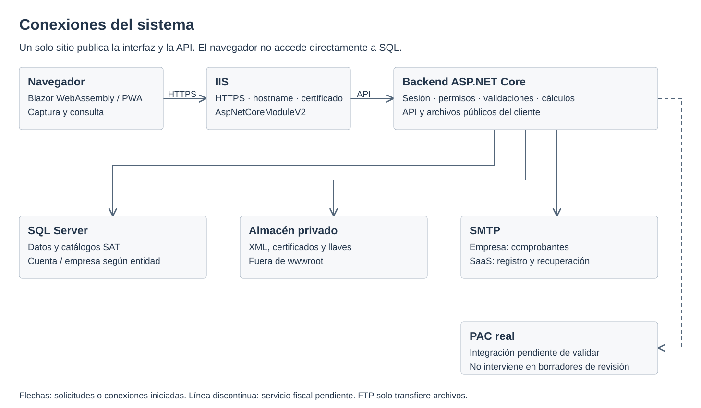
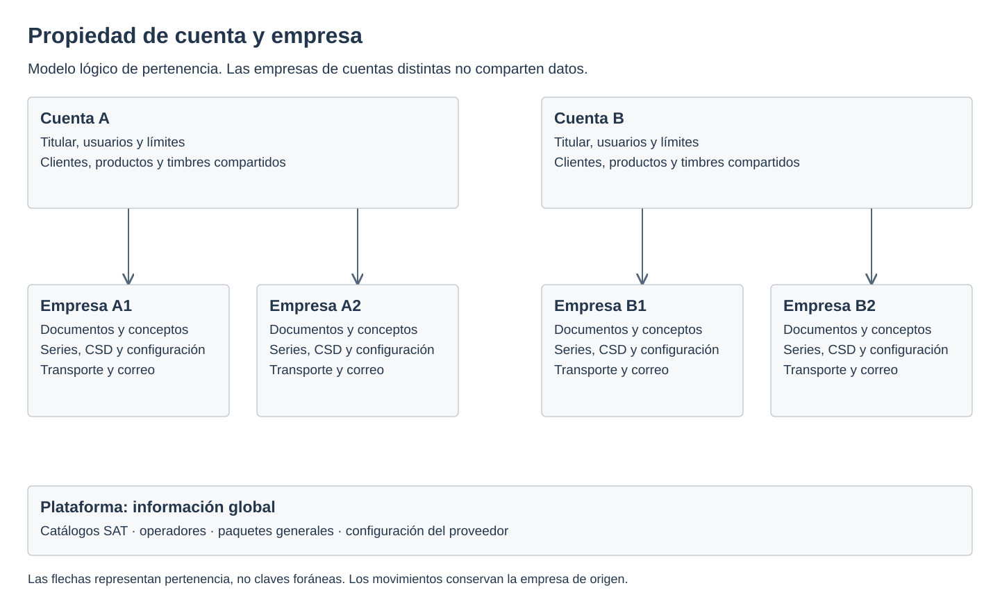

# Guía técnica para continuar el sistema de facturación

Manual de aprendizaje y mantenimiento

Versión de referencia del 6 de noviembre de 2026

## Cómo utilizar esta guía

Este documento explica cómo está construido el sistema y cómo seguir una operación desde la pantalla hasta su almacenamiento. Está dirigido a un residente o desarrollador que conoce programación básica y necesita aprender C#, ASP.NET Core, Blazor y Entity Framework mientras trabaja con este proyecto.

Conviene leer primero los capítulos 1 a 8. Después, seguir el ejemplo de guardado y los capítulos de cálculos con el código abierto. Los capítulos finales sirven como consulta para modificar, probar y entregar cambios. Las rutas se expresan desde la raíz del repositorio; una clase con el mismo nombre en Client y Server cumple responsabilidades diferentes.

Los ejemplos marcados como didácticos muestran la idea y no son archivos nuevos que deban pegarse al sistema. Los nombres de clases y métodos de referencia corresponden al código revisado. El objetivo es entender dónde realizar un cambio y qué otras partes comprobar.

El alcance de esta entrega es revisar documentos, operaciones, PDF/XML y correo. La conexión al PAC real, el uso de CSD reales y la pasarela de cobro quedan para su integración posterior. Generar XML en revisión no demuestra por sí mismo que un PAC lo haya aceptado.

## 1 Qué problema resuelve el sistema

La aplicación permite que un contratante utilice varias empresas emisoras. Una cuenta puede representar a una persona que administra una llantera y una cementera. Al entrar selecciona la empresa con la que trabajará; los comprobantes emitidos por una no se convierten en comprobantes de la otra.

La cuenta agrupa titular, usuarios, límites, clientes, productos y saldo de timbres. Las empresas de esa cuenta comparten esos catálogos y saldo. Cada empresa conserva datos fiscales, comprobantes, series, vehículos, figuras, certificados y correo propios. Otra cuenta no participa de ese conjunto compartido.

El titular es el usuario responsable de la cuenta. Crea empresas y usuarios internos dentro de los límites establecidos por el operador. El operador administra la plataforma: cuentas, límites, paquetes, compras y configuración del proveedor. Un operador no es el mismo tipo de identidad que un usuario interno.

La aplicación contempla factura estándar, Constructoras, Notaría, Comercio Exterior 2.0, Carta Porte 3.1 y complemento de pagos 2.0. Las variantes agregan datos a una operación documental común. Carta Porte está acotada al autotransporte nacional propio. La existencia de clases históricas de otros tipos no significa que su alta forme parte de la entrega.

Antes de cambiar una pantalla, identificar de quién son sus datos y quién puede operarla. Esa decisión determina el filtro, los permisos, la bitácora y las pruebas necesarias. Agregar un campo visible sin responder esas preguntas deja una operación incompleta.

## 2 Conceptos de CSharp para leer el proyecto

Una **clase** reúne datos y comportamiento. Comprobante es una clase que representa un documento persistido. ServicioDeEmision es otra clase que ejecuta operaciones sobre comprobantes. Una **instancia** es un objeto concreto de esa clase, por ejemplo la factura abierta en una petición.

Una **propiedad** describe un dato: Cantidad, EmpresaId o Total. Un **método** ejecuta una tarea: GuardarAsync o Calcular. Los parámetros son sus entradas y el valor retornado comunica su resultado. El modificador public permite utilizarlo desde otras clases; private lo reserva a la implementación de su clase.

Una **interfaz** define lo que un servicio ofrece sin decidir cómo lo implementa. IServicioFolios declara operaciones y ServicioDeFolios las realiza con SQL. El código consumidor puede depender de la interfaz. Esto permite cambiar detalles internos sin reescribir cada consumidor.

Un **record** se utiliza principalmente como portador de valores. Los DTO y las entradas/salidas del motor de impuestos emplean este enfoque. Un DTO es el objeto que cruza la API; una entidad EF es el objeto que representa datos persistidos. Aunque compartan nombres de propiedades, no deben confundirse.

El signo ? indica nulabilidad. Guid? puede contener una clave o no tener valor; decimal? permite distinguir un importe ausente de uno igual a cero. Esa diferencia es importante para un impuesto exento, cuyo importe se omite. La expresión ! indica al compilador que se está asumiendo un valor no nulo; no valida el dato en ejecución.

Task<T> representa una operación asíncrona que devolverá T. async y await permiten esperar SQL, archivos o red sin bloquear innecesariamente un hilo. No crean por sí mismos una transacción ni convierten automáticamente una operación en paralela. CancellationToken permite abandonar trabajo cuando la petición se cancela.

Resultado<T> es un tipo propio para comunicar éxito con un valor o un error de negocio. EsExito y EsFallo permiten elegir el camino. Un dato inválido debe producir un error entendible; una excepción representa un fallo que debe manejar la infraestructura, sin devolver su detalle sensible al navegador.

En LINQ, Where filtra, Select transforma, Any comprueba existencia y Sum suma. La expresión x => x.Id == id es una función breve llamada lambda. Cuando se usa sobre un IQueryable de EF, se intenta traducir a SQL; cuando se usa sobre una colección cargada, se ejecuta en memoria.

El proyecto también utiliza constructores primarios: los parámetros escritos junto al nombre de una clase son dependencias de su constructor. Resultado<ComprobanteDto> es un tipo genérico, cuyo T se concreta con ese DTO. La notación => puede expresar el cuerpo breve de un método; [.. coleccion] construye una colección expandiendo otra; new crea una instancia. Un using al principio importa un espacio de nombres; un using aplicado a un objeto asegura su liberación. namespace organiza nombres, no crea una carpeta física por sí mismo.

```csharp
// Ejemplo didáctico de lectura con EF.
var documento = await baseDeDatos.Comprobantes
    .AsNoTracking()
    .FirstOrDefaultAsync(c => c.Id == id, ct);
```

En este ejemplo se parte del conjunto de comprobantes, se pide una lectura sin seguimiento de cambios y se obtiene el primero que coincida. Los filtros de tenencia configurados en el contexto siguen aplicándose. FirstOrDefaultAsync devuelve null si no encuentra uno; esa ausencia debe manejarse.

## 3 Arquitectura utilizada y sus límites

La solución es una aplicación cliente servidor con un backend organizado como **monolito modular**. Monolito significa que sus módulos se despliegan y ejecutan en una misma aplicación servidor. Modular significa que se agrupan por responsabilidades, con servicios y contratos que delimitan sus dependencias.

No se requiere levantar un microservicio para cada módulo. La API, los cálculos, la generación de documentos y los trabajos de fondo viven en el mismo proceso ASP.NET Core. El navegador ejecuta el cliente WebAssembly y se comunica con ese proceso mediante HTTP.

Se reconocen capas de presentación, aplicación/servicios, dominio y persistencia, pero no debe describirse como una implementación estricta de Clean Architecture con proyectos independientes para cada capa. Varios servicios utilizan AppDbContext directamente. Tampoco existe un repositorio genérico obligatorio o un mediador que reciba todas las operaciones.

Las áreas principales son Plataforma, Operador y Documentos. Plataforma ofrece identidad, empresas, catálogos, clientes, productos, folios y timbres. Documentos consume contratos de Plataforma para emitir y obtener información fiscal. Operador administra el SaaS y la facturación de sus ventas de timbres. Infra contiene mecanismos transversales utilizados por las áreas.

La regla práctica es que una pantalla llama a un servicio HTTP del Client; el endpoint del Server recibe la petición; un servicio de aplicación autoriza y ejecuta la operación; los cálculos puros se delegan a clases específicas; EF o el almacén privado persisten lo necesario.

Los contratos de Facturacion.Shared/Contratos están congelados. Cambiar su firma o DTO requiere acuerdo explícito y commit dedicado. La necesidad de una operación nueva no se debe resolver consultando por dentro las tablas de otro módulo desde cualquier lugar. Primero se identifica si existe un contrato o si necesita ampliarse.



## 4 Proyectos archivos y carpetas

Facturacion.sln agrupa la solución. Cada archivo .csproj define un proyecto y sus referencias. Directory.Build.props concentra opciones compartidas de compilación; Directory.Packages.props concentra versiones de paquetes. El archivo de solución ayuda al IDE, pero no es el backend ejecutable.

### Facturacion Client

Program.cs registra los servicios del navegador, HttpClient, autorización visual y MudBlazor. App.razor configura el enrutador y la puerta de arranque. Paginas contiene pantallas navegables; Componentes contiene piezas reutilizables o específicas de formularios. Layout contiene la estructura visual: MainLayout, LayoutDeOperador y LayoutDeAcceso, entre otros elementos.

Servicios/Plataforma, Servicios/Documentos y Servicios/Operador contienen clientes HTTP. Su función es construir solicitudes y leer respuestas; no acceden directamente a SQL. wwwroot contiene index.html, estilos, fuentes, JavaScript y service worker. Todo su contenido publicado puede llegar al navegador.

### Facturacion Server

Program.cs es el punto de entrada. Modules/Plataforma, Modules/Documentos y Modules/Operador registran endpoints y servicios de sus áreas. Data/Entidades describe objetos persistidos; Data/Configurations configura su correspondencia con SQL. Data/AppDbContext.cs reúne sus DbSet. Migrations conserva cambios de modelo y su snapshot.

Infra contiene tenencia, errores, correo, almacenamiento, instalación, idempotencia, seguridad y registro. Properties/launchSettings.json define perfiles locales de ejecución; no configura el binding del IIS remoto. Los recursos fiscales publicados se necesitan para cargar catálogos y procesar esquemas/transformaciones.

### Facturacion Shared

Comun contiene tipos comunes, permisos, RFC y resultados. Plataforma, Documentos, Operador, Notaria, Obras, ComercioExterior y Transporte contienen DTO o tipos utilizados por ambas partes. Contratos contiene interfaces que establecen la frontera de colaboración entre módulos. Shared no debe incluir credenciales o reglas que solo estén protegidas porque no se vean en pantalla: su código también llega al cliente.

### Carpetas de apoyo

docs contiene manuales, referencia funcional y scripts. tests contiene pruebas. herramientas contiene preparación/verificación de entregas. CatalogosSAT es material de origen de catálogos. Sistema anterior conserva referencias del aplicativo previo. .github guarda automatización de GitHub; no es necesaria para que IIS responda solicitudes.

bin y obj son resultados de compilación y archivos intermedios. outputs, entregas, artifacts y tmp pueden contener paquetes, evidencias o trabajo temporal; no son módulos de negocio. Antes de borrar una carpeta de entrega, comprobar que ningún sitio IIS apunte a ella y que no conserve la única copia de configuración o llaves. Los certificados de desarrollo no sustituyen CSD reales.

## 5 Cómo se construyeron y conectaron los proyectos

La estructura utiliza un proyecto Blazor WebAssembly PWA, un proyecto ASP.NET Core Web API y una biblioteca compartida. La plantilla hospedada antigua ya no es el mecanismo utilizado en .NET moderno; la relación entre Client y Server se establece mediante referencias y configuración del servidor.

Como explicación de la estructura, estos comandos representan la creación de sus tipos de proyecto; no deben ejecutarse encima de las carpetas actuales:

```text
dotnet new blazorwasm --pwa -o Facturacion.Client
dotnet new webapi -o Facturacion.Server
dotnet new classlib -o Facturacion.Shared
```

El estado actual se comprueba leyendo los .csproj, no repitiendo las plantillas. Server referencia Client para incluir su publicación y utiliza Microsoft.AspNetCore.Components.WebAssembly.Server. Ambos proyectos utilizan Shared para intercambiar tipos compatibles.

El servidor sirve los recursos Blazor y los estáticos, registra primero los endpoints API y deja MapFallbackToFile("index.html") al final. El fallback permite que una ruta de pantalla como /facturas/... abra la aplicación cliente; no ejecuta por sí mismo un método de facturación.

En Client/Program.cs, BaseAddress se obtiene del origen del navegador. Por ello, cuando se publica todo junto, las llamadas api/... van al mismo sitio sin escribir una IP SQL ni una segunda URL de backend en cada pantalla. IIS debe apuntar a la raíz publicada del servidor, no a wwwroot.

La compilación convierte C# del cliente en los recursos WebAssembly que necesita el navegador. El servidor se ejecuta en Windows/.NET. Compartir lenguaje no significa que compartan memoria: entre ambos existe una frontera HTTP y datos serializados.

## 6 Arranque e inyección de dependencias

Program.cs del servidor crea WebApplicationBuilder, configura registro e instalación y decide si debe mostrar el asistente o arrancar la aplicación completa. Si la instalación está lista registra Infraestructura, Plataforma, Operador y Documentos, construye la aplicación, conecta el pipeline y publica sus rutas.

AddInfraestructura, AddPlataforma, AddOperador y AddDocumentos registran lo que podrá solicitar una clase en su constructor. MapInfraestructura, MapPlataforma, MapOperador y MapDocumentos conectan las rutas HTTP. Registrar un servicio y publicar un endpoint son operaciones distintas: una clase puede existir en el contenedor sin tener URL pública.

La **inyección de dependencias** permite recibir AppDbContext o IServicioFolios sin crearlos manualmente con new dentro de cada método. El contenedor sabe qué implementación corresponde a la interfaz. Esto centraliza opciones, facilita pruebas y evita que una clase configure otra conexión sin filtros por accidente.

AddScoped crea una instancia por alcance; en ASP.NET Core suele ser una por petición. AppDbContext se registra así porque captura cuenta/empresa del contexto de la solicitud. AddSingleton conserva una instancia durante la vida de la aplicación; se usa para objetos como esquemas SAT compilados. AddTransient genera una instancia cada vez que se resuelve. En Blazor WebAssembly el alcance no tiene el mismo significado de petición HTTP que en el backend.

El servidor utiliza AddDbContext y no un pool reutilizable de contextos. Un contexto que conserve información de otra empresa es un riesgo. No convertir un servicio de petición en singleton solo para reducir construcciones: podría capturar un DbContext o identidad que no le corresponde.

El pipeline aplica mecanismos como errores, cabeceras, autenticación y autorización antes de ejecutar las operaciones. Un trabajo AddHostedService se inicia en segundo plano con el proceso: por ejemplo, conciliación de timbrados y barrido de reservas. No depende de que el usuario mantenga abierta una pestaña.

## 7 Qué es una API y dónde se registra

Una API HTTP ofrece operaciones mediante un verbo y una ruta. GET consulta; POST inicia una operación o crea un recurso; PUT guarda una representación; DELETE solicita eliminación bajo las reglas del sistema. El formato habitual de datos es JSON; PDF, XML y ZIP se devuelven como archivos con su Content-Type.

El proyecto utiliza principalmente **Minimal APIs**: clases estáticas con métodos Map... que llaman MapGroup, MapGet, MapPost, MapPut o MapDelete. No es necesario encontrar una carpeta Controllers para localizar la API.

AuthEndpoints.MapAuth registra /api/auth. EmisionEndpoints.MapEmision registra /api/documentos. El prefijo de MapGroup se suma a la ruta del método. El fragmento /{id:guid} indica un parámetro de ruta que debe tener formato Guid.

```csharp
// Registro real de la operación de guardado.
grupo.MapPut("/{id:guid}", Guardar)
    .RequireAuthorization(Permisos.Politicas.EditarFacturas);
```

Con el grupo /api/documentos, esa declaración expone PUT /api/documentos/{id}. El método Guardar recibe id, PeticionGuardarBorrador, ServicioDeEmision, HttpContext y CancellationToken. ASP.NET obtiene el identificador de la ruta, deserializa el JSON y resuelve el servicio desde el contenedor.

RequireAuthorization comprueba la política del endpoint. Cuando una política admite acciones sobre varias variantes, el servicio comprueba además la variante exacta, la licencia y la propiedad. Que una petición llegue al método no implica que ya cumpla todas las condiciones de negocio.

Las rutas de pantalla y las de API son diferentes. /facturas/{id} pertenece al enrutamiento del Client; /api/documentos/{id} devuelve información del servidor. Una pantalla puede realizar varias peticiones: documento, catálogos, variante y permisos.

## 8 Recorrido completo al guardar una factura

En Client/Paginas/Facturas/FormularioDeEmision.razor, el usuario cambia datos de captura. CapturarFactura construye PeticionGuardarBorrador y GuardarAsync llama al servicio HTTP. Este servicio es Facturacion.Client.Servicios.Documentos.ServicioDeEmision, no la clase homónima del Server.

El cliente HTTP ejecuta PutAsJsonAsync contra api/documentos/{id}. ManejadorDeAutenticacion agrega Authorization: Bearer con el token en memoria. IIS entrega la petición al backend; autenticación valida el token y la política autoriza la entrada al endpoint.

EmisionEndpoints.Guardar llama a Facturacion.Server.Modules.Documentos.Emision.ServicioDeEmision.GuardarAsync. Este método abre una transacción, toma el bloqueo coordinado de pagos y carga el comprobante. Si no existe, no pertenece al alcance, su estado impide editar o el permiso no alcanza, devuelve un error de negocio.

Después valida serie, receptor, conceptos, moneda habilitada y datos adicionales. ResolverConceptosAsync obtiene información autorizada de productos y construye entradas para MotorDeImpuestos.Calcular. El resultado del navegador no se acepta como total definitivo.

AplicarCabecera actualiza datos generales y receptor; AplicarConceptos conserva renglones e impuestos; AplicarRelacionados guarda relaciones. Para obra aplica amortización y, después, AplicarTotales utiliza ProyeccionMonetariaCfdi. El servicio registra la bitácora, ejecuta SaveChangesAsync y confirma la transacción. Finalmente convierte el resultado mediante ADto.

El endpoint transforma el Resultado en respuesta HTTP. El Client lee ComprobanteDto y actualiza su formulario. Si hay un error, lo presenta sin mostrar una excepción SQL interna. Si la transacción no llega a confirmarse, sus cambios transaccionales no deben considerarse guardados.

**Dónde depurar:** colocar un punto de interrupción en el GuardarAsync del formulario, otro en el del servicio HTTP y otro en el del servidor. En F12 → Red comprobar URL, verbo, código y JSON; en el backend comprobar el contexto activo antes de estudiar el cálculo. Así se distingue un fallo de interfaz, comunicación, autorización, validación o persistencia.

## 9 Inicio de sesión JWT y renovación

JWT significa JSON Web Token. Su forma habitual contiene cabecera, carga y firma. La carga incluye claims: datos de identidad y alcance que el servidor afirma haber emitido. El contenido codificado puede leerse; la firma protege su integridad. **Firmar no es cifrar**: no introducir contraseñas o secretos en los claims.

ServicioDeTokens.Emitir construye el token de un usuario con identificadores de usuario, cuenta, empresa activa si existe, familia de sesión y un jti propio. Añade un claim por permiso. Firma con HMAC SHA-256 mediante la clave configurada y establece emisor, audiencia y expiración.

En PlataformaModule, AddJwtBearer valida emisor, audiencia, firma y vigencia. Decodificar el token en el navegador para conocer permisos no sustituye esa validación. Cambiar el texto de un claim fuera del servidor invalida su firma; el servidor no debe confiar en el contenido solo por tener formato JWT.

El inicio de sesión llega a POST /api/auth/iniciar-sesion. ServicioDeAutenticacion coordina la validación del usuario con Identity, el contexto accesible y la emisión de tokens. Identity conserva el hash de contraseña y los mecanismos de bloqueo; el proyecto emite el JWT por su cuenta.

El **access token** se devuelve para mantenerse en memoria en ServicioDeSesion del Client. Su duración predeterminada es de 15 minutos. El **refresh token** es un secreto aleatorio distinto: va en cookie HttpOnly, Secure y SameSite=Strict. JavaScript no necesita leerlo para pedir renovación. La base conserva su hash SHA-256, no su valor en claro.

ServicioDeRefreshTokens.CrearFamilia crea la sesión. RotarAsync busca el hash, comprueba expiración/revocación, consume el token de forma controlada y crea su sucesor dentro de una transacción. Si detecta reutilización de un token consumido, invalida la familia. La expiración original se conserva; renovar no prolonga indefinidamente las 12 horas o los 30 días seleccionados.

ServicioDeSesion.RefrescarAsync coordina la renovación para que varias solicitudes que caducan juntas no consuman varias veces la cookie. ManejadorDeAutenticacion.SendAsync agrega el Bearer y, ante 401, intenta renovar y reenvía una sola vez. Clonar conserva el cuerpo y cabeceras porque el mismo HttpRequestMessage no se reutiliza directamente.

Al refrescar la página, el token en memoria se pierde. PuertaDeArranque intenta recuperar la sesión mediante la cookie antes de mostrar contenido. Eso evita interpretar un F5 como cierre permanente o mostrar momentáneamente una pantalla incorrecta. Nunca resolverlo guardando el JWT en localStorage.

La revocación de refresh impide seguir renovando, pero un access token ya emitido conserva su vigencia hasta expirar salvo controles adicionales de la operación. No asumir que editar una casilla cambia instantáneamente todos los JWT existentes: comprobar cuándo se vuelve a construir la sesión.

### Sesión del operador

ServicioDeTokens.EmitirDeOperador emite un token sin empresa, con identidad y permisos de operador. Su audiencia añade /operador a la base mediante AudienciaDeOperador. El panel usa su propio circuito de autenticación y renovación. Esta separación evita tratar un token de cliente como una sesión administrativa.

## 10 Aislamiento de datos y autorización

Autenticar responde quién realiza la petición. Autorizar responde si puede hacerla. La tenencia responde a qué cuenta/empresa pertenecen los datos. Son controles relacionados pero distintos: un usuario autenticado puede tener permiso de editar y aun así no poder editar un documento ajeno.

ContextoEmpresaHttp obtiene los identificadores del usuario autenticado. AppDbContext expone EmpresaActual y CuentaActual. FiltroDeEmpresa.AplicarFiltroDeEmpresa recorre el modelo y aplica HasQueryFilter a las entidades que implementan IEntidadDeEmpresa, IEntidadDeEmpresaOpcional o IEntidadDeCuenta.

Por ejemplo, la consulta a Comprobantes queda limitada a la empresa activa aunque el método de consulta no repita Where(EmpresaId...). Una consulta a Productos utiliza el alcance de cuenta. En ausencia de alcance válido, el filtro no debe convertirse en acceso global.

El filtro protege lecturas, pero no basta para escrituras. SelladoDeEmpresaInterceptor interviene en SavingChanges/SavingChangesAsync, revisa ChangeTracker, sella claves de altas y rechaza cambios de pertenencia. Una entidad no debe trasladarse de cuenta o empresa por modificar un campo recibido del navegador.

Los catálogos SAT son globales; las tablas de identidad y consultas administrativas requieren controles explícitos. IgnoreQueryFilters existe para operaciones justificadas, como consultas del operador, y omite la protección automática de lectura. Nunca usarlo para arreglar una lista vacía sin entender el contexto.

Las operaciones SQL directas y ExecuteUpdate/ExecuteDelete no deben asumirse protegidas por interceptores SaveChanges: se ejecutan por un camino diferente. Su alcance y autorización deben revisarse expresamente. Lo mismo ocurre al añadir un proceso de fondo sin HttpContext: necesita un contexto de trabajo deliberado.

Permisos contiene los 66 permisos asignables del cliente y sus implícitos; PermisosDePanel contiene los del operador. Un permiso de crear permite editar borradores propios y el de modificar permite también los de otros usuarios según las reglas del tipo. La licencia de una variante se comprueba además del permiso.

Cambiar de empresa llama al circuito /api/auth/cambiar-empresa, valida pertenencia/acceso y devuelve token nuevo. Las excepciones que envían listas de empresas para usuarios o una empresa de alta como filtro no autorizan cambiar arbitrariamente el contexto de cualquier operación.



## 11 Entity Framework desde lo básico

Entity Framework Core es un ORM: relaciona objetos de C# con estructuras de una base relacional. Evita escribir manualmente cada SELECT, INSERT o UPDATE, pero no elimina SQL ni la necesidad de comprender índices, relaciones y transacciones.

AppDbContext es la unidad de trabajo de EF. Hereda de IdentityUserContext<Usuario, Guid>, incorpora las tablas de usuarios sin depender de tablas de roles y expone DbSet como Comprobantes, Conceptos y Productos. Un DbSet representa el acceso a un tipo de entidad; no significa que toda su tabla ya esté cargada en memoria.

OnModelCreating aplica las configuraciones del ensamblado y los filtros de tenencia. En Data/Configurations se utiliza Fluent API: ToTable decide la tabla, HasKey la clave, Property configura campos y HasMany/HasForeignKey las relaciones. ConfigureConventions aplica convenciones comunes de facturación.

```csharp
// Fragmentos de ConceptoConfiguracion.Configure.
constructor.ToTable("Conceptos");
constructor.HasKey(c => c.Id);
constructor.Property(c => c.Descripcion).HasMaxLength(1000);
constructor.Property(c => c.Cantidad).HasPrecision(18, 6);
```

HasPrecision(18,6) permite 18 dígitos totales, de los cuales seis son decimales; no significa 18 antes del punto más otros seis. HasMaxLength limita almacenamiento, pero el servicio puede exigir una regla más específica. Una FK mantiene integridad referencial; no comprueba por sí sola todos los permisos ni que los datos fiscales sean correctos.

Una navegación como comprobante.Conceptos permite trabajar con relaciones de objetos. Include indica qué relaciones se necesitan cargar. No asumir que cualquier propiedad relacionada se consulta sola: revisar cómo CargarAsync construye la consulta. Evitar incluir colecciones que no utiliza un listado; puede aumentar lecturas y memoria.

El modelo utiliza entidades propias. Un ComprobanteDto se arma para devolver una vista controlada al navegador; devolver la entidad completa puede filtrar campos o crear referencias circulares. ADto hace esa proyección de forma explícita.

## 12 Consultas seguimiento y guardado con EF

Mientras la expresión es IQueryable, EF construye la consulta. ToListAsync, FirstOrDefaultAsync o SumAsync provocan su ejecución. Si se llama ToList antes de Where, el filtro posterior puede ejecutarse en memoria después de haber cargado más filas de las necesarias.

AsNoTracking resulta útil para consultas: evita mantener objetos en ChangeTracker cuando no se van a editar. Para una operación de modificación, el servicio suele cargar la entidad con seguimiento, cambiar sus propiedades y ejecutar SaveChangesAsync. EF compara estados y genera las instrucciones SQL correspondientes.

Los estados importantes son Added, Modified, Deleted y Unchanged. Add marca alta; cambiar una propiedad de una entidad seguida permite detectarla como modificada; Remove marca borrado. Ninguna de esas acciones garantiza persistencia hasta que el método de guardado se ejecute correctamente.

SaveChangesAsync guarda los cambios pendientes del contexto. Una transacción explícita puede agrupar consultas, bloqueos y uno o varios guardados. CommitAsync confirma el conjunto. Ante error antes del commit, el servicio debe abandonar o revertir la unidad de trabajo; no devolver éxito porque un objeto en memoria ya tenía el nuevo valor.

El servidor configura AppDbContext en InfraestructuraModule usando OpcionesDeAppDbContext.Configurar. Allí se llama UseSqlServer con UseCompatibilityLevel(120) y se conectan SelladoDeEmpresaInterceptor y AltaSinClaveInterceptor. No crear otro contexto con opciones improvisadas, porque podría perder estas protecciones.

La compatibilidad 120 orienta las traducciones de EF hacia SQL Server 2014, por ejemplo evitando OPENJSON en traducciones de ciertas listas. No cambia la versión real del motor ni convierte funciones SQL posteriores en compatibles. El script se ensayó con compatibilidad 120 en un motor posterior; la prueba nativa de SQL Server 2014 del receptor sigue siendo independiente.

Para consultas de concurrencia crítica hay procedimientos almacenados. ServicioDeFolios.ReservarAsync llama dbo.ReservarFolio con parámetros SQL. EF y SQL directo pueden convivir cuando se mantiene el mismo alcance, se parametrizan valores y se entiende la transacción. No interpolar texto recibido del usuario para construir SQL ejecutable.

## 13 Migraciones esquema y actualizaciones

El enfoque del modelo es code first: las clases y configuraciones describen lo que EF considera el esquema. Una migración expresa la diferencia entre ese modelo y su snapshot anterior. El snapshot sirve para comparar el modelo, no es una copia de todos los registros.

Al cambiar una propiedad persistida pueden requerirse entidad, configuración, migración, actualización de la base y adaptación de lectores/escritores. Agregar un botón, cambiar CSS o renombrar una etiqueta no requiere por sí mismo una migración. Un DTO nuevo tampoco cambia tablas automáticamente.

Up aplica la modificación y Down define el retroceso previsto, cuando es viable. Quitar una columna en Down puede perder datos. Revisar siempre el SQL generado: una intención de renombrar podría aparecer como eliminar/agregar si EF no reconoce lo deseado.

```powershell
# Para desarrollo sobre una base administrada por EF.
dotnet ef migrations add NombreDelCambio --project .\Facturacion.Server --startup-project .\Facturacion.Server
dotnet ef database update --project .\Facturacion.Server --startup-project .\Facturacion.Server
```

Estos comandos explican el flujo de desarrollo. No deben aplicarse sin revisión a la base del ingeniero creada desde un script SSMS. Esa base puede tener todas las tablas y __EFMigrationsHistory vacío. Ejecutar todas las migraciones suponiendo que está vacía produciría objetos duplicados.

Para esa línea de entrega se preparó un acumulado desde el esquema original: docs/sql/Facturacion.Actualizar-Completo-Sql2014.sql, copiado al paquete como Actualizar-base.sql. Valida el esquema inicial, actualiza estructuras y transforma datos que cambiaron de pertenencia. Tiene varias etapas; no asumir reversión global de todo el archivo ante cualquier fallo.

Una base nueva utiliza el esquema de instalación correspondiente; una base anterior utiliza la actualización adecuada. El asistente no decide arbitrariamente qué migraciones aplicar ni crea tablas cuando prueba la conexión. Antes de actualizar se respalda base, archivos y configuración y se verifica la versión del código que utilizará ese esquema.

## 14 Dónde se guardan los datos y por qué

SQL conserva datos que se consultan, relacionan o necesitan consistencia: cuentas, empresas, permisos, clientes, productos, comprobantes, conceptos, impuestos, compras, saldos, intentos y auditoría. El [diccionario de tablas](Base-de-datos.md) detalla las 93 tablas inventariadas y sus columnas.

Las 93 incluyen 91 del modelo de aplicación/Identity, __EFMigrationsHistory y sysdiagrams. Esta última pertenece a diagramas de SSMS y es opcional. La base de prueba actualizada tiene 92 porque no contiene esa tabla. Comparar conteos sin distinguir su finalidad puede producir un falso diagnóstico de estructura incompleta.

Los datos fiscales se copian en el documento para preservar su historia. Un concepto guarda descripción, cantidad, precio, descuento e impuestos usados en esa operación; no necesita consultar el precio actual del producto para reconstruir una factura anterior. Guardar conceptos no crea automáticamente productos de catálogo.

Comprobantes.RutaXml referencia un archivo del almacén privado. AlmacenDeArchivos.GuardarAsync cifra contenido y produce una ruta relativa dentro de una carpeta de empresa/categoría; LeerAsync valida la ruta y utiliza el propósito correcto para descifrar. Un endpoint autorizado transmite los bytes al usuario. El archivo no se expone como un enlace público bajo wwwroot.

Hay excepciones importantes: IntentosTimbrado guarda el XML enviado para recuperar una operación; los intentos del proveedor conservan su emisión; CertificadosProveedor guarda CER y KEY cifrados en columnas binarias. Por eso es incorrecto afirmar que ningún XML o certificado se almacena en SQL. Los PDF se generan con sus servicios y no tienen una tabla universal que guarde cada descarga.

DatosComercioExterior.Contenido usa JSON para representar datos anidados del complemento. Permite conservar su estructura sin una tabla por propiedad. El costo es que una consulta SQL sobre campos internos resulta menos sencilla, especialmente en SQL 2014. La validación tipada se realiza en el servidor; el texto JSON por sí solo no asegura reglas fiscales.

La conexión del asistente y sus llaves están en configuración privada del servidor. En la modalidad junto al sitio se utiliza cnf/appsettings.Instalacion.json y cnf/appsettings.ArranqueRevision.json, junto con llaveros y cnf/datos. Una ruta configurada externamente o una instalación antigua pueden cambiar la ubicación efectiva. Revisar RutasDeInstalacion antes de mover archivos.

La cadena SQL guardada por el asistente se cifra con Data Protection. DPAPI protege el llavero de instalación bajo la identidad de Windows que ejecuta el sitio. SMTP y CSD también se protegen con Data Protection. El sistema verifica las contraseñas de inicio de sesión con un hash.

Respaldar solamente SQL no recupera XML privados y llaves. Copiar cnf sin considerar DPAPI, identidad y equipo tampoco garantiza restauración. Deben recuperarse juntos base, archivos y material criptográfico compatible, y probar el arranque con la identidad de destino.

## 15 Motor de impuestos y operaciones de factura

MotorDeImpuestos es una clase estática de cálculo puro: recibe datos, valida y devuelve importes sin consultar SQL o red. CalculoDeImpuestos.cs define sus records de entrada y salida: ImpuestoDeConcepto, ConceptoACalcular, ComprobanteACalcular y ComprobanteCalculado, entre otros.

El método público Calcular recibe el comprobante. Validar revisa moneda, tipo de cambio, conceptos, cantidades, descuentos y reglas de impuestos. Después un Calcular privado obtiene cada renglón. Agrupar reúne impuestos compatibles y Redondear concentra el criterio numérico del motor.

Para cada concepto se ejecuta:

```text
Importe = redondear(Cantidad × ValorUnitario, 6)
Descuento = redondear(Descuento capturado, 6)
Base = redondear(Importe − Descuento, 6)
Impuesto con tasa = redondear(Base × TasaOCuota, 6)
```

La tasa federal se expresa como fracción: 0.16 representa 16 %. No confundirla con un campo de porcentaje de obra que espera 30 para 30 %. El tipo de cambio se declara; el motor no convierte automáticamente cada concepto a pesos por capturarlo.

El subtotal suma importes anteriores a descuento. Traslados se agrupan por impuesto, factor y tasa; retenciones se consolidan para la salida correspondiente. El total base se obtiene así:

```text
Total = Subtotal − Descuento + Trasladados − Retenidos
```

Ejemplo con dos renglones: 2 piezas × 100 = 200, descuento 20, base 180, IVA 28.80. Otro renglón de 1 × 50 sin descuento y con tasa cero aporta base 50 e impuesto cero. Subtotal 250, descuento 20, traslado 28.80 y total 258.80. No calcular 16 % de todo el subtotal: el segundo concepto tiene otra tasa.

El motor distingue **exento** de **tasa cero**. Exento conserva importe nulo y no declara una tasa. Tasa cero tiene tasa e importe iguales a cero. También rechaza cantidad no positiva, precio negativo, descuento mayor que importe e impuestos duplicados del mismo sentido.

El criterio actual es MidpointRounding.ToEven, redondeo bancario. Por ejemplo, a dos decimales 1.005 se convierte en 1.00 y 1.015 en 1.02. El propio comentario del motor indica que ese criterio no está confirmado contra el SAT. Esta guía describe el comportamiento implementado; cualquier cambio exige revisar pruebas de puntos medios y XML, sin presentarlo como una validación fiscal ya concluida.

## 16 Precisión monetaria vista previa y totales finales

MotorDeImpuestos calcula a seis decimales. ProyeccionMonetariaCfdi prepara los importes a los decimales de la moneda del catálogo y suma los renglones ya proyectados. Esa segunda etapa evita que el total visible se derive de una base diferente de la presentada en el documento.

ProyeccionMonetariaCfdi.Calcular ordena conceptos, redondea importe, descuento, base e impuesto por concepto y agrupa esos valores. Agrega impuestos locales: la retención local de obra y el ISH de los conceptos marcados cuando aplican. AplicarA copia los totales al comprobante y CoincideCon permite comprobar coherencia.

```text
Total final = Subtotal − Descuento
            + Traslados federales − Retenciones federales
            + Traslados locales − Retenciones locales
```

No sustituir este recorrido por Math.Round(total, 2) al final: sumar importes redondeados por renglón puede diferir de redondear una suma no proyectada. Tampoco recalcular IVA desde un texto de pantalla con formato de moneda.

FormularioDeEmision.ActualizarVistaPreviaAsync construye la captura y solicita el cálculo al endpoint /api/documentos/{id}/calcular. El Client usa ServicioDeEmision.CalcularAsync. El Server usa CalcularVistaPreviaAsync, consulta el comprobante sin seguimiento, aplica el motor y la proyección en memoria y devuelve VistaPreviaFacturaDto sin SaveChanges.

La interfaz coordina cancelación y resultados para no mostrar una respuesta antigua sobre una captura más reciente. La actualización de vista previa es distinta de guardar y distinta de generar el PDF. El botón de vista previa PDF puede guardar primero para que el archivo se base en el documento persistido; revisar VistaPreviaAsync y AbrirVistaPreviaAsync al cambiar ese comportamiento.

Si se modifica el precio unitario, deben coincidir formulario, petición, resolución de conceptos, motor, persistencia, proyección, XML y PDF. Un cambio exclusivo en la fórmula del navegador produciría una vista atractiva, pero el guardado podría devolver otro total.

## 17 Constructoras y complemento de pagos

### Amortización y líquido de obra

ServicioDeObras guarda y calcula la estimación. Porcentaje multiplica la base por el porcentaje y divide entre 100. AmortizacionDeObra.DescuentoDe calcula el descuento de anticipo por renglón; Aplicar ajusta descuento, leyenda e impuestos y vuelve a proyectar totales. Esta operación evita que el anticipo se descuente comercialmente pero se conserve un IVA incompatible con los conceptos.

ServicioDeObras.Calcular distingue trabajos, amortización, subtotal, IVA, total comercial y líquido. Las deducciones contractuales no se convierten todas en impuestos fiscales. RetencionLocalDeObra calcula la retención local admitida por el caso configurado; su importe afecta la proyección fiscal.

Ejemplo probado: trabajos 200,000; amortización 30 % = 60,000; subtotal 140,000; IVA 22,400; total comercial 162,400. Deducciones de 1,000, 2,000, 400 y 600 dejan líquido 158,400. La retención local de 1,000 produce total fiscal 161,400 en ese caso; líquido y total fiscal no representan la misma magnitud.

Para modificar obra, revisar ServicioDeObras, AmortizacionDeObra, RetencionLocalDeObra, conciliación fiscal y el PDF de estimación. No cambiar solo el resumen lateral. Los porcentajes deben responder al contrato real; este ejemplo no define por sí solo qué deducción aplica jurídicamente a cualquier obra.

### Saldos y proporcionalidad de pagos

ServicioDePagos.CrearBorradorAsync crea el comprobante de pago. GuardarAsync valida la captura; ConsultarSaldoAsync y ResolverDocumentosAsync resuelven documentos y abonos. ValidarSaldosParaEmisionAsync vuelve a comprobar saldo antes de emitir, porque otro proceso pudo registrar un pago después de abrir el formulario.

CalculoDeImpuestosDePago.Repartir calcula la proporción abono/total original y la aplica a cada grupo fiscal de la factura. Para tasa recalcula impuesto desde la base proporcional; para cuota escala el importe; para exento conserva ausencia de importe. Totalizar construye los totales del complemento y el generador completa las conversiones que correspondan.

Ejemplo: factura 1,160 con base 1,000 e IVA 160. Abono 580 representa 50 %: base proporcional 500 e IVA 80. El saldo pendiente queda 580. Una factura que mezcla tasas necesita repartir cada grupo, no dividir todos los abonos entre 1.16.

ConversionDePago.EsEquivalenciaValida valida precisión y sentido. AMonedaDelPago calcula abono/equivalencia. Si el documento está en MXN y el pago en USD, una equivalencia de 20 MXN por USD convierte un abono de 2,000 MXN en 100 USD. Cuadra comprueba que monto y documentos correspondan, con tolerancias de conversión específicas.

El CFDI tipo P conserva total cero y moneda XXX en la cabecera. El dinero recibido está dentro del complemento. No confundir este módulo con la pasarela que cobraría paquetes de timbres del SaaS.

## 18 Notaría Comercio Exterior y Carta Porte

### Notaría

ServicioDeNotaria administra el perfil del notario y los datos vinculados al comprobante. NotariaEndpoints separa /api/notaria/configuracion de /api/notaria/comprobantes/{comprobanteId}. Las partes tienen un recurso adicional /partes. Esta separación permite configurar al emisor y después capturar cada operación concreta.

Las entidades DatosNotaria, InmueblesNotariales y PartesNotariales conservan instrumento, inmuebles, vendedores y compradores. El servicio valida datos como CURP, número de notaría y estado de catálogo. Los datos de una compraventa inmobiliaria y los honorarios facturados son conjuntos diferentes; no sumar el precio del inmueble al total de honorarios por compartir formulario.

GeneradorDeXmlNotaria arma el complemento. GeneradorDePdfCfdi tiene secciones notariales específicas. Si un campo aparece en captura pero falta en un archivo, seguir DTO → servicio → entidad → carga de salidas → generador. No dar por hecho que agregar un control lo incorpora a PDF y XML automáticamente.

### Comercio Exterior

ServicioDeComercioExterior guarda el contenido vinculado al comprobante y ValidadorFiscalDeComercioExterior revisa cruces antes de generar salida. GeneradorDeXmlComercioExterior crea el complemento 2.0. DatosComercioExterior contiene el JSON tipado que representa sus domicilios y mercancías.

El valor en USD de mercancías, la fracción arancelaria y los datos del receptor extranjero no sustituyen los conceptos o totales del comprobante principal. La operación exige que los conjuntos sean coherentes. El ID interno del producto puede utilizarse para NoIdentificacion de esta variante; no convertirlo automáticamente en una clave SAT.

### Carta Porte

ServicioDeTrasladosCartaPorte administra el traslado y sus colecciones. ValidadorFiscalCartaPorte revisa coherencia de transporte; GeneradorDeXmlCartaPorte y GeneradorDePdfCartaPorte generan sus salidas. TrasladosCartaPorte, UbicacionesCartaPorte, MercanciasCartaPorte y RemolquesCartaPorte conservan cabecera y detalle.

Vehiculos y FigurasTransporte son catálogos de empresa. Se seleccionan para la operación y se conservan los datos necesarios del traslado. Las mercancías requieren sus propias claves de Carta Porte; relacionarlas con un producto no transforma su clave estándar en una clasificación de transporte.

La dirección de código postal, municipio y estado debe resolverse coherentemente aunque el usuario cambie solo algunos dígitos. Una búsqueda interactiva y una validación fiscal tienen tareas distintas: el autocomplete ayuda a capturar y el servidor valida lo que se guarda.

El alcance nacional propio no debe ampliarse por añadir opciones de un catálogo que también contiene transporte internacional u otras modalidades. Cualquier ampliación exige campos, reglas, esquemas y pruebas de esa operación, no solo un selector adicional.

## 19 De los datos al XML al PDF y al correo

### Construcción y firma del XML

GeneradorDeXmlCfdi.Generar construye un XDocument y sus XElement/XAttribute. XNamespace identifica el espacio fiscal de cada nodo; no es solo un prefijo decorativo. El generador utiliza CultureInfo.InvariantCulture para evitar que una coma decimal regional rompa un atributo numérico.

ServicioDeXmlCfdi.GenerarAsync coordina el documento real. GenerarParaRevisionAsync y GenerarParaVistaPreviaAsync seleccionan la modalidad de revisión cuando está habilitada. Se validan datos, se obtienen decimales de moneda y se integran los complementos necesarios.

El recorrido de emisión es: construir XML con sello vacío, obtener cadena original mediante XSLT, firmar con la llave privada del CSD, incorporar sello y validar el XML con XSD. XSD define estructura y tipos; XSLT transforma el XML para obtener la cadena original. Ninguno equivale a la certificación del PAC.

El CSD identifica al emisor y contiene material para sellar. Las credenciales del PAC autentican el acceso al servicio externo de certificación. Son elementos diferentes. En revisión se puede utilizar material sintético bajo sus opciones de entorno; no deben presentarse esos resultados como comprobantes certificados de una empresa real.

### Generación del PDF

GeneradorDePdfCfdi.Generar devuelve bytes y Construir arma el documento QuestPDF. Encabezado, Receptor, Conceptos, Totales y Pie son métodos que distribuyen su presentación. También hay secciones para Notaría, Comercio Exterior y pagos. Carta Porte y estimación de obra tienen generadores especializados.

Un cambio visual del PDF normalmente se realiza en el generador y sus datos de entrada. Si el dato no se carga, modificar el diseño no lo inventa. Si cambia una regla de importe, debe modificarse el cálculo autorizado antes de mostrar el número con otra etiqueta.

ServicioDeSalidasFiscales coordina descargas y obtiene el XML guardado o la salida permitida para el estado. ServicioDePdfBorrador atiende la vista previa de borradores. No asumir que dos botones que muestran PDF llaman al mismo servicio o permiten los mismos estados.

### Envío

ServicioDeEnvioDeComprobantes.ObtenerPropuestaAsync prepara datos para la ventana. EnviarAsync valida destinatarios, permiso y estado, reúne PDF/XML y llama al correo de la empresa. Se registra el intento/resultado en EnviosDeCorreo.

ServicioDeCorreoDeEmpresa utiliza la configuración del emisor, descifra el secreto cuando debe conectar y valida el destino SMTP. No utiliza el SMTP del SaaS cuando falla el de la empresa. El Reply-To utiliza contacto de la empresa y la copia a esta se envía oculta.

«Probar conexión» comprueba conectividad/autenticación según la operación implementada. Para confirmar funcionamiento de extremo a extremo hay que enviar una muestra autorizada y revisar recepción y adjuntos. Un resultado aceptado por SMTP no garantiza que el destinatario lo vea en bandeja principal.

## 20 Timbrado folios idempotencia y recuperación

Guardar borrador y timbrar son operaciones separadas. ServicioDeTimbrado.TimbrarAsync comprueba primero que exista PAC y el permiso del tipo. Si no hay proveedor, rechaza antes de apartar folio o timbre.

ApartarAsync controla el paso de estado y las reservas. ServicioDeFolios.ValidarSerieAsync comprueba serie activa del tipo y empresa; ReservarAsync ejecuta dbo.ReservarFolio con parámetros. El procedimiento hace una actualización bloqueada dentro de una transacción corta. Dos solicitudes no deben leer simultáneamente el mismo siguiente folio.

El XML sellado y los datos de intento se conservan antes de enviarlo. EnviarConReintentosAsync realiza la llamada fuera de la transacción de reserva. ResolverAsync y CierreDeTimbrado aplican el resultado. Si se corta la red después de que el PAC haya recibido el XML, una conciliación debe averiguar el estado sin certificar otra factura a ciegas.

ConciliacionDeTimbrados trabaja en segundo plano. La bolsa también tiene barrido de reservas. El folio apartado no vuelve a la serie por liberar una reserva fallida: debe poder rastrearse. Timbres y folios no tienen exactamente la misma política de devolución.

La idempotencia identifica la misma intención del usuario mediante Idempotency-Key. FiltroDeIdempotencia y ClavesIdempotencia conservan el resultado según su ventana de vigencia. Repetir la misma petición por un fallo de red no debe crear otro cobro o timbrado. Una nueva intención requiere la clave que corresponda al flujo; no generar otra automáticamente cada vez que se reintenta el mismo envío incierto.

El orden importa: reservar y guardar estado, salir de la transacción, llamar a la red y cerrar/conciliar el resultado. Mantener una transacción abierta mientras responde un servicio externo prolonga bloqueos y hace más difícil recuperar la operación.

Las clases existen para el flujo fiscal, pero el PAC real no forma parte de la validación de entrega. La cancelación real, sus motivos, acuses y respuesta del servicio deben comprobarse al integrar las credenciales correspondientes.

## 21 Operador compras y factura del proveedor

La compra pertenece a la cuenta, conserva la empresa que la originó y registra cantidades y precios históricos. ServicioDeCompras recibe el paquete seleccionado y obtiene el precio del servidor. Una cantidad o precio manipulados en el navegador no deben redefinir la compra.

Comprar crea pendiente_de_pago. La acreditación confirmada aumenta la bolsa mediante dbo.AcreditarCompra y registra movimientos. Una pantalla de compra pendiente no significa saldo acreditado. Sin pasarela integrada, no existe una confirmación bancaria automática que deba darse por terminada.

El precio del paquete incluye IVA. DesgloseDeIva.CalcularDesdeTotal utiliza subtotal = total / 1.16, redondea a seis decimales con AwayFromZero y obtiene IVA como total − subtotal. Para 116, devuelve base 100 e IVA 16. **Ese criterio de puntos medios es diferente del ToEven del motor general**; conservarlo identificado al revisar cálculos, sin asumir una regla única en todas las clases.

ServicioDeFacturasDeCompras.ObtenerAsync consulta la factura vinculada a una compra; GuardarAsync prepara/corrige sus datos. ValidarCompra exige compra pagada y sus importes coherentes. El operador utiliza /api/operador/compras/{id}/factura para consultar o guardar la preparación, bajo sus permisos administrativos.

ConfiguracionFiscalProveedor define al emisor de esas ventas. CertificadosProveedor conserva su CSD cifrado; no utiliza el CSD de la empresa compradora. FacturasDeCompras conserva copia del emisor, receptor, concepto, importes y estado. IntentosFacturasProveedor guarda intentos y datos de emisión para recuperación.

XmlDeFacturaProveedor, TimbradoDeFacturasProveedor, SalidasDeFacturasProveedor y ConciliacionDeFacturasProveedor atienden la rama fiscal del proveedor. Su reserva usa ReservarFolioProveedor. Esta rama está conectada mediante IEmisionDeFacturasDeCompras, en la frontera de contratos compartidos.

Para agregar un dato a la factura de compras, revisar tanto preparación y entidad del operador como el contrato de emisión, persistencia de intentos y salidas. No mezclar la serie del proveedor con las Series de una empresa cliente por tener ambas un texto de folio.

## 22 Catálogos SAT y búsquedas

Un catálogo SAT relaciona claves oficiales con descripciones, vigencia y atributos necesarios para validar. Los archivos de origen no son el desplegable: la carga transforma sus datos en tablas que el servidor consulta.

La preparación inicial utiliza recursos publicados. Los lectores interpretan hojas y encabezados, validan y guardan registros/versiones. Si falta una tabla, la carga no se resuelve cambiando el archivo Excel: primero se revisa el esquema. Si falta un archivo publicado, la base correcta tampoco lo sustituye.

Los catálogos grandes se consultan con búsqueda en el servidor; no se envían completos al navegador. Los pequeños pueden precargarse. La búsqueda utiliza límites y, cuando corresponde, texto completo. El debounce espera una breve pausa al escribir para reducir peticiones repetidas. El filtro debe encontrar clave/descripción según el catálogo, no limitar toda búsqueda al identificador técnico.

CatalogosEndpoints y ServicioCatalogosSat atienden las consultas de captura. CatalogosDeOperadorEndpoints y ActualizadorDeCatalogos atienden la consulta/actualización administrativa. Una nueva fuente oficial debe pasar por el flujo disponible y registrar su versión; no se supone que el sistema descargue futuras versiones de Internet por sí solo.

La carga de catálogos y la actualización del esquema son operaciones diferentes. Cambiar una clave en SQL manualmente puede dejar datos cacheados, inconsistencias de vigencia o una versión sin actualizar. Utilizar el mecanismo de actualización y revisar la invalidación del cliente.

El service worker solo cachea el app shell. La API está excluida. GuardaDeVersion compara versión cliente/servidor y pide renovar cuando corresponde. Una pestaña que conserva ensamblados anteriores puede mostrar errores aunque el backend ya se haya actualizado; primero comprobar versiones, no borrar datos de negocio.

## 23 Instalación configuración y ejecución en IIS

La publicación contiene backend y cliente. IIS apunta a la carpeta que tiene web.config, DLL y ejecutable cuando corresponde; wwwroot queda dentro con los recursos públicos. FTP transfiere esa estructura a la ruta física configurada. La transferencia no instala el Hosting Bundle ni crea permisos SQL.

En publicación autocontenida Windows x64, web.config inicia Facturacion.Server.exe. El paquete incluye su runtime. En publicación dependiente inicia dotnet con Facturacion.Server.dll y necesita el runtime compatible del servidor. Ambas requieren AspNetCoreModuleV2 para integración IIS.

Al iniciar, InstalacionModule.Preparar decide si falta conexión o configuración. RutasDeInstalacion determina el directorio privado. Si corresponde, el asistente aparece en /operador. Captura servidor/base/autenticación, prueba acceso y guarda parámetros; después comprueba si existe operador principal y permite crearlo si falta.

ConfiguracionDeInstalacion.GuardarAsync crea un temporal .conexion-{guid}.tmp dentro del directorio privado y lo mueve al nombre definitivo si no existe. Esto explica por qué se requiere permiso de modificación en cnf: la operación necesita crear/renombrar/eliminar un temporal, no solo escribir un archivo ya creado.

La raíz publicada necesita lectura/ejecución. cnf y el almacén privado requieren modificación para la identidad efectiva del proceso. La compatibilidad con instalaciones antiguas puede conservar una conexión en otra ruta; revisar antes de conceder permisos o mover archivos.

Con autenticación Windows a SQL, el servidor recibe la identidad del proceso que ejecuta el backend. En IIS suele ser la del grupo o la cuenta de servicio configurada; no la del navegador. Tener acceso a SSMS con la cuenta del desarrollador no demuestra que el grupo IIS tenga permisos. Con autenticación SQL se utiliza el login vinculado a un usuario autorizado en la base.

AllowedHosts limita los nombres aceptados por la aplicación. DNS resuelve nombre a IP; binding decide qué sitio atiende ese nombre/puerto; el certificado acredita el nombre HTTPS. Son configuraciones distintas. Si localhost funciona y el hostname no, revisar esas piezas antes de modificar la conexión SQL.

La modalidad Staging actual utiliza el asistente sin clave de instalación. ArranqueDeRevision genera configuración protegida para llaves y opciones. En Staging se convierte el formato anterior de la cadena SQL antes de cargarla. Conserva los llaveros al actualizar porque protegen los datos existentes.

## 24 Cómo realizar cambios sin romper otros módulos

### Cambio exclusivamente visual

Localizar Paginas/Componentes y estilos semánticos. Revisar si existe un componente común antes de duplicarlo. Cambiar disposición, etiqueta o contraste y comprobar escritorio, móvil, foco y estados de validación. No requiere migración si no cambia persistencia.

### Dato nuevo que debe guardarse

Definir propiedad: cuenta, empresa, plataforma o copia histórica. Revisar entidad/configuración EF, migración o actualización SQL, DTO de petición/respuesta, servicio de validación/guardado, consulta de reapertura y formulario. Si se muestra en PDF/XML/correo, revisar también su carga y generadores. Una propiedad solo en el DTO desaparece al volver a abrir si no hay persistencia.

Si toca Facturacion.Shared/Contratos, obtener el acuerdo y separar el commit. Si el dato solo se calcula, decidir si conviene persistirlo o derivarlo de la fuente autorizada; duplicar importes sin una regla de sincronización crea inconsistencias.

### Nueva operación API

Buscar un endpoint similar del mismo módulo. Definir verbo/ruta, DTO y política. Implementar autorización de propiedad/estado y validación en el servicio. Registrar la ruta mediante Map... y el servicio mediante Add... si es nuevo. Añadir servicio HTTP y captura en el Client. Probar llamada directa sin permiso y con otra cuenta; ocultar el botón no basta.

### Cambio de cálculo

Construir un ejemplo con resultado esperado antes de editar. Revisar si corresponde a MotorDeImpuestos, ProyeccionMonetariaCfdi, obra, pagos o DesgloseDeIva. Comprobar cero, exento, descuento, retención, moneda y puntos medios. Validar que guardar/reabrir, PDF y XML mantengan la misma operación.

### Cambio de propiedad o aislamiento

Un cambio de empresa a cuenta afecta interfaces de tenencia, filtros, sellado, índices únicos, permisos y datos existentes. No basta renombrar EmpresaId por CuentaId. Los datos duplicados deben transformarse con una regla y bitácora, como ocurrió al compartir clientes/productos y timbres. Probar dos cuentas y varias empresas antes de aceptar la actualización.

### Secuencia recomendada

Crear una rama de trabajo; revisar estado Git; reproducir el problema con datos de prueba; recorrer el flujo; hacer el cambio mínimo coherente; compilar; ejecutar pruebas pertinentes; verificar manualmente la pantalla y las salidas afectadas; revisar diff y secretos; preparar commit entendible. Para cambios SQL, respaldar y probar primero sobre una base de prueba del origen correcto.

No publicar bin/obj, configuraciones privadas, contraseñas, llaves o datos de prueba como si fueran código fuente. Un paquete publicado se prepara desde la versión verificada; no se construye seleccionando DLL sueltas de distintas compilaciones.

## 25 Depuración pruebas y preguntas habituales

### Ubicar el origen de un error

Un 400 suele señalar captura inválida; 401, sesión/autenticación; 403, permiso o acceso; 404, recurso inexistente o fuera de alcance; 409, conflicto de estado/concurrencia; 500, un fallo interno que requiere registro del servidor. El código preciso depende del endpoint; leer también el Problem Details recibido.

En F12 → Red comprobar la petición que falla y distinguirla del GET que ya respondió 200. Una factura puede cargar bien y fallar después al pedir las partes notariales o un catálogo. En el servidor seguir la misma petición con registros depurados. No imprimir contraseñas o XML con datos personales para simplificar un diagnóstico.

Si un listado devuelve cero filas, revisar sesión, cuenta, empresa, permiso y filtro antes de usar IgnoreQueryFilters. Si la base dice «Invalid object name», comprobar conexión y versión de esquema. Si EF informa cambios pendientes de modelo, revisar modelo/migración/snapshot; no suprimir el aviso como solución general.

IIS 500.31 se relaciona con carga del runtime, antes del uso normal de tablas. Un error de preparación SAT ya dentro de la aplicación puede deberse a archivo, tabla, encabezado o permiso; leer el primer error concreto. Un archivo bloqueado al publicar exige detener el proceso correspondiente, no forzar una mezcla de versiones.

### Ejecutar y comprobar

```powershell
dotnet restore .\Facturacion.Server\Facturacion.Server.csproj
dotnet build .\Facturacion.Server\Facturacion.Server.csproj -c Release
dotnet run --project .\Facturacion.Server --launch-profile https
dotnet test .\tests\Facturacion.Pruebas\Facturacion.Pruebas.csproj
```

Usar una base de desarrollo/prueba y la configuración del equipo. El perfil HTTPS del proyecto utiliza localhost:7123; el perfil HTTP utiliza localhost:5184. Un sitio IIS puede usar otras rutas y puertos. No confundir la publicación instalada con la carpeta del código que se está modificando.

Las pruebas registradas de documentos y correo cubrieron casos de los seis tipos, cálculos, salidas, aislamiento y compras del operador. La regresión previa registró 318 aprobadas y dos omitidas. Esa evidencia no significa que cada futura modificación conserve esos resultados; repetir las comprobaciones afectadas y registrar omisiones.

### Respuestas que debe poder dar quien continúa

**¿Por qué hay un solo servidor publicado?** Porque ASP.NET Core publica API y archivos del Client en el mismo origen. El navegador ejecuta la interfaz, no SQL.

**¿Por qué una cuenta puede tener varias empresas?** Para agrupar el contratante y sus recursos compartidos sin mezclar documentos/folios/configuración de emisores distintos.

**¿Por qué EF no basta para toda la seguridad?** Traduce y persiste datos; necesita filtros, sellado y autorización de servicios. Una consulta directa a SQL no pasa por esas políticas.

**¿Por qué no se recalcula una factura antigua con el producto actual?** Porque se conservan los datos e importes de su emisión. Cambiar el catálogo debe afectar futuras capturas, no el historial.

**¿Por qué el token no contiene una contraseña?** Porque el JWT puede leerse. Su firma acredita integridad y emisor; los secretos permanecen en el servidor.

**¿Guardar ya timbra?** No. Guardar persiste el borrador. Timbrar reserva y ejecuta otro flujo; en revisión se generan archivos sin certificación real.

**¿Dónde modificar un total?** En la clase de cálculo correspondiente y su proyección, siguiendo sus consumidores. El diseño del PDF no es el origen de los importes.

**¿Qué falta para emitir realmente?** Configuración/integración PAC, CSD válido del emisor y pruebas del servicio real. La factura de paquetes requiere el CSD del proveedor; los documentos de una empresa requieren el de esa empresa.

**¿Qué estudiar primero?** El recorrido GuardarAsync, AppDbContext/configuraciones, contexto/filtros, JWT y motor/proyección. Después la variante concreta que se modificará. Leer una operación completa enseña más que editar componentes aislados sin seguir sus datos.

## 26 Ruta de lectura del código

Para orientarse, seguir estos archivos en este orden. Los nombres de métodos son puntos de entrada para buscar con el IDE o con rg; revisar sus llamadas antes de cambiar una firma.

- Facturacion.Server/Program.cs: arranque y conexión de módulos/pipeline.
- Facturacion.Client/Program.cs y App.razor: servicios del navegador, router y puerta de sesión.
- Facturacion.Client/Paginas/Facturas/FormularioDeEmision.razor: CapturarFactura, GuardarAsync y ActualizarVistaPreviaAsync.
- Facturacion.Client/Servicios/Documentos/ServicioDeEmision.cs: CrearBorradorAsync, GuardarAsync, CalcularAsync y TimbrarAsync por HTTP.
- Facturacion.Server/Modules/Documentos/Emision/EmisionEndpoints.cs: MapEmision y adaptación a HTTP.
- Facturacion.Server/Modules/Documentos/Emision/ServicioDeEmision.cs: CrearBorradorAsync, GuardarAsync, ResolverConceptosAsync, AplicarConceptos y AplicarTotales.
- Facturacion.Server/Modules/Documentos/Impuestos/MotorDeImpuestos.cs: Calcular, Validar, Agrupar y Redondear.
- Facturacion.Server/Modules/Documentos/Salidas/ProyeccionMonetariaCfdi.cs: Calcular, CoincideCon y AplicarA.
- Facturacion.Server/Data/AppDbContext.cs y Data/Configurations/Documentos/ConceptoConfiguracion.cs: modelo y mapeo.
- Facturacion.Server/Data/OpcionesDeAppDbContext.cs y FiltroDeEmpresa.cs: configuración SQL y filtros.
- Facturacion.Server/Infra/Tenencia/ContextoEmpresaHttp.cs y SelladoDeEmpresaInterceptor.cs: contexto y protección de escritura.
- Facturacion.Server/Modules/Plataforma/Auth/ServicioDeTokens.cs y ServicioDeRefreshTokens.cs: Emitir, EmitirDeOperador, RotarAsync e InvalidarFamiliaAsync.
- Facturacion.Client/Servicios/Plataforma/ServicioDeSesion.cs y ManejadorDeAutenticacion.cs: token en memoria, renovación y reintento.
- Facturacion.Server/Modules/Plataforma/Folios/ServicioDeFolios.cs: validación/reserva/confirmación de folios.
- Facturacion.Server/Modules/Documentos/Timbrado/ServicioDeTimbrado.cs: TimbrarAsync, ApartarAsync y ResolverAsync.
- Facturacion.Server/Modules/Documentos/Salidas/ServicioDeXmlCfdi.cs y GeneradorDeXmlCfdi.cs: coordinación y construcción XML.
- Facturacion.Server/Modules/Documentos/Salidas/GeneradorDePdfCfdi.cs: Generar, Construir y secciones visuales.
- Facturacion.Server/Modules/Documentos/Salidas/ServicioDeEnvioDeComprobantes.cs: propuesta, adjuntos y envío.
- Facturacion.Server/Infra/Almacen/AlmacenDeArchivos.cs: GuardarAsync, LeerAsync y rutas privadas.
- Facturacion.Server/Infra/Instalacion/ConfiguracionDeInstalacion.cs y RutasDeInstalacion.cs: parámetros y ubicación privada.

Los manuales Base-de-datos.md, Instalacion-y-actualizacion.md, Funcionamiento.md y Pruebas-y-pendientes.md amplían las referencias sin duplicar aquí todas las columnas, comandos administrativos y evidencias históricas.

## 27 Ejercicios para aprender siguiendo una operación

### Ejercicio uno seguir una lectura

Abrir una factura de prueba, identificar en Red el GET de /api/documentos/{id} y localizar Obtener en EmisionEndpoints. Seguir ObtenerAsync hasta la consulta, el filtro activo y ADto. El resultado esperado del ejercicio es poder explicar de dónde sale un dato visible sin cambiar código ni registros.

### Ejercicio dos comprobar un importe

En una base de prueba capturar cantidad 2, precio 100, descuento 20 e IVA 16 %. Antes de guardar comprobar base 180, IVA 28.80 y total 208.80. Revisar la petición de cálculo y detenerse en MotorDeImpuestos.Calcular; guardar, reabrir y comparar PDF/XML. Si hay diferencia, identificar en qué etapa aparece por primera vez.

### Ejercicio tres planear un campo sin implementarlo

Tomar un dato hipotético, por ejemplo una referencia interna de seguimiento que no sea un atributo fiscal. Escribir si pertenece a cuenta, empresa o comprobante; dónde se captura; si se guarda; si puede cambiar después de emitir; qué permiso lo modifica y si se imprime. Localizar las clases que habría que tocar antes de generar una migración. No incorporarlo al XML fiscal como atributo inventado.

### Ejercicio cuatro comprobar el aislamiento

Con datos de prueba, usar dos empresas de una cuenta y otra cuenta distinta. Comprobar que clientes/productos se compartan dentro de la primera cuenta y que documentos/series permanezcan por empresa. Pedir un documento ajeno por identificador con una sesión sin acceso y revisar el rechazo. No ejecutar este ejercicio modificando manualmente claims o filtros del servidor para forzar el resultado.

Estos ejercicios permiten aprender el recorrido sin empezar por una refactorización grande. Cuando se pueda explicar quién autoriza, quién calcula y quién guarda cada dato, es más sencillo decidir el lugar correcto de una modificación.

## 28 Índice de archivos que registran la API

Las rutas se registran en los siguientes archivos del Server. El prefijo indicado proviene de MapGroup; cuando una ruta se declara directamente se indica su raíz API. Los verbos enumerados son declaraciones encontradas en cada archivo. Para la ruta y política completas, leer la declaración y sus grupos superiores. Este índice es de código, no una especificación OpenAPI ejecutada.

- Infra/InfraestructuraModule.cs: /api/version. Verbos: GET.
- Infra/Instalacion/InstalacionModule.cs: /api/instalacion. Verbos: GET, POST.
- Modules/Documentos/Cancelacion/CancelacionEndpoints.cs: /api/documentos, /api/cancelaciones. Verbos: GET, POST.
- Modules/Documentos/ComercioExterior/ComercioExteriorEndpoints.cs: /api/comercio-exterior/comprobantes. Verbos: GET, POST, PUT.
- Modules/Documentos/Egresos/NotasCreditoEndpoints.cs: /api/notas-credito. Verbos: GET, PUT.
- Modules/Documentos/Emision/EmisionEndpoints.cs: /api/documentos. Verbos: DELETE, GET, POST, PUT.
- Modules/Documentos/Notaria/NotariaEndpoints.cs: /api/notaria, /api/notaria/comprobantes, /api/notaria. Verbos: GET, POST, PUT.
- Modules/Documentos/Obras/ObrasEndpoints.cs: /api/obras/comprobantes, /api/obras. Verbos: GET, PUT.
- Modules/Documentos/Pagos/PagosEndpoints.cs: /api/pagos. Verbos: DELETE, GET, POST, PUT.
- Modules/Documentos/Salidas/EnvioEndpoints.cs: /api/documentos. Verbos: GET, POST.
- Modules/Documentos/Salidas/SalidasDeFacturasProveedor.cs: /api/operador/compras, /api/timbres/compras. Verbos: GET.
- Modules/Documentos/Timbrado/TimbradoDeFacturasProveedor.cs: /api/operador. Verbos: POST.
- Modules/Documentos/Timbrado/TimbradoEndpoints.cs: /api/documentos. Verbos: GET, POST.
- Modules/Documentos/Traslados/TrasladosCartaPorteEndpoints.cs: /api/traslados-carta-porte. Verbos: GET, POST, PUT.
- Modules/Operador/Auth/OperadorAuthEndpoints.cs: /api/operador/auth, /api/operador/perfil. Verbos: GET, POST, PUT.
- Modules/Operador/Auth/OperadoresEndpoints.cs: /api/operador/operadores. Verbos: GET, POST, PUT.
- Modules/Operador/Catalogos/CatalogosDeOperadorEndpoints.cs: /api/operador/catalogos-sat. Verbos: GET, POST.
- Modules/Operador/Clientes/ClientesDePlataformaEndpoints.cs: /api/operador/cuentas. Verbos: GET, POST, PUT.
- Modules/Operador/Clientes/UsuariosDePlataformaEndpoints.cs: /api/operador/usuarios. Verbos: DELETE, GET, POST, PUT.
- Modules/Operador/Compras/ComprasDeOperadorEndpoints.cs: /api/operador/compras. Verbos: GET, POST.
- Modules/Operador/Compras/FacturasDeComprasEndpoints.cs: /api/operador/compras. Verbos: GET, PUT.
- Modules/Operador/Configuracion/ConfiguracionDelSistemaEndpoints.cs: /api/operador/configuracion. Verbos: GET, POST, PUT.
- Modules/Operador/Configuracion/FiscalDelProveedorEndpoints.cs: /api/operador/configuracion/facturacion. Verbos: GET, POST, PUT.
- Modules/Operador/Membresias/MembresiasYTableroEndpoints.cs: /api/operador/membresias, /api/operador. Verbos: GET, POST.
- Modules/Operador/Paquetes/PaquetesDeOperadorEndpoints.cs: /api/operador/paquetes. Verbos: GET, POST, PUT.
- Modules/Plataforma/Auth/AuthEndpoints.cs: /api/auth. Verbos: GET, POST.
- Modules/Plataforma/Catalogos/CatalogosEndpoints.cs: /api/catalogos. Verbos: GET.
- Modules/Plataforma/Clientes/ClientesEndpoints.cs: /api/clientes. Verbos: DELETE, GET, POST, PUT.
- Modules/Plataforma/Empresas/EmpresasEndpoints.cs: /api/empresa. Verbos: DELETE, GET, POST, PUT.
- Modules/Plataforma/Folios/FoliosEndpoints.cs: /api/series. Verbos: DELETE, GET, POST, PUT.
- Modules/Plataforma/Productos/ProductosEndpoints.cs: /api/productos. Verbos: DELETE, GET, POST, PUT.
- Modules/Plataforma/Tablero/TableroEndpoints.cs: /api/tablero. Verbos: GET.
- Modules/Plataforma/Timbres/TimbresEndpoints.cs: /api/timbres. Verbos: GET, POST.
- Modules/Plataforma/Transporte/CatalogosDeTransporteEndpoints.cs: /api/transporte. Verbos: DELETE, GET, POST, PUT.
- Modules/Plataforma/Usuarios/PerfilEndpoints.cs: /api/perfil. Verbos: GET, PUT.
- Modules/Plataforma/Usuarios/UsuariosEndpoints.cs: /api/usuarios. Verbos: GET, POST, PUT.
